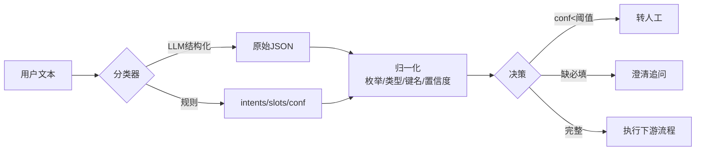

# 01 · 意图识别：Agent 的第一道门

> 对应主题 [02-prompt-context](README.md)。代码锚点：[code/02-prompt-context/intent_recognition.py](../../code/02-prompt-context/intent_recognition.py)。
> 本章讲：用户一句话进来，系统如何判断「他想干什么」，并决定走哪条流程。

## 一、问题背景：不识别意图，后面全是错的

假设你做了一个「教学活动助手」，用户说：「帮我搞个下周的语文教研」。
如果不先识别意图，系统会怎样？

- **走错流程**：把「查询」当「创建」，或把「闲聊」当「建活动」，直接调错工具。
- **漏抽字段**：不知道这是「创建活动」，就不会去抽学科、日期、主讲人，后面草稿缺字段。
- **该问的不问**：用户没说日期，系统如果不判断「缺什么」，就会拿着半截信息去创建。
- **风险不可控**：创建类操作有副作用，识别错了可能建错活动、发错通知。

**意图识别（Intent Recognition）就是 Agent 的第一道门**：先判断「想干什么」（intent），
再抽取「需要哪些信息」（slots），判断「缺什么要问」（clarification），最后决定「执行 / 澄清 / 转人工」。
这道门没做好，后面所有步骤都会放大错误。

## 二、核心概念：四个词说清意图识别

**意图（Intent）**：用户想完成的任务类别，如 `create_activity`（建活动）、`query_activity`（查活动）、
`knowledge_qa`（问知识）、`chitchat`（闲聊）。意图是一个**有限枚举**，不是自由文本。

**槽位（Slot）**：完成该意图所需的参数，如学科、日期、主讲人。槽位有**必填**与**可选**之分，
必填缺失就要澄清。

**多意图（Multi-intent）**：一句话可能包含多个意图，如「查一下上周活动，再帮我建一个」= 查询 + 创建。
好的识别要能输出**意图数组**，而不是硬选一个。

**置信度（Confidence）**：系统对这次识别的把握。低于阈值就不该硬走，而应**转人工**或**追问**。
这是「不确定就别猜」的工程原则。

> 术语辨析：**意图识别 ≠ 槽位抽取**。意图是「做什么」（分类问题），槽位是「用什么做」（信息抽取问题）。
> 两者常一起做，但失败模式不同：意图错是「方向错」，槽位错是「参数错」。

## 三、工作原理：一条完整流水线

```text
用户文本
  → 分类器（三选一：规则 / 向量 / LLM 结构化）
  → 原始输出（intents / slots / confidence）
  → 归一化（枚举映射 / 类型纠正 / 键名收窄 / 置信度钳制）
  → 决策（confidence < 阈值 → 转人工；缺必填 → 澄清；否则 → 执行）
  → 交给下游流程（建活动 / 查询 / 问答 / 闲聊）
```

三种分类器的取舍（本 demo 对照前两种）：

| 方式 | 优点 | 缺点 | 适用 |
|---|---|---|---|
| **规则（关键词）** | 便宜、确定、可解释、零延迟 | 同义改写就漏，维护关键词表累 | 意图少、表达固定、作为兜底 |
| **向量分类** | 能理解语义相似，比规则稳 | 需训练/标注，边界意图易混 | 意图多、有标注数据 |
| **LLM 结构化** | 理解同义表达、能多意图、可解释 | 会漂移（格式/枚举）、有成本延迟 | 表达开放、意图复杂 |

**为什么 LLM 方案必须配归一化？** 因为 LLM 会「漂移」：把 `create_activity` 写成 `create`、
把 `speakers` 数组写成 `"张三、李四"` 字符串、把置信度写成 `1.7`。这些在 demo 里被**故意模拟**，
归一化负责修：别名映射、字符串转数组、钳制到 [0,1]。**模型负责语义，代码负责边界**——这是本章最重要的结论。

## 四、架构与流程



**图解关键**：无论用哪种分类器，原始输出都先过**归一化**再决策。归一化是「LLM 方案能上生产」的前提。
决策分三支：低置信转人工、缺槽位追问、齐全才执行。

## 五、代码实现：把流水线跑出来

[intent_recognition.py](../../code/02-prompt-context/intent_recognition.py) 约 220 行，离线可跑：

```bash
cd code/02-prompt-context && ../../.venv/bin/python intent_recognition.py
```

**实测输出**（节选）：

```text
输入：帮我搞个下周的语文教研
  规则 : ['create_activity'] conf=0.75 slots=['activity_type','subject']
  LLM  : ['create_activity'] conf=0.72 slots=['activity_type','subject']（已归一化）
  决策 : clarify — 缺必填槽位

评测（标注集）：
  规则基线准确率： {'accuracy': 0.9, 'n': 10}
  LLM 结构化准确率： {'accuracy': 1.0, 'n': 10}

小模型漂移演示（原始输出 → 归一化）：
  原始： {"intents":["create"],"slots":{"speakers":"张三、李四"},"confidence":1.7}
  归一化： {"intents":["create_activity"],"slots":{"speakers":["张三","李四"]},"confidence":1.0}
  → 意图别名映射 / 主讲人字符串转数组 / 置信度钳制到 1.0
```

**关键代码讲解**——归一化（本章核心）：

```python
INTENT_ALIASES = {"create": "create_activity", "query": "query_activity", "qa": "knowledge_qa"}

def normalize(raw: str) -> dict:
    data = _extract_json(raw)                      # 兼容 ```json 围栏
    intents = [INTENT_ALIASES.get(str(i).strip(), str(i).strip()) for i in intents]  # 别名映射
    intents = [i for i in intents if i in INTENTS] or ["chitchat"]                   # 收窄到合法枚举
    for k, v in slots_in.items():
        if k not in SLOT_KEYS: continue            # 键名收窄：自创键丢弃
        if k == "speakers" and isinstance(v, str):  # 类型纠正：字符串→数组
            v = re.split(r"[、和,]", v)
    confidence = max(0.0, min(1.0, float(data.get("confidence", 0.5))))  # 钳制
```

三个动作对应三类漂移：**别名映射**修枚举、**键名收窄**丢弃自创键、**类型纠正+钳制**修类型。
`selftest()` 逐条断言这些修复，并验证「LLM 准确率 ≥ 规则准确率」。

**决策逻辑**：

```python
def decide(result, threshold=0.6):
    if result["confidence"] < threshold: return {"action": "handoff", ...}
    if "create_activity" in result["intents"]:
        missing = [k for k in REQUIRED_SLOTS if k not in result["slots"]]
        if missing: return {"action": "clarify", "missing": missing, ...}
    return {"action": "execute", ...}
```

## 六、深入分析：设计取舍

**规则 vs LLM，到底用哪个？** 生产常见做法是**规则兜底 + LLM 主判**：LLM 处理开放表达，
规则处理高频确定表达（如「创建」开头直接判创建），既省成本又保稳定。本 demo 的评测显示
LLM 在开放表达上更准（1.0 vs 0.9），但规则零延迟零成本——组合使用才是工程解。

**置信度阈值怎么定？** 没有万能值。原则：**误判代价高就调高阈值**（宁可多转人工），
**体验优先就调低**（宁可多试）。阈值应基于评测集调，而不是拍脑袋。demo 用 0.6 演示。

**多意图怎么处理？** 输出意图数组，下游按优先级或并行处理。硬选一个会丢失用户真实需求
（「查一下再建一个」被识别成纯创建，就漏了查询）。

**为什么强调「不编造」？** 槽位缺失时应留空并触发澄清，而不是让模型猜一个日期。
demo 的 prompt 明确「不要编造用户没说的信息」，`decide` 再兜一层「缺必填就追问」。

## 七、工程实践

- **[teaching-agent/m02](../../projects/teaching-agent/m02_intent_slots.py)** 是本章的 teaching 专用版：
  21 条真实表达回归、`PROMPT_VERSION` 版本管理、`_normalize` 确定性纠偏。本章 demo 是它的通用精简版。
- **版本管理**：改 prompt 必须升版本 + 跑回归（见 m02 的 `PROMPT_VERSION = "intent-v2"`），否则行为悄悄退化。
- **评测驱动**：用标注集算准确率，别凭感觉。demo 的 `EVAL_SET` 是起点，真实项目应扩到几十上百条。
- **练习 1**：给 demo 加一个「向量分类」分支（可用简单字符 bigram 相似度），对比三种方案准确率。
- **练习 2**：把置信度阈值从 0.6 调到 0.8，观察「转人工」变多。
- **练习 3**：构造一条多意图输入（「查一下上周活动，再建一个」），让 `intents` 返回两个。

## 八、本章总结

- **核心知识**：意图/槽位/多意图/置信度；三种分类器取舍；归一化 + 三分支决策。
- **必须掌握的原理**：模型负责语义、代码负责边界；LLM 必配归一化；低置信转人工、缺槽位澄清。
- **工程实践能力**：能跑通 demo、解释漂移修复、用标注集评测、做版本管理。
- **联系**：[02-prompt-context](README.md)（prompt 工程）→ 本章（意图）→ [03-tool-use](../03-tool-use/README.md)（调工具）→ [05-planning](../05-planning/README.md)（工作流编排）。

## 九、参考资料

- 本项目：[teaching-agent/m02](../../projects/teaching-agent/m02_intent_slots.py)、[其文档 02-Prompt与上下文工程](../../projects/teaching-agent/docs/02-Prompt与上下文工程.md)
- 本章代码：[intent_recognition.py](../../code/02-prompt-context/intent_recognition.py)
- Prompt 结构化输出：[OpenAI Structured Outputs](https://platform.openai.com/docs/guides/structured-outputs)
