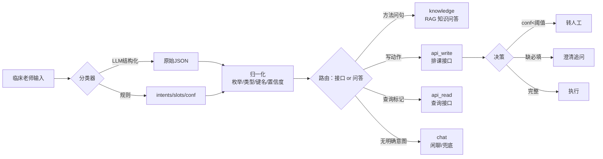

# 01 · 意图识别：Agent 的第一道门（医教场景）

> 对应主题 [02-prompt-context](README.md)。代码锚点：[code/02-prompt-context/intent_recognition.py](../../code/02-prompt-context/intent_recognition.py)。
> 场景：**临床教学管理助手**（住院医师规范化培训 / 教学查房 / 病例讨论 / 技能培训）。
> 本章讲：临床老师一句话进来，系统如何判断「他想干什么」，并决定走哪条流程。

## 一、问题背景：不识别意图，后面全是错的

假设你做了一个「临床教学管理助手」，心内科带教老师说：「帮我搞个下周三的急性胸痛教学查房」。
如果不先识别意图，系统会怎样？

- **走错流程**：把「查询排期」当「排课」，或把「问培训规定」当「建活动」，直接调错接口。
- **漏抽字段**：不知道这是「创建教学活动」，就不会去抽科室、病例主题、带教老师，后面草稿缺字段。
- **该问的不问**：老师没说日期，系统如果不判断「缺什么」，就会拿着半截信息去排课。
- **风险不可控**：排课是有副作用的操作，识别错了可能排错科室、占用示教室、发错通知。

**意图识别（Intent Recognition）就是 Agent 的第一道门**：先判断「想干什么」（intent），
再抽取「需要哪些信息」（slots），判断「缺什么要问」（clarification），最后决定「执行 / 澄清 / 转人工」。
这道门没做好，后面所有步骤都会放大错误。

## 二、核心概念：四个词说清意图识别

**意图（Intent）**：用户想完成的任务类别，医教场景常见四类——
`create_session`（排课：教学查房/病例讨论/技能培训）、`query_session`（查排期/活动）、
`knowledge_qa`（问培训规定/查房流程/带教要求）、`chitchat`（闲聊）。意图是一个**有限枚举**。

**槽位（Slot）**：完成该意图所需的参数。医教核心槽位：`session_type`（活动类型）、
`department`（科室）、`topic`（病例/主题）、`date_text`（日期）、`instructor`（带教老师）。
必填缺失就要澄清。

**多意图（Multi-intent）**：一句话可能包含多个意图，如「查一下我下周排期，再排一个病例讨论」= 查询 + 排课。
好的识别要能输出**意图数组**。

**置信度（Confidence）**：系统对这次识别的把握。低于阈值就不该硬走，而应**转人工**或**追问**。

**通道（Route）：动作意图 vs 知识意图**。识别出意图后，最关键的一步是判断**这次该调接口还是走问答**：

| 通道 | 含义 | 意图 | 典型表达 |
|---|---|---|---|
| `api_write` | 调业务接口·写（排课，需鉴权/确认） | create_session | 「帮我安排下周三的教学查房」 |
| `api_read` | 调业务接口·读（查我的排期） | query_session | 「查一下我下周的教学安排」 |
| `knowledge` | 走 RAG 知识问答（只读，不改状态） | knowledge_qa | 「教学查房的要求是什么」 |
| `chat` | 闲聊 / 兜底 | chitchat | 「今天天气不错」 |

判据是**用户要系统做事，还是想要信息**：要做事（祈使+具体对象+可执行动作）→ 调接口；
要信息（方法/规定/流程/为什么）→ 问答。
陷阱：**「如何安排教学查房」含动作词「安排」，但它是问方法，应走问答，不能调排课接口**。

> 术语辨析：**意图识别 ≠ 槽位抽取**。意图是「做什么」（分类），槽位是「用什么做」（抽取）。
> 失败模式不同：意图错是「方向错」，槽位错是「参数错」。

## 三、工作原理：一条完整流水线

```text
临床老师一句话
  → 分类器（三选一：规则 / 向量 / LLM 结构化）
  → 原始输出（intents / slots / confidence）
  → 归一化（枚举映射 / 类型纠正 / 键名收窄 / 置信度钳制）
  → 路由（判定走哪条通道：api_write / api_read / knowledge / chat）
  → 决策（confidence < 阈值 → 转人工；排课缺必填 → 澄清；否则 → 执行）
  → 交给下游（排课接口 / 查询接口 / RAG / 闲聊）
```

**怎么判断「调接口」还是「问答」？** 用**确定性信号**判据，按优先级：

| 优先级 | 判据 | 结论 | 例子 |
|---|---|---|---|
| 1 | 方法/解释问句（如何/怎么/为什么/要求/规定/流程）+ 无「帮我/给我」 | `knowledge` | 「如何安排教学查房」 |
| 2 | 强查询标记（查一下/查询/看看/排期/列表） | `api_read` | 「查一下我下周的教学安排」 |
| 3 | 写动作（安排/排课/创建/删除/修改） | `api_write` | 「帮我安排教学查房」 |
| 4 | 数据指代（我的/列表/记录）或查询意图 | `api_read` | 「我的教学活动列表」 |
| 5 | 知识意图 | `knowledge` | 「教学查房的要求是什么」 |
| 6 | 其余 | `chat` | 「今天天气不错」 |

**两个顺序陷阱**：
- 优先级 1 要在最前：否则「如何安排教学查房」会因含「安排」被误调排课接口。
- 优先级 2 要在 3 之前：否则「查一下我下周的教学安排」会因含「安排」被误判成排课（实际是查询）。

三种分类器的取舍：

| 方式 | 优点 | 缺点 | 适用 |
|---|---|---|---|
| **规则（关键词）** | 便宜、确定、可解释、零延迟 | 同义改写就漏 | 意图少、表达固定、兜底 |
| **向量分类** | 能理解语义相似 | 需标注，边界易混 | 意图多、有数据 |
| **LLM 结构化** | 理解同义、可多意图 | 会漂移、有成本延迟 | 表达开放、意图复杂 |

**为什么 LLM 方案必须配归一化？** 因为 LLM 会漂移：把 `create_session` 写成 `create`、
把 `instructor` 写成数组、把置信度写成 `1.7`。归一化负责修。**模型负责语义，代码负责边界**。

## 四、架构与流程



**图解关键**：无论用哪种分类器，原始输出都先过**归一化**，再过**路由**决定通道。
路由是「接口/问答」的分水岭：`api_write`/`api_read` 走业务接口，`knowledge` 走 RAG，`chat` 兜底。
排课接口再经**决策**（低置信转人工、缺槽位追问、齐全才执行）。

## 五、代码实现：把流水线跑出来

[intent_recognition.py](../../code/02-prompt-context/intent_recognition.py) 约 280 行，离线可跑：

```bash
cd code/02-prompt-context && ../../.venv/bin/python intent_recognition.py
```

**实测输出**（节选）：

```text
输入：帮我搞个社区获得性肺炎的病例讨论
  规则 : ['create_session'] conf=0.75 slots=['session_type','topic']
  LLM  : ['create_session'] conf=0.72 slots=['session_type','topic']（已归一化）
  决策 : clarify — 缺必填槽位

── 调接口 vs 问答：怎么判断 ──
  「如何安排教学查房？」
    意图=['create_session','query_session','knowledge_qa'] → 通道=knowledge
    理由：方法/解释类问句（如何/怎么/规定/流程/要求），走知识问答
  「安排下周三的急性胸痛教学查房」
    意图=['create_session','query_session'] → 通道=api_write

评测：
  意图识别——规则：{'accuracy': 1.0}  LLM：{'accuracy': 1.0}
  路由判定——LLM：{'accuracy': 1.0}
```

**关键代码讲解**——归一化（本章核心）：

```python
INTENT_ALIASES = {"create": "create_session", "query": "query_session", "qa": "knowledge_qa"}

def normalize(raw: str) -> dict:
    data = _extract_json(raw)                      # 兼容 ```json 围栏
    intents = [INTENT_ALIASES.get(str(i).strip(), str(i).strip()) for i in intents]  # 别名映射
    intents = [i for i in intents if i in INTENTS] or ["chitchat"]                   # 收窄枚举
    for k, v in slots_in.items():
        if k not in SLOT_KEYS: continue            # 键名收窄
        if k == "instructor" and isinstance(v, list):  # 类型纠正：数组→字符串
            v = v[0] if v else ""
    confidence = max(0.0, min(1.0, float(data.get("confidence", 0.5))))  # 钳制
```

**关键代码讲解**——路由（接口 vs 问答）：

```python
def route(text, result):
    method = _hit(text, METHOD_WORDS)          # 如何/怎么/要求/规定
    query = _hit(text, QUERY_MARKERS)          # 查一下/看看/排期/列表
    write = _hit(text, WRITE_WORDS)            # 安排/排课/创建
    if method and not any(w in text for w in ("帮我", "给我", "替我")):
        return {"route": "knowledge", ...}      # 1. 方法问句优先
    if query:
        return {"route": "api_read", ...}       # 2. 查询标记优先于写动作
    if write or "create_session" in result["intents"]:
        return {"route": "api_write", ...}      # 3. 写动作
    ...
```

**实测陷阱纠正**：分类器对「如何安排教学查房」同时给出 `create_session`（含「安排」），
但路由用「如何」信号纠正为 `knowledge`。`evaluate_route()` 用 10 条标注算路由准确率（实测 1.0）。

## 六、深入分析：设计取舍

**为什么用「信号路由」而不是「纯意图路由」？** 因为分类器会被字面误导：「如何安排教学查房」含「安排」，
可能被标成 create。若直接按意图调接口，就误排课了。路由用确定性信号做二次判断——**分类器给语义，路由给边界**。

**为什么要区分「查询标记」和「写动作」的优先级？** 因为中文里「安排」既出现在排课请求里，
也出现在查询请求里（「查一下我下周的教学安排」）。把查询标记放在写动作之前，能避免把查询误判成排课。

**规则 vs LLM，到底用哪个？** 生产常见「规则兜底 + LLM 主判」：LLM 处理开放表达，
规则处理高频确定表达。本 demo 评测 LLM 与规则均为 1.0，但规则零延迟零成本——组合使用才是工程解。

**置信度阈值怎么定？** 误判代价高（排课、发布）就调高阈值（宁可多转人工）；体验优先就调低。基于评测集调，不拍脑袋。

## 七、工程实践

- **业务落地**：[teaching-agent/m02](../../projects/teaching-agent/m02_intent_slots.py) 是同构实现（教学场景），
  含 21 条回归、`PROMPT_VERSION` 版本管理、`_normalize` 确定性纠偏。本章 demo 是它的通用精简版。
- **版本管理**：改 prompt 必须升版本 + 跑回归，否则行为悄悄退化。
- **评测驱动**：用标注集算准确率。`EVAL_SET` 是起点，真实项目应扩到几十上百条。
- **练习 1**：给 demo 加「向量分类」分支（字符 bigram 相似度），对比三方案。
- **练习 2**：构造多意图「查一下我下周排期，再排一个病例讨论」，让 `intents` 返回两个。
- **练习 3**：给 `ROUTE_EVAL` 加「取消我的教学查房」（写）和「取消查房要什么手续？」（问），
  验证前者 `api_write`、后者 `knowledge`。

## 八、本章总结

- **核心知识**：意图/槽位/多意图/置信度；**通道路由（接口 vs 问答）**；三种分类器取舍；归一化 + 三分支决策。
- **必须掌握的原理**：模型负责语义、代码负责边界；LLM 必配归一化；**方法问句优先走问答、查询标记优先于写动作**；
  低置信转人工、缺槽位澄清。
- **工程实践能力**：能跑通 demo、解释漂移修复与路由纠正、用标注集评测、做版本管理。
- **联系**：[02-prompt-context](README.md)（prompt 工程）→ 本章（意图+路由）→ [02 接口 40 参](02-api-param-strategy.md)
  → [03-tool-use](../03-tool-use/README.md)（工具/接口契约）。

## 九、参考资料

- 本项目：[teaching-agent/m02](../../projects/teaching-agent/m02_intent_slots.py)、[medical-education 框架示例](../../code/07-frameworks/medical-education/README.md)
- 本章代码：[intent_recognition.py](../../code/02-prompt-context/intent_recognition.py)
- Prompt 结构化输出：[OpenAI Structured Outputs](https://platform.openai.com/docs/guides/structured-outputs)
