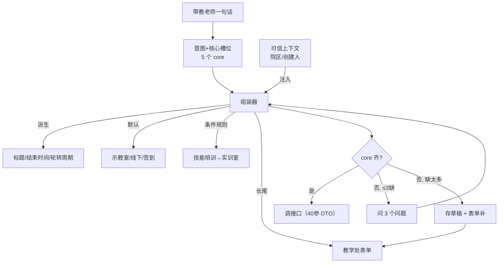

# 02 · 接口有 40 个参数，意图识别该怎么办（医教场景）

> 深入 [01-intent-recognition](01-intent-recognition.md) 的「意图 → 调接口」环节。场景：临床教学管理系统
> 「创建教学活动」接口（教学查房/病例讨论/技能培训）共 40 个参数。本章讲工程解：**参数分层**。
> 代码锚点：[large_api_params.py](../../code/02-prompt-context/large_api_params.py)。

## 一、问题背景：40 个参数会把两条路都堵死

设想「创建教学活动」接口有 40 个参数（院区、创建人、标题、时长、地点、平台、讲义、签到码、
教学处审批、继续教育学分、教学录像归档……）。如果沿用「抽槽位 → 缺啥问啥」的朴素做法，会同时撞两堵墙：

**第一堵墙：用户体验。** 带教老师说「帮我排下周三的教学查房」，系统反问 35 个问题——没人受得了。
其中很多问题老师根本答不了：院区、教学处审批流、继续教育学分系数、归档策略是管理员/教学处配置，
不是临床老师该填的。

**第二堵墙：模型能力。** 让 LLM 一次从一句话里抽 40 个字段，准确率会暴跌；字段越多，漏抽、错位、编造越严重。

**根因不是模型不行，而是问题问错了**：40 个参数里，**真正需要老师说的只有 5 个**，其余都能由系统补。

## 二、核心概念：按「来源」给参数分六层

| 层 | 谁负责 | 要不要问用户 | 医教例子 | 数量 |
|---|---|---|---|---|
| **system（系统）** | 可信上下文注入 | **绝不问** | id、院区(tenant)、创建人、created_at、状态 | 5 |
| **core（核心）** | Agent 抽取/澄清 | **只问这层缺的** | 活动类型、科室、病例主题、日期、带教老师 | 5 |
| **derived（派生）** | 代码计算 | 不问 | 标题、结束时间、时长、周次、轮转周期、科室 id | 6 |
| **default（默认）** | 默认值填充 | 不问（可后改） | 示教室、线下、人数上限、通知渠道、签到、录像 | 10 |
| **conditional（条件）** | 规则触发 + 表单 | 不追问 | 技能培训→模型实训室、线上→会议链接、实习生→需督导 | 6 |
| **form（长尾）** | 教学处表单 | 不问（Agent 不碰） | 预算编码、教学处审批流、继续教育学分、归档策略 | 8 |

合计 40。**Agent 真正要问的只有 core 层，而 core 里通常也只需澄清 2~3 个。**

判据（怎么把一个参数归到哪层）：
1. 值来自「谁在操作/在哪个院区」而非「老师想做什么」？是 → **system**（绝不能由模型生成，否则越权/串院区）。
2. 能否从别的字段算出来？是 → **derived**（算，别问）。
3. 是否有合理默认值、老师不特意说就无所谓？是 → **default**（填默认，告知可改）。
4. 是否「只有某种情况下才需要」？是 → **conditional**（规则判断，交表单/系统补）。
5. 是否管理员/教学处长尾配置、老师一时答不上？是 → **form**（交前端表单，Agent 不介入）。
6. 剩下真正定义这个教学活动的 3~6 个 → **core**（问）。

## 三、工作原理：从 40 个参数到 3 个问题

```text
意图识别（create_session）+ 核心槽位抽取（5 个）
  → 组装：
      system      ← 可信上下文注入（院区/创建人/now）
      core        ← 槽位（缺的记录）
      derived     ← 计算（title=科室+病例+类型；end=date+duration）
      default     ← 填默认（示教室/线下/人数/签到…）
      conditional ← 规则命中 → 交表单（技能培训→模型实训室、线上→会议链接）
      form        ← 长尾一律交表单（教学处审批/继续教育学分…）
  → 校验：core 是否齐？
      ├─ 齐 → 调接口创建（40 参数 DTO 已是完整对象）
      └─ 缺 → 最多问 3 个（优先级排序）；缺太多 → 先存草稿 + 表单补
```

关键换算：**40 个参数 → 5 个核心 → 实际问 ≤3 个**。其余 35 个由「注入/计算/默认/条件/表单」消化。

## 四、架构与流程



**图解关键**：组装器是中枢——把「老师说的 5 个」和「系统知道的 30 个」合成完整 DTO。
左侧注入/派生/默认/条件/表单是五条「补参」通道，把 40 参数的压力从临床老师身上卸下来。

## 五、代码实现：把 40 参策略跑出来

[large_api_params.py](../../code/02-prompt-context/large_api_params.py) 约 230 行，离线可跑：

```bash
cd code/02-prompt-context && ../../.venv/bin/python large_api_params.py
```

**实测**（三组输入）：

```text
── 完整输入（教学查房/心内科/急性胸痛）──
参数统计：{'total_params': 40, 'system_injected': 5, 'core_resolved': 5, 'derived': 6,
          'defaulted': 10, 'conditional_to_form': 2, 'form_only': 8, 'questions': 0}
要问用户：0 个
可直接创建：title=心内科急性胸痛教学查房 end=11月25日+60min

── 缺 2 个核心 ──
要问用户：2 个 → ['请问安排在哪一天？', '请问带教老师是谁？']

── 几乎没信息 ──
要问用户：3 个（草稿模式 True）→ 先存草稿，其余走教学处表单
```

**关键代码讲解**——组装与「问几个」：

```python
def assemble(slots, ctx, max_questions=3):
    plan = Plan()
    # 1) system：从可信上下文注入，绝不问（院区/创建人来自登录态）
    for p in PARAMS:
        if p.category == "system":
            plan.dto[p.name] = sys_map[p.name]
    # 2) core：从槽位取，缺的记录
    missing_core = [n for n in CORE_PARAMS if not slots.get(n)]
    # 3) derived：算出来（标题=科室+病例+类型）
    plan.dto.update(derive_all(slots, ctx))
    # 4) default：填默认（示教室/线下/签到…）
    # 5) conditional：条件命中 → 交表单（技能培训→模型实训室）
    # 6) form：长尾 → 交表单
    # 7) 核心缺项：最多问 3 个；超过 → 草稿模式
    if missing_core:
        plan.needs_draft = len(missing_core) > max_questions
        plan.questions = [QUESTION_MAP[n] for n in missing_core[:max_questions]]
    return plan
```

四个设计点：
- **system 用 `ctx` 注入**：`creator_id`/`tenant_id` 来自登录态，不是模型给的——安全边界（防越权/串院区）。
- **`derive_all` 纯计算**：标题/结束时间由核心字段算，不问老师。
- **`max_questions=3` 硬上限**：超过就 `needs_draft`，转草稿 + 表单，避免连环追问。
- **`validate` 只校验 core**：system/derived/default/条件/表单不参与「缺参报错」。

## 六、深入分析：设计取舍

**为什么不问用户全部 40 个？** 因为「可问性」不同。system 问了会越权（老师不该指定创建人/院区）；
derived 问了是浪费（说「11月25日」，结束时间算得出）；form 字段问了老师也答不上（教学处审批流）。
只有 core 是「老师本来就知道、且不说系统就不知道」的。

**为什么默认值 + 告知，而不是逐个确认？** 默认值降低交互成本，「可事后在表单改」保证不锁死。
只在不可逆、高风险处打断（如创建前确认草稿），其余默认。

**为什么缺太多就转草稿？** 问 3 个以上体验差，且老师可能自己也没想清楚。草稿模式让老师先有一个可编辑对象，
在教学处表单里慢慢补，比被连环追问友好。

**「40 参数」和「调接口 vs 问答」路由是什么关系？** 路由决定「走不走接口」；
参数分层决定「走接口时怎么补全 40 个参数」。两者串行：先路由到 `api_write`，再按六层组装 DTO。

**局限**：本 demo 的派生/条件规则是硬编码；生产应从 OpenAPI/pydantic schema **自动生成**分层元数据
（required/default/依赖），并监控「平均提问数/草稿率」。

## 七、工程实践

- **schema 驱动分层**：用接口 OpenAPI 自动标注 required/optional/default，把「用户可问字段」收敛到白名单
  （本 demo 的 `askable=True`），其余不进模型 schema。
- **安全**：system 字段（院区/创建人/状态）永远从可信上下文注入，禁止模型生成（对照 [09](../09-safety-guardrails/README.md)）。
- **监控**：记录每次创建的「提问数 / 草稿率 / 表单补全率」，提问数持续偏高说明 core 划分或默认值不合理。
- **练习 1**：给 demo 加「第 4 个核心缺项」输入，观察 `needs_draft=True` 且 questions=3。
- **练习 2**：把 `mode` 默认改成「线上」，观察条件字段 meeting_link/platform 进表单（条件命中）。
- **练习 3**：给 `PARAMS` 加一个 derived 字段「participant_count = max_participants」，验证派生自动补。

## 八、本章总结

- **核心知识**：参数六层（system/core/derived/default/conditional/form）；40→5 的换算；草稿优先。
- **必须掌握的原理**：按来源分层而非按字段列举；system 注入、derived 计算、default 填充、条件/长尾走表单；
  只对 core 提问且 ≤3；缺太多转草稿。
- **工程实践能力**：能跑通 demo、解释「为什么只问核心」、设计 schema 驱动分层。
- **联系**：[01 意图识别与路由](01-intent-recognition.md)（走不走接口）→ 本章（走接口时怎么补 40 参）
  → [03-tool-use](../03-tool-use/README.md)（工具/接口契约）。

## 九、参考资料

- 本章代码：[large_api_params.py](../../code/02-prompt-context/large_api_params.py)
- 意图与路由：[01 · 意图识别](01-intent-recognition.md)
- 医教框架示例：[medical-education](../../code/07-frameworks/medical-education/README.md)
- 安全边界（system 字段不可由模型生成）：[09 · 安全与护栏](../09-safety-guardrails/README.md)
- OpenAPI 规范：[OAS 3.1](https://spec.openapis.org/oas/v3.1.0)
