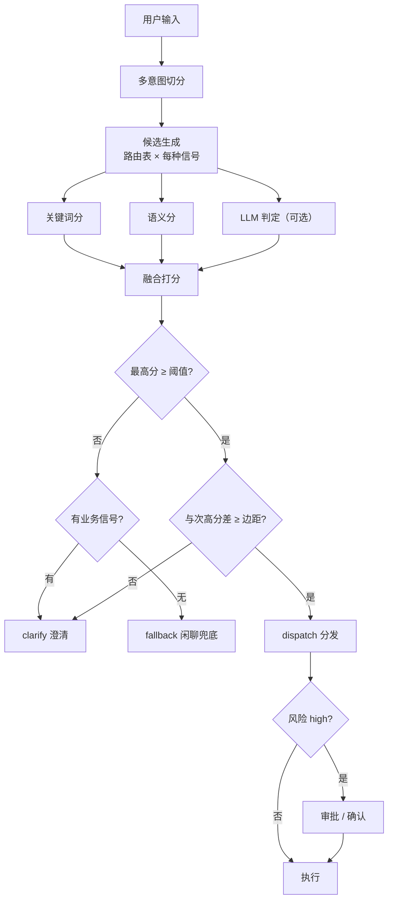
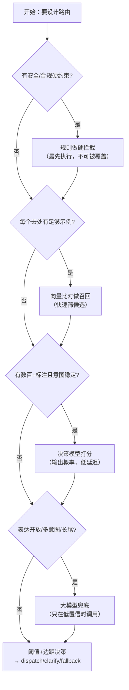

# 03 · Agent 的意图路由怎么设计

> **所属主题**：[02-prompt-context](README.md)
> **前置章节**：[01 · 意图识别](01-intent-recognition.md)、[02 · 接口 40 参](02-api-param-strategy.md)
> **代码示例**：[intent_router.py](../../code/02-prompt-context/intent_router.py)
> **本章目标**：从「判断一句话走哪条路」升级到「设计一个可演进的路由层」——多去处、多信号、可兜底、可评测。

## 本章先看结论

意图路由的核心不是「写一堆 if/else」，而是把路由做成**数据 + 打分 + 兜底**三件事：

1. **路由是数据**：每个去处（查数据、建活动、知识问答、专业子代理、长流程、闲聊）声明成一条 `Route`
   （关键词、示例、风险、成本、处理器）。加一个去处 = 加一条数据，不改判断逻辑。
2. **路由是打分**：关键词、语义相似、（可选）LLM 判定三种信号融合成候选分数，
   用**阈值**决定「够不够格」、用**边距**决定「有没有歧义」。
3. **路由是兜底**：分数不够 → 澄清；完全没信号 → 闲聊兜底；写操作 → 标记审批。
   拿不准就**不硬猜**，这是路由层最重要的工程原则。
4. **判据有四种来源**：规则、向量比对、决策模型、大模型。它们按「成本/泛化/可解释」取舍，
   生产上**分层组合**而非四选一（详见 §6）。

## 1. 问题背景：if/else 路由会怎么坏掉

一开始，路由可能长这样：

```python
if "创建" in text: return create()
elif "查询" in text: return query()
else: return chat()
```

三个去处时它够用。但当 Agent 长出十几个去处，会依次坏在四处：

1. **冲突**：「教学查房有哪些要求？」含「查房」（像查询），但其实是知识问答。
2. **顺序耦合**：新增一个「考核流程」去处，得插在哪条判断之前？顺序一改，旧行为就变。
3. **无兜底**：没匹配上就 `else: chat`，用户真正想做的事被当闲聊，静默失败。
4. **不可观测/不可评测**：出错了不知道「为什么走到这条路」「当时各候选多少分」。

这三个问题指向同一个结论：**路由不应该是一串命令式判断，而应该是一张可维护的路由表 + 一套可解释的打分。**

## 2. 核心概念

**路由表（route registry）**：一组 `Route` 声明。每条包含：

| 字段 | 作用 |
|---|---|
| `name` | 去处标识，如 `create_session` |
| `kind` | 去处类型：`tool_read / tool_write / knowledge / subagent / workflow / chat` |
| `keywords` | 强信号词（确定性） |
| `examples` | 示例句（给语义相似用，也是评测素材） |
| `risk` | 风险级别（low/medium/high） |
| `cost` | 相对成本（用于同分时选便宜的去处） |
| `requires_approval` | 写操作是否要人工确认 |

**候选生成与打分**：对每个 `Route` 算一个分数。本 demo 用两种离线信号：

- **关键词分**：命中 1/2/3+ 个关键词 → 0.6 / 0.85 / 1.0；
- **语义分**：输入与该 route 所有示例句的最大字符 bigram Jaccard 相似度；
- **融合**：`score = 0.6 × 关键词 + 0.4 × 语义`（权重和 = 1，分数落在 [0,1]）。

生产里第三种信号是 **LLM 路由**：让模型在候选集里选，输出 `{route, confidence}`，再与规则分融合。

**阈值（threshold）与边距（margin）**：两个完全不同的判据。

- **阈值**：最高分够不够格（如 0.38）。不够 → 信号不足 → 澄清。
- **边距**：最高分比第二名高多少（如 0.06）。太接近 → 有歧义 → 澄清。

**三态出口**：`dispatch`（分发）/ `clarify`（澄清）/ `fallback`（兜底闲聊）。
这正是 01 章「执行 / 追问 / 转人工」在路由层的落点。

**风险分级**：写操作（建活动、排考核）标 `high` + `requires_approval`，
路由分发后必须过权限与确认，不能因为「路由对了」就直接执行。

**多意图**：一句话可能含多个任务（「查一下排期，再安排一个病例讨论」）。
路由要先**切分子句**再逐段路由，输出任务列表，由编排层排序（详见 05-planning）。

**分发目标**：路由不只分发到「接口」，还可能是**子代理**（subagent）或**长流程**（workflow）。
例如「两个科室排期冲突，帮我协调」→ 交给专门的排期协调子代理，而不是某个单接口。

## 3. 设计原则

1. **声明式**：路由是数据，不是代码分支；新增去处不改判断逻辑。
2. **多信号**：关键词（准）+ 语义（泛）+ LLM（灵活）互补，单信号必然有盲区。
3. **可解释**：每次决策记录各候选分数与选择理由，便于排障与评测。
4. **敢兜底**：低分转澄清、零信号转闲聊，绝不静默硬猜。
5. **风险分级**：写操作单独标风险与审批，路由正确 ≠ 可以执行。
6. **成本感知**：同分时优先便宜的去处（子代理/长流程成本高）。
7. **可评测**：维护标注集，路由准确率与混淆矩阵进回归。

## 4. 工作原理



**图解关键**：打分与决策分离——打分只产出候选分，决策用「阈值 + 边距 + 业务信号」三条件决定出口。
这样阈值可以按业务调，而不用改动打分逻辑。

## 5. 代码实现

```bash
cd code/02-prompt-context && ../../.venv/bin/python intent_router.py
```

**实测节选**：

```text
路由注册表：6 个去处 -> ['query_schedule', 'create_session', 'knowledge_qa',
                        'exam_workflow', 'subagent_scheduling', 'chat']

「查一下我下周的教学安排」 → query_schedule | dispatch | 选中（tool_read，分 0.73）
「帮我安排一次教学查房」   → create_session | dispatch | 风险=high 需审批=True
「组织全院心肺复苏技能考核」→ exam_workflow | dispatch | workflow，分 0.91
「安排」                   → clarify | 输入过短，信息不足
「查一下我下周的排期，再安排一个病例讨论」→ 拆成 2 个子句，分别 query + create
准确率 1.0（8 条标注）
```

**关键代码讲解**——路由是数据：

```python
ROUTES = [
    Route("query_schedule", "tool_read",
          keywords=["查", "排期", "有哪些", "列表"],
          examples=["查一下我下周的教学安排", ...]),
    Route("create_session", "tool_write",
          keywords=["安排", "创建", "组织", "举办"],
          examples=["帮我安排一次教学查房", ...],
          risk="high", requires_approval=True),
    ...
]
```

**关键代码讲解**——阈值 + 边距 + 兜底：

```python
business = [(s, r) for s, r, _ in scored if r.kind != "chat"]  # 闲聊不参与竞争
best_score, best_route = business[0]
second = business[1][0]

if best_score < AMBIGUOUS_MIN:      # 完全没信号
    return Decision(..., action="fallback")
if best_score < THRESHOLD:          # 信号不足
    return Decision(..., action="clarify")
if best_score - second < MARGIN:    # 有歧义
    return Decision(..., action="clarify")
return Decision(..., action="dispatch", requires_approval=best_route.requires_approval)
```

三个细节：
- **闲聊只做兜底**：若让 `chat` 参与竞争，它会把「有业务信号但分数不高」的输入抢走（闲聊句式与任何句子都像）。
- **短输入保护**：`len(clean) <= 2` 直接澄清（只有「安排」两个字时，任何路由都是猜）。
- **同分选便宜**：`sort(key=(-score, cost))`，同分时优先低成本去处。

## 6. 深入分析：设计取舍

### 6.1 四类方法：规则 / 向量比对 / 决策模型 / 大模型

路由的「判据」可以来自四类方法。它们不是互斥的替代品，而是**成本、泛化、可解释性**三者的不同取舍。

**① 规则（rules）**：关键词、正则、句式模板。
本质是「人写的 if」。优点是确定、零延迟、完全可解释、可作为安全硬约束（如「含转账 → 必须走审批」）；
缺点是**同义改写就漏**，规则之间还会互相冲突（「查房」既像查询又像知识问答），维护成本随去处数量增长。

**② 向量比对（vector / embedding similarity）**：把输入和每个去处的示例句做语义相似度，取最近邻。
本质是「和示例像不像」。优点是不用训练、加去处只需加示例、能覆盖改写；缺点是**近似意图容易混淆**
（「安排查房」与「查一下安排」向量很近），且相似度分数**不可直接当概率**。

**③ 决策模型（trained classifier）**：用标注数据训练分类器（逻辑回归、GBDT、小 Transformer、朴素贝叶斯等），
输出各类概率。本质是「从数据里学分界」。优点是**低延迟、输出概率、可用特征解释**、对已知意图区分度高；
缺点是**依赖标注量与质量、需要训练/版本/监控**，冷启动阶段样本少时未必强于规则，意图变更要重训。

**④ 大模型（LLM router）**：把输入、候选列表与每个去处的说明交给模型，让它选择并给理由。
本质是「让模型读规则和示例做判断」。优点是**理解开放表达、能处理多意图与隐含意图、冷启动友好**；
缺点是**成本高、延迟大、输出会漂移**，且需要归一化与校验（见 01 章）。

**对比维度**：

| 维度 | 规则 | 向量比对 | 决策模型 | 大模型 |
|---|---|---|---|---|
| 数据需求 | 无 | 每类几条示例 | 数百~数千标注 | 无（但需写好候选说明） |
| 单次延迟 | 微秒级 | 毫秒级（含编码） | 亚毫秒~毫秒 | 数百毫秒~数秒 |
| 单次成本 | ≈0 | 低（编码） | ≈0 | 高（token） |
| 可解释性 | 完全可解释 | 可看最近示例 | 可看特征/概率 | 可看理由（未必可靠） |
| 同义泛化 | 差 | 好 | 中~好 | 最好 |
| 近似意图区分 | 差（易冲突） | 差（易混淆） | 好 | 好 |
| 多意图 | 需手工切分 | 需手工切分 | 需多标签训练 | 天然支持 |
| 冷启动 | 好 | 好 | 差 | 好 |
| 维护成本 | 规则越加越高 | 低 | 高（标注/训练/监控） | 中（Prompt 版本） |

**本 demo 的实测**（同一 8 条标注集，纯 Python 现场跑）：

```text
方法        准确率    单次耗时ms    需训练   可解释
规则         0.5       0.001        否       是
向量比对      1.0       0.054        否       是
决策模型      1.0       0.015        是       部分
大模型        1.0       0.062        否       部分
```

注意「规则 0.5」不是 bug：纯关键词在「教学查房有哪些要求？」这类**含歧义词**的句子上会冲突，
这恰好说明单靠规则的边界。而决策模型与向量在本标注集上打平——**样本只有 8 条**，
模型还没体现出数据优势；数据量上去后通常才会拉开差距。（大模型一列是确定性替身，真实 LLM 延迟会高 3~4 个数量级。）

### 6.2 怎么选：一张决策图



**读法**：从左上往下走，每一步只回答「要不要引入这一类方法」。
**规则永远在最前**（安全不可协商）；**大模型放在最后且按需调用**（只在前面都低置信时兜底，控成本）。

### 6.3 生产推荐：分层组合，而不是四选一

```text
输入
 ├─① 规则硬约束：命中安全/合规规则 → 直接定路由（不可被后续覆盖）
 ├─② 向量召回：取 Top-K 候选（便宜、覆盖改写）
 ├─③ 决策模型：对候选打分，输出概率（低延迟、可分意图）
 └─④ 大模型兜底：仅当前三路置信度不足时调用（贵，但能处理开放表达）
        ↓
   阈值 + 边距 → dispatch / clarify / fallback
```

这种分层的好处是**成本按需**：绝大多数请求在前两层就解决，大模型只处理少数难例。
风险也更可控：规则层保证安全边界不被模型绕过。

**什么时候该升级/降级？**

| 信号 | 说明 | 动作 |
|---|---|---|
| 规则冲突率高 | 多组关键词互相覆盖 | 引入向量/模型；把冲突规则改成有序硬约束 |
| 向量近似混淆 | 两个去处示例太像 | 补区分性示例，或加决策模型 |
| 澄清率过高 | 阈值过严或候选不足 | 调阈值、补示例；必要时让 LLM 兜底 |
| 大模型成本超预算 | 调用占比过高 | 提高前置层置信度、加缓存、只对长尾调用 |
| 意图新增/变更 | 旧模型失效 | 补标注 → 重训 → 回归评测 → 灰度 |

**冷启动建议**：先用「规则 + 向量」上线（零训练），同时把线上请求与人工修正**沉淀成标注**；
等标注量足够，再训练决策模型替换或补充向量层；大模型始终只做兜底。

### 6.4 阈值与边距怎么定

不能用「感觉」。做法：在标注集上画分数分布，选使「误路由率」和「澄清率」都可接受的切点。
阈值高 → 多澄清（稳但烦）；阈值低 → 多误判（快但错）。边距同理。

### 6.5 子代理分发与接口调用的区别

接口调用是「一次请求」，子代理是「一段自主执行」——
延迟、成本、风险都更高。因此子代理路由应更保守（更高阈值），并且要能取消、能限额。

### 6.6 路由会退化吗

会。新增去处、改示例、换模型都可能改变分数分布。所以必须**回归评测 + 线上观测**（记录每次决策的分数与出口）。

### 6.7 让模型报置信度，合理吗？

**结论：可以作为「参考信号」，但不能当成「校准过的概率」直接做决策。** 更稳的做法是
用外部可验证的信号（证据、候选边距、校验结果）来兜底，把自报置信度只当其中一个弱特征。

**为什么不能直接用？**

1. **未校准、普遍过度自信**。模型说 0.9，实际准确率可能只有 0.6~0.7。语言模型在 RLHF 后尤其容易高估自己，
   而且这个偏差会随模型版本变化。
2. **可被 prompt 诱导**。你在提示里写「请给出置信度 0~1」，模型往往会给出「看起来合理」的数字，
   而不是真实概率；换个措辞，分布就变了。
3. **没有证据支撑**。置信度是模型对自己的主观评价，不是对事实的核对。
   它对「我见过这类问题」敏感，对「这次真的答对了」并不敏感。
4. **跨版本漂移**。同一阈值在 A 模型上合适，换到 B 模型或新版本就失效。

**什么时候可以用？**

- **候选间相对比较**：让模型在 A/B 两个去处里选，用「更倾向哪个」比用绝对分数可靠。
- **触发澄清/兜底**：置信度低时多问一句、转人工，这个用途是合理的（宁可不做，不可做错）。
- **与其他信号组合**：置信度 + 证据 + 边距，三者一致时才放行。

**正确的工程做法**

1. **用标注集校准**：画可靠度图（reliability diagram），算 ECE；用温度缩放（temperature scaling）
   或等渗回归把分数拉回接近真实概率。
2. **校准后重新选阈值**：校准会把整体分布压低/抬高，旧阈值会失效（demo 里校准后「≥0.9」一个都选不出来）。
3. **坚持外部信号**：要求模型给出**证据**（命中的字段、引用的文档、匹配的规则），
   代码核对证据是否存在、是否支持结论；再看候选分数边距。
4. **高风险不依赖置信度**：写操作、资金、对外发布，一律走权限校验与人工确认，与置信度无关。

**本 demo 的实测**（合成数据，200 条校准 + 200 条测试）：

```text
测试集基础准确率: 0.595
自报置信度 ECE = 0.256          ← 明显过度自信
  0.7-0.8 桶：平均置信 0.77，实际准确率 0.51
  0.8-0.9 桶：平均置信 0.85，实际准确率 0.57
  0.9-1.0 桶：平均置信 0.94，实际准确率 0.73

温度缩放 T = 3.20（T>1 = 过度自信，需要压低），校准后 ECE = 0.078

决策策略（覆盖率 / 接受域准确率）：
  直接卡自报置信 ≥ 0.90     0.24 / 0.729   ← 筛掉的不多，留存的也不够准
  校准后置信 ≥ 0.90         0.00 / —       ← 校准后旧阈值失效，一个都过不了
  分数边距 ≥ 0.18          0.605 / 0.86
  有证据（校验通过）         0.495 / 0.949   ← 比自报置信可靠得多
  证据 + 边距 ≥ 0.12       0.48 / 0.979
```

**怎么读这组数**：自报置信 0.9 以上那批，实际只有 73% 对；而有证据的那批，95% 对。
差别不在「模型觉得自己多确定」，而在「有没有可核对的东西」。

> 与 [01 章](01-intent-recognition.md) §2.4 一致：置信度只能当风险参考，不能当授权；
> 关键决策要落在「证据 + 校验 + 审批」上。

## 7. 工程实践

- **本项目**：[teaching-agent/m05](../../projects/teaching-agent/m05_workflow.py) 的显式工作流本质是「预定义路由 + 状态机」；
  [m04](../../projects/teaching-agent/m04_tools.py) 的工具白名单是「路由目标」的权限边界。
- **Harness 实践**：DSH 的 subagent 机制就是把「路由到子代理」做成了一等公民——
  主 Agent 决定是否 spawn 子代理、spawn 哪个，子代理有自己的上下文与预算。
- **评测**：路由标注集应覆盖：正常表达、同义改写、含糊短句、多意图、否定、跨领域。
  每次改动跑一遍，记录准确率与混淆矩阵。
- **练习 1**：给 `ROUTES` 加一个「取消教学活动」去处（`tool_write`，high），并补 2 条标注。
- **练习 2**：把 `THRESHOLD` 调到 0.55，观察哪些输入从 dispatch 变成 clarify。
- **练习 3**：给 `route_clause` 接入一个 mock LLM 信号（返回候选分布），观察融合后的分数变化。
- **练习 4**：运行 `compare_strategies()`，再加 20 条标注（含同义改写、短句），观察哪类方法先掉分。
- **练习 5**：把 `model_strategy` 的朴素贝叶斯换成逻辑回归（numpy 手写即可），对比准确率与训练时间。
- **练习 6**：运行 `confidence_calibration.py`，把温度 T 手动改成 1.0 与 3.2，观察接受域准确率与覆盖率的变化。

## 8. 本章总结

- **核心知识**：路由表 / 候选打分 / 阈值 + 边距 / 三态出口 / 风险分级 / 多意图 / 子代理分发；
  **四类判据（规则/向量/决策模型/大模型）的取舍与分层组合**；
  **自报置信度需校准、且必须用证据/边距兜底**。
- **必须掌握的原理**：路由是数据不是分支；多信号融合；阈值管「够不够」，边距管「歧不歧」；拿不准就兜底。
- **工程实践能力**：能设计并评测一个多去处路由层，能解释分数与出口的关系。
- **联系**：[01 意图识别](01-intent-recognition.md)（识别）→ [02 参数策略](02-api-param-strategy.md)（补参）
  → 本章（路由设计）→ [05 规划](../05-planning/README.md)（多任务编排）。

## 9. 参考资料

- 本章代码：[intent_router.py](../../code/02-prompt-context/intent_router.py)
- 意图识别：[01 · 意图识别](01-intent-recognition.md)
- 工作流与编排：[05-planning](../05-planning/README.md)
- 工具权限边界：[teaching-agent/m04_tools.py](../../projects/teaching-agent/m04_tools.py)
