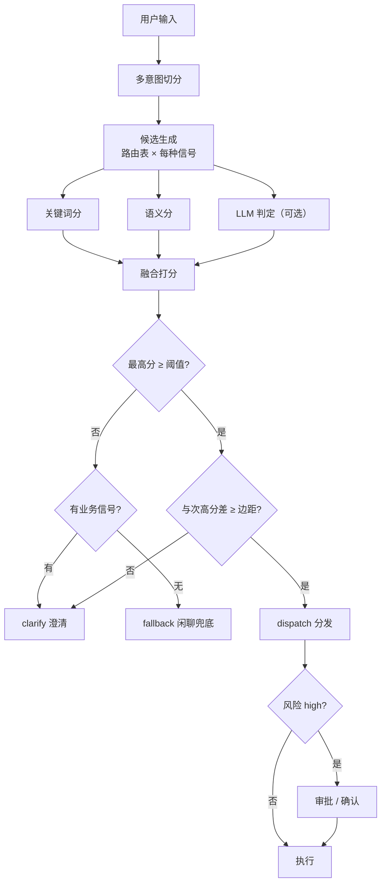

# 03 · Agent 的意图路由怎么设计

> **所属主题**：[02-prompt-context](README.md)
> **前置章节**：[01 · 意图识别](01-intent-recognition.md)、[02 · 接口 40 参](02-api-param-strategy.md)
> **代码示例**：[intent_router.py](../../code/02-prompt-context/intent_router.py)
> **本章目标**：从「判断一句话走哪条路」升级到「设计一个可演进的路由层」——多去处、多信号、可兜底、可评测。

## 本章先看结论

意图路由的核心不是「写一堆 if/else」，而是把路由做成**数据 + 打分 + 兜底**三件事：

1. **路由是数据**：每个去处（查数据、建活动、知识问答、专业子代理、长流程、闲聊）声明成一条 `Route`
   （关键词、示例、风险、成本、处理器）。加一个去处 = 加一条数据，不改判断逻辑。
2. **路由是打分**：关键词、语义相似、（可选）LLM 判定三种信号融合成候选分数，
   用**阈值**决定「够不够格」、用**边距**决定「有没有歧义」。
3. **路由是兜底**：分数不够 → 澄清；完全没信号 → 闲聊兜底；写操作 → 标记审批。
   拿不准就**不硬猜**，这是路由层最重要的工程原则。

## 1. 问题背景：if/else 路由会怎么坏掉

一开始，路由可能长这样：

```python
if "创建" in text: return create()
elif "查询" in text: return query()
else: return chat()
```

三个去处时它够用。但当 Agent 长出十几个去处，会依次坏在四处：

1. **冲突**：「教学查房有哪些要求？」含「查房」（像查询），但其实是知识问答。
2. **顺序耦合**：新增一个「考核流程」去处，得插在哪条判断之前？顺序一改，旧行为就变。
3. **无兜底**：没匹配上就 `else: chat`，用户真正想做的事被当闲聊，静默失败。
4. **不可观测/不可评测**：出错了不知道「为什么走到这条路」「当时各候选多少分」。

这三个问题指向同一个结论：**路由不应该是一串命令式判断，而应该是一张可维护的路由表 + 一套可解释的打分。**

## 2. 核心概念

**路由表（route registry）**：一组 `Route` 声明。每条包含：

| 字段 | 作用 |
|---|---|
| `name` | 去处标识，如 `create_session` |
| `kind` | 去处类型：`tool_read / tool_write / knowledge / subagent / workflow / chat` |
| `keywords` | 强信号词（确定性） |
| `examples` | 示例句（给语义相似用，也是评测素材） |
| `risk` | 风险级别（low/medium/high） |
| `cost` | 相对成本（用于同分时选便宜的去处） |
| `requires_approval` | 写操作是否要人工确认 |

**候选生成与打分**：对每个 `Route` 算一个分数。本 demo 用两种离线信号：

- **关键词分**：命中 1/2/3+ 个关键词 → 0.6 / 0.85 / 1.0；
- **语义分**：输入与该 route 所有示例句的最大字符 bigram Jaccard 相似度；
- **融合**：`score = 0.6 × 关键词 + 0.4 × 语义`（权重和 = 1，分数落在 [0,1]）。

生产里第三种信号是 **LLM 路由**：让模型在候选集里选，输出 `{route, confidence}`，再与规则分融合。

**阈值（threshold）与边距（margin）**：两个完全不同的判据。

- **阈值**：最高分够不够格（如 0.38）。不够 → 信号不足 → 澄清。
- **边距**：最高分比第二名高多少（如 0.06）。太接近 → 有歧义 → 澄清。

**三态出口**：`dispatch`（分发）/ `clarify`（澄清）/ `fallback`（兜底闲聊）。
这正是 01 章「执行 / 追问 / 转人工」在路由层的落点。

**风险分级**：写操作（建活动、排考核）标 `high` + `requires_approval`，
路由分发后必须过权限与确认，不能因为「路由对了」就直接执行。

**多意图**：一句话可能含多个任务（「查一下排期，再安排一个病例讨论」）。
路由要先**切分子句**再逐段路由，输出任务列表，由编排层排序（详见 05-planning）。

**分发目标**：路由不只分发到「接口」，还可能是**子代理**（subagent）或**长流程**（workflow）。
例如「两个科室排期冲突，帮我协调」→ 交给专门的排期协调子代理，而不是某个单接口。

## 3. 设计原则

1. **声明式**：路由是数据，不是代码分支；新增去处不改判断逻辑。
2. **多信号**：关键词（准）+ 语义（泛）+ LLM（灵活）互补，单信号必然有盲区。
3. **可解释**：每次决策记录各候选分数与选择理由，便于排障与评测。
4. **敢兜底**：低分转澄清、零信号转闲聊，绝不静默硬猜。
5. **风险分级**：写操作单独标风险与审批，路由正确 ≠ 可以执行。
6. **成本感知**：同分时优先便宜的去处（子代理/长流程成本高）。
7. **可评测**：维护标注集，路由准确率与混淆矩阵进回归。

## 4. 工作原理



**图解关键**：打分与决策分离——打分只产出候选分，决策用「阈值 + 边距 + 业务信号」三条件决定出口。
这样阈值可以按业务调，而不用改动打分逻辑。

## 5. 代码实现

```bash
cd code/02-prompt-context && ../../.venv/bin/python intent_router.py
```

**实测节选**：

```text
路由注册表：6 个去处 -> ['query_schedule', 'create_session', 'knowledge_qa',
                        'exam_workflow', 'subagent_scheduling', 'chat']

「查一下我下周的教学安排」 → query_schedule | dispatch | 选中（tool_read，分 0.73）
「帮我安排一次教学查房」   → create_session | dispatch | 风险=high 需审批=True
「组织全院心肺复苏技能考核」→ exam_workflow | dispatch | workflow，分 0.91
「安排」                   → clarify | 输入过短，信息不足
「查一下我下周的排期，再安排一个病例讨论」→ 拆成 2 个子句，分别 query + create
准确率 1.0（8 条标注）
```

**关键代码讲解**——路由是数据：

```python
ROUTES = [
    Route("query_schedule", "tool_read",
          keywords=["查", "排期", "有哪些", "列表"],
          examples=["查一下我下周的教学安排", ...]),
    Route("create_session", "tool_write",
          keywords=["安排", "创建", "组织", "举办"],
          examples=["帮我安排一次教学查房", ...],
          risk="high", requires_approval=True),
    ...
]
```

**关键代码讲解**——阈值 + 边距 + 兜底：

```python
business = [(s, r) for s, r, _ in scored if r.kind != "chat"]  # 闲聊不参与竞争
best_score, best_route = business[0]
second = business[1][0]

if best_score < AMBIGUOUS_MIN:      # 完全没信号
    return Decision(..., action="fallback")
if best_score < THRESHOLD:          # 信号不足
    return Decision(..., action="clarify")
if best_score - second < MARGIN:    # 有歧义
    return Decision(..., action="clarify")
return Decision(..., action="dispatch", requires_approval=best_route.requires_approval)
```

三个细节：
- **闲聊只做兜底**：若让 `chat` 参与竞争，它会把「有业务信号但分数不高」的输入抢走（闲聊句式与任何句子都像）。
- **短输入保护**：`len(clean) <= 2` 直接澄清（只有「安排」两个字时，任何路由都是猜）。
- **同分选便宜**：`sort(key=(-score, cost))`，同分时优先低成本去处。

## 6. 深入分析：设计取舍

**规则 vs 语义 vs LLM 路由怎么选？**

| 方式 | 优点 | 缺点 | 适合 |
|---|---|---|---|
| 规则/关键词 | 确定、零延迟、可解释 | 同义改写漏 | 强意图词、安全边界、兜底 |
| 语义相似 | 覆盖改写，离线可跑 | 近似意图易混 | 有示例库、意图稳定 |
| LLM 路由 | 理解开放表达、可解释 | 成本/延迟/漂移 | 表达开放、去处多 |

生产常见组合：**LLM 主判 + 规则兜底 + 语义召回候选**。本 demo 用规则+语义演示原理，LLM 作为第三信号的接入点已留好。

**阈值和边距怎么定？** 不能用「感觉」。做法：在标注集上画分数分布，选使「误路由率」和「澄清率」都可接受的切点。
阈值高 → 多澄清（稳但烦）；阈值低 → 多误判（快但错）。边距同理。

**路由到子代理和路由到接口有什么区别？** 接口调用是「一次请求」，子代理是「一段自主执行」——
延迟、成本、风险都更高。因此子代理路由应更保守（更高阈值），并且要能取消、能限额。

**路由会退化吗？** 会。新增去处、改示例、换模型都可能改变分数分布。所以必须**回归评测 + 线上观测**（记录每次决策的分数与出口）。

## 7. 工程实践

- **本项目**：[teaching-agent/m05](../../projects/teaching-agent/m05_workflow.py) 的显式工作流本质是「预定义路由 + 状态机」；
  [m04](../../projects/teaching-agent/m04_tools.py) 的工具白名单是「路由目标」的权限边界。
- **Harness 实践**：DSH 的 subagent 机制就是把「路由到子代理」做成了一等公民——
  主 Agent 决定是否 spawn 子代理、spawn 哪个，子代理有自己的上下文与预算。
- **评测**：路由标注集应覆盖：正常表达、同义改写、含糊短句、多意图、否定、跨领域。
  每次改动跑一遍，记录准确率与混淆矩阵。
- **练习 1**：给 `ROUTES` 加一个「取消教学活动」去处（`tool_write`，high），并补 2 条标注。
- **练习 2**：把 `THRESHOLD` 调到 0.55，观察哪些输入从 dispatch 变成 clarify。
- **练习 3**：给 `route_clause` 接入一个 mock LLM 信号（返回候选分布），观察融合后的分数变化。

## 8. 本章总结

- **核心知识**：路由表 / 候选打分 / 阈值 + 边距 / 三态出口 / 风险分级 / 多意图 / 子代理分发。
- **必须掌握的原理**：路由是数据不是分支；多信号融合；阈值管「够不够」，边距管「歧不歧」；拿不准就兜底。
- **工程实践能力**：能设计并评测一个多去处路由层，能解释分数与出口的关系。
- **联系**：[01 意图识别](01-intent-recognition.md)（识别）→ [02 参数策略](02-api-param-strategy.md)（补参）
  → 本章（路由设计）→ [05 规划](../05-planning/README.md)（多任务编排）。

## 9. 参考资料

- 本章代码：[intent_router.py](../../code/02-prompt-context/intent_router.py)
- 意图识别：[01 · 意图识别](01-intent-recognition.md)
- 工作流与编排：[05-planning](../05-planning/README.md)
- 工具权限边界：[teaching-agent/m04_tools.py](../../projects/teaching-agent/m04_tools.py)
