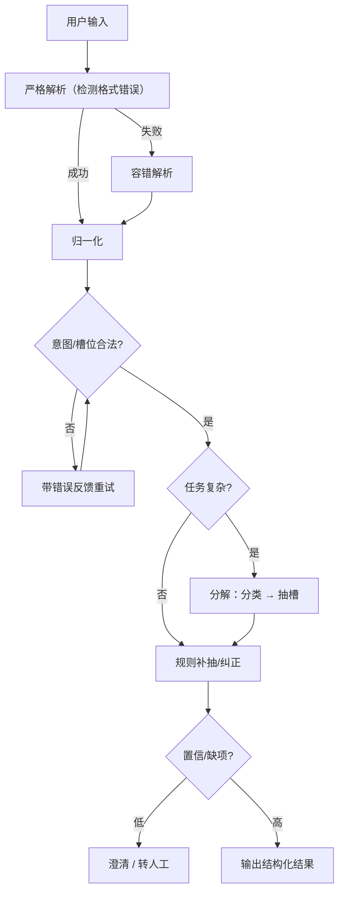

# 04 · 小模型上的意图识别怎么优化

> **所属主题**：[02-prompt-context](README.md)
> **前置章节**：[01 · 意图识别](01-intent-recognition.md)、[03 · 意图路由](03-agent-intent-routing.md)
> **代码示例**：[small_model_optimization.py](../../code/02-prompt-context/small_model_optimization.py)
> **业务场景**：本地部署的 7B/8B 模型（Ollama / vLLM）做临床教学助手的意图识别。
> **本章目标**：知道小模型**具体坏在哪**，以及一条按成本递增的优化阶梯。

## 本章先看结论

小模型的问题往往**不是「语义不理解」，而是「输出不稳定」**：

- JSON 不合法（尾逗号、代码围栏、截断）；
- 枚举漂移（`create` 而不是 `create_session`，甚至返回中文「创建」）；
- 类型漂移（`instructor` 返回数组、`date` 返回整数）；
- 自创键名、漏槽位、编造槽位。

因此优化顺序应当是**从零成本到有成本**：

```text
解析容错 → 归一化 → 带错误反馈的重试 → 任务分解 → 规则兜底 → 换模型/微调
```

**先做「代码能兜住的」，再花钱换模型。** 本仓库真实对比中，7B 的意图准确率 87.5%、8 例里 3 例槽位漂移；
8B（思考模式）准确率 100% 但 8 例里仍有 2 例漂移、单次延迟 13.67s——**连 8B 都不能省掉兜底**。

## 1. 问题背景：小模型「不稳」比「不聪明」更常见

小模型和前沿模型的能力差距，在意图识别这类**结构化输出**任务上，往往不是「想不出来」，而是：

- **指令遵循弱**：「不要输出多余字段」它可能不听；「必须用英文键名」它可能漏。
- **格式控制差**：长 JSON 容易断，尾逗号、缺引号、代码围栏都可能出现。
- **枚举不稳定**：同一意图这次叫 `create`，下次叫 `创建`，再下次叫 `create_activity`。
- **长上下文稀释**：schema 越长、示例越多，它越容易抓不住重点（反而漏字段）。
- **多任务互相干扰**：一次同时做「分类 + 抽槽 + 判缺项」，三件事都做不好。

所以优化思路不是「写更长的提示词求它听话」，而是**降低它每一步的负担 + 用代码保证边界**。

## 2. 失败模式与对策对照

| 失败模式 | 典型表现 | 首选对策 |
|---|---|---|
| JSON 不合法 | 尾逗号、围栏、截断 | 解析容错 + `max_tokens` + JSON mode |
| 枚举漂移 | `create` / `创建` / `create_activity` | 别名映射 + 枚举白名单 |
| 类型漂移 | `instructor: ["张三"]`、`date: 1120` | 类型纠正 + 正则/日期解析 |
| 自创键名 | `user_department`、`dept` | 键名收窄（白名单外丢弃） |
| 漏槽位 | 明明说了科室却没抽 | 分解任务 + 规则补抽 |
| 编造槽位 | 用户没说日期却填了 | 校验+澄清，禁止模型猜 |
| 多意图混乱 | 两个任务只返回一个 | 先切分子句，逐段识别 |
| 长 schema 失焦 | 字段越多漏越多 | 只给核心字段 + schema 放末尾 |

## 3. 优化阶梯：七层，按成本递增

### 3.1 解析层（零额外调用）

小模型输出先做**容错解析**：剥代码围栏、修尾逗号、容忍前后缀文本。
但注意：**严格解析要作为「检测器」保留**——先严格解析，失败再容错，这样能统计「模型格式错误率」。

### 3.2 归一化层（零额外调用）

把模型输出修成系统可接受的结构：别名→枚举、字符串→数组、丢弃白名单外的键、钳制置信度。
这是 01 章的核心结论：**模型负责语义，代码负责边界**。

### 3.3 重试层（+1 次调用/失败）

解析失败或校验不通过时，**把错误信息喂回模型**再试一次：

```text
上一次输出不是合法 JSON：缺少右花括号，且 slots.instructor 应为字符串。
请只输出合法 JSON，不要加解释或代码围栏。
```

带错误反馈的重试，比盲目重试有效得多。但要设上限（1~2 次）并计入成本。

### 3.4 任务分解层（+1 次调用）

把「分类 + 抽槽 + 判缺项」拆成多次调用：

```text
调用 1：只判意图（输出 {"intent": ...}）→ 准确率高
调用 2：给定意图，只抽该意图的槽位 → 负担小
调用 3（可选）：只判缺项与澄清问题
```

小模型一次做一件事，稳定性显著提升；代价是调用次数翻倍。

### 3.5 规则兜底层（≈零成本）

- **规则补抽**：日期、科室、人名这类强模式用正则补；
- **规则纠正**：意图与关键词明显冲突时以规则为准；
- **低置信**：转澄清或人工，不硬猜。

规则不是「落后」，而是**小模型最可靠的护栏**。

### 3.6 解码与提示层（零成本，需配置）

- `temperature=0`、`top_p=1`，减少随机性；
- `max_tokens` 按输出长度设上限，避免截断长 JSON；
- 支持时开 **JSON mode / 结构化输出**（Ollama `format`、OpenAI `response_format`）；
- Prompt 只留核心字段与 1~3 条**覆盖边界**的示例；schema 放在**末尾**（小模型对结尾更敏感）。

### 3.7 模型与数据层（有成本）

- **选型**：7B vs 8B（思考模式）不是「大一点就好」——8B 更准但延迟高一个数量级；
- **量化**：Q4 会进一步降低格式稳定性，结构化任务建议 Q8 或 FP16；
- **微调**：用真实 bad case 做 LoRA，对「固定意图集」通常比 prompt 更稳；
- **蒸馏**：用大模型标注数据训练小模型，兼顾成本与准确率。

## 4. 架构与流程



**图解关键**：容错解析只是「兜住格式」，不负责「修语义」；语义修复在归一化与重试；
规则层在最后补抽与纠正；**低置信永远有澄清出口**。

## 5. 代码实现

```bash
cd code/02-prompt-context && ../../.venv/bin/python small_model_optimization.py
```

**实测（模拟小模型，10 条标注）**：

```text
方案          JSON合法   意图准确   槽位准确   调用次数
baseline      0.7       0.1       0.786     10
+normalize    0.7       0.5       0.857     10
+retry        1.0       0.6       1.0       13
+decompose    1.0       0.8       1.0       20
+rules        1.0       0.6       1.0       13
```

**怎么读这张表**：

- **baseline**：JSON 0.7、意图 0.1——格式与枚举双重崩，说明「直接解析」不可行。
- **+normalize**：JSON 没变（归一化不修格式），但意图 0.1→0.5、槽位 0.79→0.86——**零成本拿到最大增量**。
- **+retry**：JSON 与槽位 1.0，代价 13 次调用（+30%）。
- **+decompose**：意图 0.8 最高，但调用翻倍到 20 次。
- **+rules**：借助规则把槽位补到 1.0，调用回到 13 次；意图 0.6 不是最高，但**性价比最好**。

**关键代码讲解**——严格与容错分离：

```python
def parse_strict(raw):          # 保留为「格式错误检测器」
    return json.loads(raw.strip())

def parse_tolerant(raw):        # 兜住围栏与尾逗号
    fence = re.search(r"```(?:json)?\s*(.*?)```", raw, re.S)
    text = fence.group(1).strip() if fence else raw.strip()
    text = re.sub(r",\s*}", "}", text)
    return json.loads(text)
```

**关键代码讲解**——带错误反馈的重试：

```python
try:
    data = parse_strict(raw)
except json.JSONDecodeError:
    calls += 1                                  # 计成本
    data = parse_tolerant(small_model(text, idx, "raw"))   # 真实场景：把错误信息喂回模型
```

## 6. 深入分析：取舍

**分解一定更好吗？** 准确率通常更高，但调用次数翻倍、延迟叠加。对「意图少、schema 短」的场景，
一次调用 + 归一化 + 规则兜底可能已经够用；对「意图多、槽位多」的场景，分解更稳。

**重试会不会掩盖问题？** 会。重试成功率高时，容易忽略「模型格式能力差」这个根因。
所以要把**首次解析失败率**作为指标持续监控，而不是只看最终成功率。

**规则和小模型怎么分工？** 规则负责「确定性、可枚举、强模式」的部分（日期、科室、白名单）；
模型负责「开放表达、同义改写」。两者冲突时，安全/合规相关以规则为准。

**换更大模型 vs 微调小模型？** 换模型是「用钱换延迟与稳定」；微调是「用数据换准确率」。
若意图集固定、bad case 可收集，LoRA 微调往往比升级模型更划算；若意图经常变，先做 prompt+归一化。

**7B 与 8B 的真实差距？** 本仓库 m11 实测：7B 意图 87.5%、3/8 漂移、1.62s；8B（思考模式）100%、
2/8 漂移、13.67s。**8B 更准但慢 8 倍**，且仍会漂移——这就是为什么兜底不能省。

## 7. 工程实践

- **版本管理**：Prompt 变更升版本 + 跑回归（[m02](../../projects/teaching-agent/m02_intent_slots.py) 的 `PROMPT_VERSION`）。
- **回归集**：把线上 bad case 脱敏后补进 [m11](../../projects/teaching-agent/m11_model_bench.py) 的评测集，按「意图/槽位/格式」分项统计。
- **配置**：Ollama 侧 `temperature=0`、限制 `num_predict`；能开 JSON mode 就开。
- **观测**：记录首次解析失败率、重试率、平均调用次数、槽位缺失率——这些比一个总准确率更能定位问题。
- **练习 1**：把 `run_baseline` 的 `parse_strict` 换成 `parse_tolerant`，看准确率虚高多少（体会「别自欺」）。
- **练习 2**：给 `run_full` 加「首次解析失败率」统计，验证重试掩盖问题的程度。
- **练习 3**：在 Ollama 上跑 `qwen2.5:7b` 与 `qwen3:8b`，用 m11 的方式对比真实漂移。

## 8. 本章总结

- **核心知识**：小模型失败模式（格式/枚举/类型/键名/漏抽/编造）；七层优化阶梯。
- **必须掌握的原理**：先零成本（解析容错+归一化），再按预算加（重试/分解/规则），最后才换模型；
  规则是护栏不是落后；重试要监控首次失败率，别自欺。
- **工程实践能力**：能跑通 demo、解释每一层的收益与成本、用 m11 实测小模型。
- **联系**：[01 意图识别](01-intent-recognition.md)（归一化）→ [03 路由](03-agent-intent-routing.md)（四类判据）
  → 本章（小模型优化）→ [10 生产实践](../10-production/README.md)（成本与延迟）。

## 9. 参考资料

- 本章代码：[small_model_optimization.py](../../code/02-prompt-context/small_model_optimization.py)
- 真实模型对比：[teaching-agent/m11_model_bench.py](../../projects/teaching-agent/m11_model_bench.py)
- 回归与门禁：[m08_eval.py](../../projects/teaching-agent/m08_eval.py)
- Ollama 结构化输出：[Ollama Structured Outputs](https://ollama.com/blog/structured-outputs)
