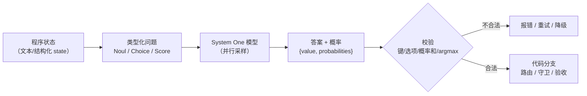

# 05 · JEV 与 System One 决策模型：把「判断」变成函数调用

> **所属主题**：[02-prompt-context](README.md)
> **前置章节**：[01 · 意图识别](01-intent-recognition.md)、[03 · 意图路由](03-agent-intent-routing.md)、[04 · 小模型优化](04-small-model-intent-optimization.md)
> **代码示例**：[jev_decision_demo.py](../../code/02-prompt-context/jev_decision_demo.py)（**本地接口模拟**，非真实 API）
> **资料性质**：本章基于 TypeSafe AI 2026-09-15 官方博客与第三方社区文档整理；
> 厂商的性能/价格数字均标注为「厂商声明」，请以你自己的实测为准。

## 本章先看结论

**JEV 不是聊天模型，而是一个「决策接口」**：输入是程序状态 + 若干**类型化问题**，
输出是**类型安全、带校准概率**的结构化答案，代码可以直接拿来分支。

对 Agent 工程的意义在于：它把 03 章里「决策模型」这一类能力，从「你自己训一个小分类器」
变成了「调一个专门做判断的模型服务」。适合放**路由、过滤、守卫、验收、打分**这些高频判断；
**不适合**写文案、长推理、开放对话。

但它不是银弹：早期访问、供应商锁定、数据合规、概率校准都要自己验证。
**先用它替换掉你最痛的那一个判断点，用标注集做 A/B，再决定要不要扩大。**

## 1. 它是什么

TypeSafe AI 把这类模型称为 **System One Models**（名字取自 Kahneman《思考，快与慢》：
System 1 是快速直觉，System 2 是慢速推理）。首个公开模型叫 **Jev**（得名于经济学家
William Stanley Jevons）。

按官方博客的定义，它是一个 **frontier-intelligence function call**：
**非结构化 state 进，类型化概率决策出**。

| 维度 | 传统 LLM | System One + Jev（厂商声明） |
|---|---|---|
| 训练目标 | RLHF / RLVR（人类偏好、可验证奖励） | **RLCD**：Reinforcement Learning for Calibrated Decisions |
| 输入 | 文本/消息序列，偏「对话」 | 非结构化 state，偏「程序状态」 |
| 输出 | 字符串，需要解析+校验 | **预定义 schema 的类型化值**，声称「不会类型错误」 |
| 采样 | 逐 token 自回归 | **单次查询并行采样**全部答案 |
| 延迟 | 3–329 秒（前沿模型） | **70–500ms**（厂商声明） |
| 价格 | 输入 $0.20–$10 / MTok | **输入 $0.042 / MTok，输出免费**（厂商声明） |
| 置信度 | 提示它给也常过度自信 | 每个输出都带校准概率（厂商声明） |

> 上述数字来自官方博客的对比，属于**厂商声明**；博客自己也说明测试多在美西笔记本上跑、
> 参考模型选择可能带来偏差。工程上必须自测。

## 2. 为什么会出现这类模型

原因和我们 01/04 章踩过的坑完全一致——**让生成式模型去做「代码里的判断」，很脆**：

1. **解析失败**：自由文本要 parse，长 JSON 会断、会多逗号；
2. **枚举漂移**：让你输出 `create_session`，它给你 `create`、`创建`、甚至一句话；
3. **过度自信**：问它「有多大把握」，它给一个看起来合理的数字，但和真实正确率不校准；
4. **类型不安全**：`instructor` 该是字符串，它给你数组。

这些问题在**单次演示**里不明显，在**每天几十万次调用的流水线**里会放大成运维事故。
System One 的思路是：**把「判断」从生成模型里拆出来，做成一个独立的、类型安全的决策服务**。

## 3. 核心概念

| 概念 | 含义 |
|---|---|
| **System One / System Two** | 快判断 vs 慢推理；Jev 定位前者 |
| **类型安全（type-safe）** | 输出结构在请求时就固定，答案只能是预定义的值 |
| **校准概率（calibrated probability）** | 声称「高置信 = 高准确」，需用你的数据验证（见 03 §6.7） |
| **并行采样** | 一次查询内并行产出所有问题的答案，而不是逐 token 生成 |
| **RLCD** | 训练方法：奖励「校准良好的决策」，而非人类偏好文本 |
| **Noul / Choice / Score** | 社区文档整理的三种问题形式：是/否、从选项选、按标准打分（**非官方术语，以官方文档为准**） |
| **高基数选择** | 选项很多（厂商博客称上限 255）时用「先评分再选择」两阶段 |

**Noul / Choice / Score 的直觉**：

- **Noul**：「这个操作是否高风险？」→ `{yes: 0.86, no: 0.14}`
- **Choice**：「用户想做什么？」→ 各候选路由的概率，代码取 argmax 或按阈值分支
- **Score**：「这条回复质量如何？」→ 1~5 各档的概率

一次请求可以并行问多个问题——这是它和「让 LLM 输出一段 JSON」最本质的区别：
**所有答案在同一次前向里给出，而不是一段段生成**。

## 4. 工作原理



**图解关键**：校验是必须的一环。即使厂商声称类型安全，**网络、版本、字段变更、概率不一致**
仍需要你这一侧兜住（demo 里的 `validate()` 就是这个角色）。

## 5. 与 Agent 意图路由的关系

03 章把路由判据分成四类：规则 / 向量比对 / 决策模型 / 大模型。
**JEV 属于「决策模型」这一类的最强形态**——不用自己训练，直接调服务。

| 场景 | 适合用 JEV？ | 理由 |
|---|---|---|
| 意图分类 / 路由（Choice） | ✅ 很适合 | 高频、选项有限、需要概率 |
| 高风险守卫（Noul） | ✅ 适合 | 需要「不确定就拒绝」的概率 |
| 回复/结果验收打分（Score） | ✅ 适合 | 大量独立判断，可并行 |
| 信息相关性过滤 | ✅ 适合 | 高频二分类 |
| 写一段给用户看的说明 | ❌ 不适合 | 它不生成字符串 |
| 多步推理 / 复杂规划 | ❌ 不适合 | 那是 System Two 的活 |
| 开放式对话 | ❌ 不适合 | 不是聊天模型 |

**推荐分工**：**LLM 负责生成与推理，JEV 负责判断与把关**。
例如：LLM 产出候选答案 → JEV 判「是否满足验收标准」→ 不满足则回到 LLM 重做。

## 6. 接入形态与校验

真实接入以官方文档为准（社区资料提到 `POST /api/v1/decide`、`jv_live_` 前缀密钥、官方 SDK，
**这些属于第三方整理，未在官方博客中逐字出现，使用前请核对官方文档**）。契约层面通常长这样：

```python
resp = client.decide(
    state=state_text,
    questions=[
        {"key": "route", "type": "choice",
         "question": "用户想做什么？",
         "options": ["query_schedule", "create_session", "knowledge_qa"]},
        {"key": "high_risk", "type": "noul",
         "question": "这个操作是否高风险？"},
    ],
)
# resp.answers: [{"key": "route", "value": "create_session",
#                 "probabilities": {...}}, ...]
```

**调用侧必须做的五件事**：

1. **校验键**：请求里的每个 `key` 都要有答案，且没有多余键；
2. **校验取值**：Choice/Score 的值必须在选项内；Noul 只能是 yes/no；
3. **校验概率**：每个概率在 [0,1]，同一问题概率和 ≈ 1；
4. **校验一致性**：`value` 应是概率最大的那个（否则按错误处理或降级）；
5. **可观测**：记录 `model` 版本、请求 ID、耗时、概率分布——出问题能回溯。

**错误处理**：瞬时错误（429/5xx/连接）按 `Retry-After` 退避重试；
鉴权错误不重试；**概率不一致**属于「可接受但需记录」的软错误，由业务决定是否采用。

## 7. 局限与风险（必须知道）

1. **早期访问**：官方博客明确说 Jev 处于 early access，能力、价格、可用性都可能变。
2. **供应商锁定**：把核心判断绑死在一个外部服务上，迁移成本高；建议在代码里做一层抽象。
3. **数据合规**：state 里可能含患者信息、内部数据；出境/脱敏/审计要先过合规。
4. **不能离线/私有化**：至少目前是托管 API，离线场景用不了（这也是 03 章保留规则/小模型的原因）。
5. **厂商数字要打折**：延迟、成本、准确率都基于厂商自测，工作负载不同结果差很多。
6. **概率仍需本地校准**：它声称校准，但「你的任务上是否校准」要用 ECE 验证（03 §6.7）。
7. **不是万能的**：它只做判断。需要生成、推理、多步规划的地方，仍要 LLM。

## 8. 怎么评估要不要用

用你自己的标注集，和现有方案做同条件对比：

| 指标 | 怎么测 |
|---|---|
| 判断准确率 | 与人工标注比；按意图/类别分别看 |
| 与 LLM 的一致率 | 同一批样本，比较两者答案 |
| 校准质量 | 可靠度图 + ECE（见 03 §6.7） |
| 延迟 | p50/p95，按你的网络位置测 |
| 单次成本 | 按你的调用量算，含重试 |
| 稳定性 | 同输入重复调用的答案一致率 |
| 失败率 | 校验不通过、超时、限流的比例 |

**建议路径**：先挑一个**高频、判断简单、错了代价可控**的点（如「这条检索结果是否相关」），
小流量 A/B；验证收益后再扩展到路由与验收。

## 9. 代码实践

```bash
cd code/02-prompt-context && ../../.venv/bin/python jev_decision_demo.py
```

**再次强调**：这个 demo 用本地桩模拟接口契约，**不联网、不调用真实 JEV**。

```text
① 路由做成 Choice 问题
   answer: create_session（概率 0.79）
② 高风险判断做成 Noul
   high_risk=yes p=0.86
③ 质量评分做成 Score
   score=1 p=0.50
④ 一次并行问多个问题
   route      create_session   p=0.79
   high_risk  no               p=0.91
   quality    1                p=0.50
⑤ 校验能抓住坏答案
   问题: ['route: 概率和 1.20 偏离 1', 'route: 选中值不是 argmax']
```

**关键代码讲解**——校验器：

```python
def validate(questions, answers, tol=0.02):
    problems = []
    for q in questions:
        a = by_key.get(q.key)
        if a is None: problems.append(f"缺少答案: {q.key}"); continue
        if isinstance(q, Choice) and set(a.probabilities) != set(q.options):
            problems.append(f"{q.key}: 选项集合不一致")
        if abs(sum(a.probabilities.values()) - 1.0) > tol:
            problems.append(f"{q.key}: 概率和偏离 1")
        if max(a.probabilities, key=a.probabilities.get) != a.value:
            problems.append(f"{q.key}: 选中值不是 argmax")
    return problems
```

这段校验就是「不要盲信类型安全」的落地：**厂商保证的是 schema，你保证的是业务语义**。

## 10. 本章总结

- **核心知识**：System One 决策模型是什么；`state + 类型化问题 → 类型安全 + 校准概率` 的接口形态；
  Noul/Choice/Score；并行采样；RLCD。
- **必须掌握的原理**：**判断与生成分离**——LLM 生成，决策模型判断；概率要本地校准验证；校验不可省。
- **工程实践能力**：能设计一次决策请求、写校验器、用标注集做 A/B、评估锁定与合规风险。
- **联系**：[03 路由四类判据](03-agent-intent-routing.md)（决策模型那一类）→ 本章（产品化形态）
  → [04 小模型优化](04-small-model-intent-optimization.md)（成本敏感时的替代）。

## 11. 参考资料

- 官方博客：[Introducing System One Models & Jev](https://typesafe.ai/blog/introducing-system-one-models-and-jev)（2026-09-15，Diogo Almeida）
- 社区文档（第三方，非官方）：[What is Jev AI & the System One Model](https://jevtypesafe.org/docs/system-one-model/)
- 行业报道（二手）：[刷屏了，前 OpenAI 研究员做的 Jev](https://eu.36kr.com/zh/p/3991165197188099)
- 校准方法：[03 · 置信度与校准](03-agent-intent-routing.md) §2、§6.7
- 决策模型选型：[03 · 四类判据](03-agent-intent-routing.md) §6.1
