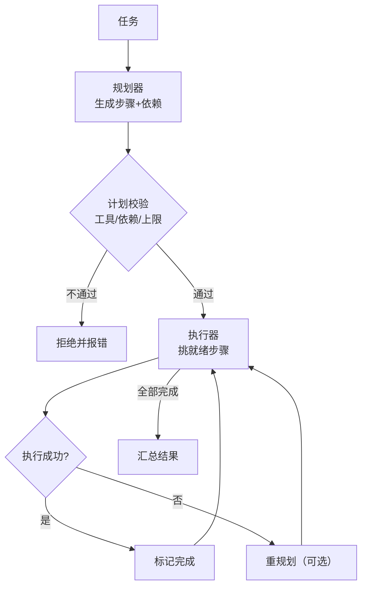

# 01 · 模型做规划：Plan-and-Execute 与 ReAct

> **所属主题**：[05-planning](README.md)
> **代码示例**：[planning_demo.py](../../code/05-planning/planning_demo.py)
> **业务场景**：临床教学管理系统，组织一次「全院心肺复苏（CPR）技能考核」。
> **本章目标**：理解模型如何把一个长任务拆成可执行的计划，以及「先规划后执行」与「边走边看」两种范式的取舍。

## 本章先看结论

一个多步骤任务，模型可以用三种方式推进：

1. **Plan-and-Execute（先规划后执行）**：一次性生成带依赖的步骤列表，再按依赖顺序执行。
2. **ReAct（Reason + Act，边走边看）**：不预先生成完整计划，每轮「想一步 → 做一步 → 看结果」。
3. **失败后重规划（Replan）**：执行中发现某步失败，只修补局部，而不是整体重来。

选择的关键不是「哪个更先进」，而是**任务的可预见性**：步骤稳定、可预演 → Plan-and-Execute；
环境不确定、需要边做边调整 → ReAct；两者都可以配重规划。

## 1. 为什么需要「规划」这一层？

假设用户说：

> 组织一次全院心肺复苏技能考核。

这句话背后至少有 7 个动作：确定考核范围、查询实训室、预约场地、通知学员、准备考核表、
安排督导、归档记录。而且它们**有依赖**：没确定范围就不知道通知谁；没预约到场地就不能发通知。

如果让模型「一口气直接做」，会遇到三个问题：

- **顺序错**：先通知后约场地，通知了却没地方上课。
- **不可审**：人无法在执行前看到「它打算怎么做」，出了问题也无法定位是哪一步。
- **难恢复**：做到一半失败，只能从头再来。

**规划层的作用**：把「做什么」先变成一份**结构化、可校验、可执行**的计划，再交给执行器。
这让长任务从「黑盒一次性生成」变成「可预演、可分步、可恢复」的流程。

> 术语：**计划（Plan）** 是一组带依赖关系的步骤；**步骤（Step）** 通常对应一次工具调用；
> **依赖（Dependency）** 决定执行顺序。计划不是自然语言段落，而是结构化数据。

## 2. 两种核心范式

### 2.1 Plan-and-Execute：先想清楚，再动手

```text
任务 → 规划器（LLM）→ 完整计划（步骤+依赖）→ 校验 → 按依赖执行 → 汇总结果
```

Demo 中生成的计划（`plan_cpr_assessment()`）：

| 步骤 | 工具 | 依赖 | 含义 |
|---|---|---|---|
| s1 | `determine_scope` | — | 确定考核对象 |
| s2 | `check_room` | — | 查询实训室 |
| s3 | `book_room` | s1, s2 | 预约场地 |
| s4 | `notify` | s3 | 通知学员 |
| s5 | `prepare_form` | s1 | 准备考核表 |
| s6 | `assign_supervisor` | s4 | 安排督导 |
| s7 | `archive` | s5, s6 | 归档记录 |

执行器只做一件事：**反复挑出「依赖都已满足」的步骤去执行**（拓扑序）。s5 可以在 s4 之前跑，
因为它只依赖 s1——这就是依赖图带来的并行机会。

**优点**：模型只调用一次（规划），token 省；计划可展示给人审；可预演成本。
**缺点**：计划是「一次性」的，环境变了不会自动适应。

### 2.2 ReAct：边走边看

```text
循环：think（下一步做什么）→ act（调用工具）→ observe（看结果）→ 判断是否完成
```

ReAct 不预先生成完整计划。它每轮只决定「下一步」，根据观察结果再决定之后做什么。
Demo 的 `react_run()` 里，每一步都记一条 `think / act / observe` 轨迹。

**优点**：灵活，能根据中间结果调整；适合探索型、环境不确定的任务。
**缺点**：每步都要调模型，token 与延迟高；没有全局计划，容易「原地打转」；难以在执行前人工审阅。

### 2.3 怎么选？

| 维度 | Plan-and-Execute | ReAct |
|---|---|---|
| 模型调用次数 | 少（1 次规划） | 多（每步 1 次） |
| 可预演/可审 | 强 | 弱 |
| 适应环境变化 | 弱（需重规划） | 强 |
| 长任务稳定性 | 好（有全局结构） | 一般（易漂移） |
| 适合场景 | 流程稳定、步骤可枚举 | 探索型、信息逐步揭示 |

工程上常见**混合**：先 Plan-and-Execute 出主干，执行中允许 ReAct 式局部调整；失败时触发重规划（见下一章）。

## 3. 工作原理：计划如何被执行



**图解关键**：校验在规划之后、执行之前，把「坏计划」挡在运行前；执行器是循环的，每轮挑一个就绪步骤；
失败分支回到执行器（重规划后继续），而不是回到任务开头。

## 4. 代码实现：把两种范式跑出来

```bash
cd code/05-planning && ../../.venv/bin/python planning_demo.py
```

**实测节选**：

```text
── 1) Plan-and-Execute：先规划，再按依赖执行 ──
  计划：
    s1:determine_scope           <- 无依赖
    s2:check_room                <- 无依赖
    s3:book_room                 <- ['s1', 's2']
    ...
  执行： ✓ s1 → ✓ s2 → ✓ s3 → ✓ s4 → ✓ s5 → ✓ s6 → ✓ s7
  统计：步骤=7 模型调用=1 token≈200

── 3) ReAct：边走边看 ──
  think: 下一步应执行 determine_scope
  act: determine_scope → observe: 成功
  ...
  统计：模型调用=8 token≈1370
```

**同一个任务，Plan-and-Execute 只调 1 次模型，ReAct 调了 8 次**——这就是「先规划」省成本的地方。

**关键代码讲解**——就绪步骤的执行循环：

```python
while True:
    pending = [s for s in steps if s.status == "pending"]
    if not pending:
        break
    ready = [s for s in pending
             if all(next(x for x in steps if x.id == d).status in ("done", "skipped")
                    for d in s.depends_on)]
    if not ready:
        raise PlanError("没有可执行的就绪步骤（依赖未满足或循环）")
    ready.sort(key=lambda s: idx.get(s.id, 10**6))
    s = ready[0]
    run_tool(s.tool)
    s.status = "done"
```

三个要点：
- **只挑就绪步骤**：依赖没满足的步骤不会被提前执行，天然保证顺序正确。
- **没有就绪步骤就报错**：说明依赖断了或存在环，绝不能静默跳过。
- **状态机（pending/done/skipped/failed）**：让「被补救替代」和「已完成」可区分（见下一章）。

## 5. 深入分析：设计取舍

**为什么计划要是结构化数据，而不是一段文字？** 因为文字无法校验、无法排序、无法局部替换。
结构化计划（`Step` 的 `id/tool/depends_on/status`）能拓扑排序、能做校验、能在失败时替换单个步骤。

**为什么依赖图比线性列表好？** 线性列表强制串行，浪费并行机会；依赖图只约束真正的前后关系。
例如「准备考核表」和「通知学员」互不依赖，可以并行或换序。

**ReAct 一定更差吗？** 不一定。当任务需要探索（如调试、检索未知信息）时，预先规划往往基于错误假设；
ReAct 的「看结果再决定」更稳。代价是模型调用多、容易打转，需要预算与终止条件（见 02 章）。

**模型生成的计划能直接用吗？** 不能。计划可能引用不存在的工具、存在循环依赖、步骤数爆炸。
必须过校验（下一章展开），并且高风险步骤要人工确认。

## 6. 工程实践

- **本项目**：[teaching-agent/m05](../../projects/teaching-agent/m05_workflow.py) 用 LangGraph 实现「显式工作流」：
  节点即步骤、条件边即依赖判断、`interrupt` 即人工确认、`SqliteSaver` 即执行状态持久化。
  它就是 Plan-and-Execute 的工程化版本——只是计划由设计者预先定义，而非模型生成。
- **医教案例**：[medical-education/langgraph_case_agent.py](../../code/07-frameworks/medical-education/langgraph_case_agent.py)
  展示了「评审→修订」的循环，是 ReAct 式回环的一个实例。
- **练习 1**：给 demo 的 `plan_cpr_assessment()` 增加一步「安排学员分组」，并让它依赖 s1。
- **练习 2**：把 `react_run()` 改成「先 plan 再 decide」，对比模型调用次数。
- **练习 3**：让 s5 与 s3 并行（互不依赖），观察执行顺序的变化。

## 7. 本章总结

- **核心知识**：计划 = 步骤 + 依赖；Plan-and-Execute（1 次规划、可审、僵化）vs ReAct（每步决策、灵活、贵）。
- **必须掌握的原理**：按依赖挑就绪步骤；计划是结构化数据；选择范式看任务可预见性。
- **工程实践能力**：能跑通 demo、解释两种范式的成本差异、把任务拆成带依赖的步骤。
- **联系**：[02 计划校验与重规划](02-plan-validation-and-replan.md)（失败怎么办）→ [05-planning](README.md)
  → [m05 工作流](../../projects/teaching-agent/m05_workflow.py)。

## 8. 参考资料

- 本章代码：[planning_demo.py](../../code/05-planning/planning_demo.py)
- 工作流实现：[teaching-agent/m05_workflow.py](../../projects/teaching-agent/m05_workflow.py)
- ReAct 论文：[ReAct: Synergizing Reasoning and Acting in Language Models](https://arxiv.org/abs/2210.03629)
- Plan-and-Solve 论文：[Plan-and-Solve Prompting](https://arxiv.org/abs/2305.04091)
