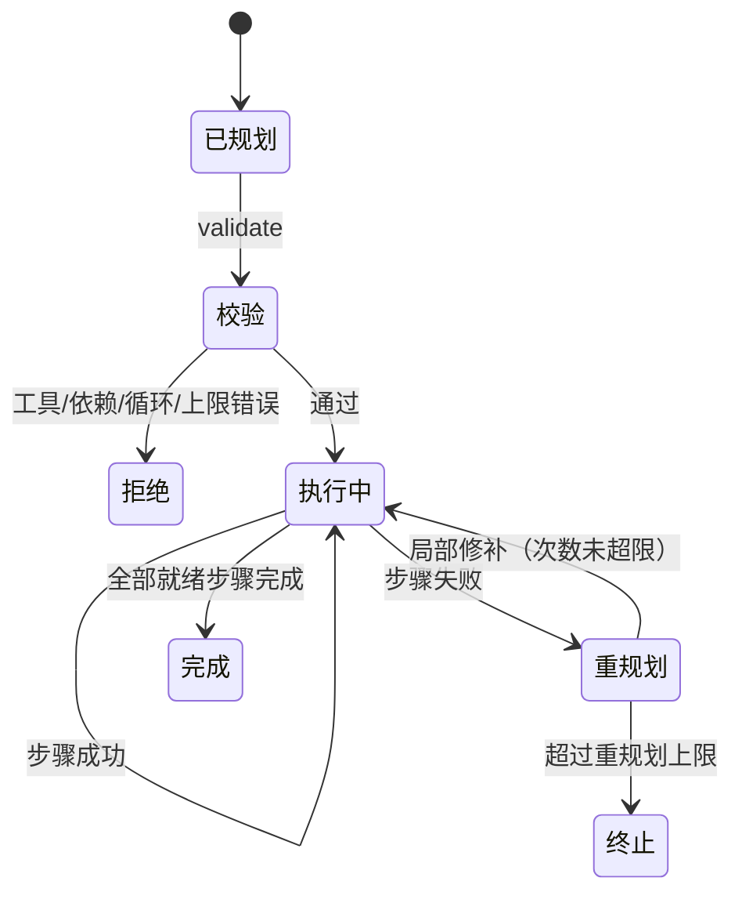

# 02 · 计划校验与重规划：让规划从「能跑」到「跑不坏」

> **所属主题**：[05-planning](README.md)
> **前置章节**：[01 · 模型做规划](01-planning-with-models.md)
> **代码示例**：[planning_demo.py](../../code/05-planning/planning_demo.py)
> **本章目标**：理解模型生成的计划为什么不可直接执行，以及失败时如何「局部修补」而不是整体重来。

## 本章先看结论

模型生成的计划，**在结构上可能直接是错的**：引用不存在的工具、存在循环依赖、步骤数爆炸。
执行时也可能**中途失败**。因此规划系统需要两件防护：

1. **计划校验（plan validation）**：执行前把坏计划挡下来——工具白名单、依赖存在性、循环检测、步骤上限。
2. **局部重规划（replan）**：执行中某步失败时，只替换/补充受影响的部分，而不是从头再来。

一句话：**先证明计划是合法的，再证明失败是可修复的。**

## 1. 问题背景：坏计划与失败步骤

### 1.1 模型会生成「看起来合理」的坏计划

- 写了工具 `book_room_v2`，但系统里只有 `book_room`；
- s1 依赖 s2、s2 又依赖 s1（循环）；
- 为了「周全」，生成了 30 个步骤，远超预算；
- 依赖了根本不存在的步骤 id。

如果把这些计划直接执行，轻则报错，重则顺序错乱、重复调用有副作用的接口。

### 1.2 执行中一定会失败

长任务里，失败是常态而不是异常：场地被占用、通知服务超时、督导临时请假。
如果每次失败都「整体重来」，会重复执行已经成功的步骤——尤其是**有副作用的步骤**（已经发过的通知再发一遍）。

## 2. 核心概念

**计划校验**：在执行前检查计划的合法性。四条基本规则：

| 规则 | 检查什么 | 不通过的后果 |
|---|---|---|
| 工具白名单 | 每个 `tool` 是否存在 | 执行时才报错，浪费时间/副作用 |
| 依赖存在性 | `depends_on` 是否都有对应步骤 | 步骤永远无法就绪 |
| 循环检测 | 依赖图是否有环 | 拓扑排序失败，死锁 |
| 步骤上限 | 步骤数是否超过预算 | token/时间爆炸，长任务失控 |

**局部重规划（local replan）**：失败后只修补受影响的部分。例如「实训室不可用」→ 插入「改用备用实训室」，
其余步骤保留。对比**整体重规划**（丢弃全部进度重新生成计划），局部重规划节省 token，也不重复已完成的副作用。

**反思（reflection）**：让模型评估「刚才做得怎么样」并给出改进。它在**失败后的原因分析**上有用；
在**每步都反思**时往往只是浪费 token。判断标准：反思是否改变了下一步的动作。

**终止条件**：重规划不能无限进行。需要「最多重规划次数」和「总步骤/预算上限」，否则会陷入
「失败→重规划→再失败」的死循环。

## 3. 工作原理

```text
规划 → 校验（工具/依赖/循环/上限）
         ├─ 不通过 → 拒绝，返回明确错误（不执行）
         └─ 通过 → 执行就绪步骤
                     ├─ 成功 → 标记 done，继续
                     └─ 失败 → 重规划次数 < 上限?
                                 ├─ 是 → 插入补救步骤 → 继续
                                 └─ 否 → 终止，标记 failed，转人工
```

关键设计：**校验错误要具体**（「未知工具 book_room_v2」而不是「计划非法」），否则无法自动修正或人工排查。

## 4. 架构与流程



**图解关键**：失败的边不回到「已规划」，而是到「重规划」——保留已完成的进度。
重规划次数是自环上的闸门，防止无限修补。

## 5. 代码实现

```bash
cd code/05-planning && ../../.venv/bin/python planning_demo.py
```

**实测节选**：

```text
── 2) 执行失败 → 重规划（不是整体重来）──
  ✓ s1:determine_scope
  ✗ s2:check_room — 工具 check_room 执行失败（模拟：资源不可用）
  ↺ 重规划：s2:check_room → ['s2b:use_backup_room']
  ✓ s2b:use_backup_room
  ✓ s3:book_room
  ...
统计：步骤=7 重规划=1 模型调用=2

── 4) 计划校验：坏计划会被拒绝 ──
  循环依赖: 拒绝 -> 检测到循环依赖：a
  未知工具: 拒绝 -> 未知工具：not_a_tool
  超过步骤上限: 拒绝 -> 步骤数 20 超过上限 12
```

**关键代码讲解**——循环检测（DFS 三色）：

```python
state = {}
def dfs(node):
    if state.get(node) == 1:          # 灰色：正在访问 → 回边 = 环
        raise PlanError(f"检测到循环依赖：{node}")
    if state.get(node) == 2:          # 黑色：已完成
        return
    state[node] = 1
    for dep in next(s.depends_on for s in steps if s.id == node):
        dfs(dep)
    state[node] = 2
```

**关键代码讲解**——局部重规划：

```python
except RuntimeError:
    stats.replans += 1
    new_steps = replanner(s, steps)      # 只针对失败步骤生成补救
    if not new_steps:
        raise
    s.status = "skipped"                 # 原步骤跳过（不重复副作用）
    steps.insert(steps.index(s) + 1, ns) # 补救步骤紧跟其后
```

三个要点：
- **原步骤标 `skipped` 而非删除**：保留「尝试过、失败了、被替代」的事实，便于审计与回放。
- **补救步骤插在失败步骤之后**：保证它在依赖它的步骤之前执行（demo 里 s2b 在 s3 之前）。
- **`replanner` 返回空表示无法修复**：此时必须抛错终止，而不是假装成功。

## 6. 深入分析：设计取舍

**为什么校验不通过就直接拒绝，而不是「试着执行一下」？** 因为执行有副作用。未知工具可能对应错误接口；
循环依赖会死锁。在执行前拒绝，成本最低。

**局部重规划 vs 整体重规划怎么选？** 看「失败的影响范围」。单个步骤失败且可替代 → 局部修补；
计划前提整体崩塌（如目标变了）→ 整体重规划。多数生产场景是前者。

**反思（reflection）什么时候值得？** 当它能改变下一步动作时（例如发现「通知失败是因为没有学员名单」，
于是插入「拉取名单」步骤）。如果反思只是重复「这次做得不错」，就是纯 token 浪费。

**重试的副作用怎么防？** 重规划可能重跑某些步骤。对有副作用的操作（发通知、写库），
必须配**幂等键**或「先查是否已执行」——参见 [teaching-agent/m10](../../projects/teaching-agent/m10_reliability.py) 的幂等与租约回收。

**终止条件为什么必须有？** 没有上限的重规划会在「失败→修补→再失败」里烧光预算。
上限应同时约束「重规划次数」和「总步骤数」。

## 7. 工程实践

- **本项目**：[m05](../../projects/teaching-agent/m05_workflow.py) 用 `MAX_CLARIFY_ROUNDS` 限制澄清轮次、
  用 Checkpoint 保存每步状态，失败后从检查点恢复而不是从头跑——这是「局部重规划」的工程版。
- **[m10](../../projects/teaching-agent/m10_reliability.py)** 的租约 + 幂等键，解决「重跑不重复副作用」。
- **练习 1**：给 demo 增加「重规划次数上限=1」，构造两次连续失败，验证第二次失败后终止。
- **练习 2**：让 `replan_on_room_failure` 在第二次失败时返回空列表，观察「无法修复 → 抛错」。
- **练习 3**：给计划加一个「发通知」步骤的幂等键，模拟重试，验证不会重复通知。

## 8. 本章总结

- **核心知识**：计划校验四规则；局部重规划 vs 整体重规划；反思的适用边界；终止条件。
- **必须掌握的原理**：坏计划在执行前拒绝；失败只修补局部；重试要防副作用；重规划必须有上限。
- **工程实践能力**：能跑通 demo、解释循环检测、设计「失败→修补→继续」的流程。
- **联系**：[01 规划范式](01-planning-with-models.md) → 本章（校验与修复）→ [m05 工作流](../../projects/teaching-agent/m05_workflow.py)
  → [08 错误恢复](../11-harness-engineering/08-error-recovery.md)（Harness 层的恢复）。

## 9. 参考资料

- 本章代码：[planning_demo.py](../../code/05-planning/planning_demo.py)
- 工作流与检查点：[teaching-agent/m05_workflow.py](../../projects/teaching-agent/m05_workflow.py)
- 可靠性与幂等：[teaching-agent/m10_reliability.py](../../projects/teaching-agent/m10_reliability.py)
- Reflexion 论文：[Reflexion: Language Agents with Verbal Reinforcement Learning](https://arxiv.org/abs/2303.11366)
