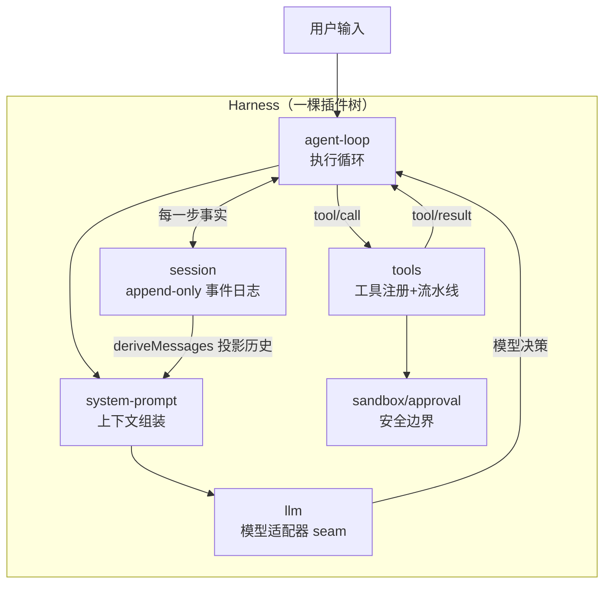

# 01 · 为什么需要 Harness

> 本章是 Harness Engineering 的入口。目标：让你从「会调模型 API」走到「理解为什么需要一个 Harness」，
> 并亲手跑通一个最小 Harness 骨架。对应代码：[minimal_harness.py](../../code/11-harness-experiments/minimal_harness.py)。

## 一、问题背景：裸调模型差在哪

假设你要做一个「帮老师创建教学活动」的助手。最直接的写法是：

```python
reply = llm.chat([{"role": "user", "content": "帮我创建下周的数学教研活动"}])
```

这在演示里能跑，但一旦放进真实业务，会立刻撞上四堵墙：

1. **模型不会自己「做事」。** 它只能输出文本。要查活动规则、查人员、写数据库，必须有人去**执行**这些动作，再把结果喂回模型。裸调一次 API 没有这个回路。
2. **模型会「忘」。** 每次请求都是无状态的。多轮对话里说过什么、查过什么、改过什么草稿，得有人记下来并在下次请求时重新组装进去。
3. **模型会「出错」且不可控。** 它可能调一个不存在的工具、传非法参数、陷入「调工具→失败→再调」的死循环，或者输出根本没法解析的 JSON。裸调没有把关、没有重试边界、没有停止条件。
4. **过程不可追溯。** 出了问题你想知道「它当时看到了什么、为什么这么做」，裸调除了最终回复什么都没留下。

**Harness（直译「挽具/框架」，此处指 Agent 运行框架）就是补上这四堵墙的那层系统。** 它把「一个会聊天的模型」包装成「一个能可靠做事、可追溯、可恢复的系统」。这个词借自测试领域的 "test harness"（把被测代码套进一个受控执行环境），含义相通：**把不确定的模型套进一个确定的执行骨架**。

> 术语澄清：**Harness ≠ Agent ≠ Framework**。
> - **Agent** 是「模型 + 上下文 + 工具 + 控制逻辑」构成的任务执行单元（一个会做事的整体）。
> - **Harness** 是承载并驱动 Agent 的**运行时系统**——管循环、管上下文、管工具执行、管状态、管安全。
> - **Framework**（如 LangGraph、CrewAI）是帮你**搭建** Agent/Harness 的工具库。
> 类比：Agent 是车，Harness 是发动机+底盘+方向盘，Framework 是造车的机床。本章聚焦 Harness 本身。

## 二、核心概念：Harness 到底管什么

一个 Harness 至少要管五件事，缺一不可：

| 职责 | 解决前面的哪堵墙 | 关键机制 |
|---|---|---|
| **执行循环（Agent Loop）** | 墙 1：模型不会做事 | 反复「模型决策→执行工具→回填结果」，直到任务完成 |
| **上下文管理（Context）** | 墙 2：模型会忘 | 记录历史，每次请求前组装模型该看到的内容 |
| **工具执行（Tool Execution）** | 墙 1/3：做事+可控 | 注册工具、校验参数、把关权限、执行、回填 |
| **状态与日志（State/Log）** | 墙 4：不可追溯 | 记录每一步事实，支持回放/恢复 |
| **控制与安全（Control）** | 墙 3：出错失控 | 停止条件、重试边界、权限审批 |

这五件事在 DeepSeek Harness（下称 DSH，本仓库使用的真实 Harness）里分别由独立插件承担：
`agent-loop`（循环）、`system-prompt`（上下文组装）、`tools`（工具）、`session`（日志）、`sandbox`/`approval`（安全）。
**记住这个对应关系**——下面会看到，它们不是写在一大坨代码里，而是各自可替换的插件。

## 三、工作原理：一次请求如何变成行动

Harness 的心脏是 **Agent Loop**。DSH 用两个词描述它的节奏：

- **step（步骤）**：一次模型请求 + 这次请求调用的工具。
- **turn（轮次）**：零个或多个 step。它在领取第一条输入前打开，在「不再欠任何工作」时关闭。

什么叫「欠工作」？模型如果调了工具，就欠一次「把工具结果告诉模型」的请求；只要还欠着，循环就继续。
模型如果直接给出最终回答（不调工具），就不欠了，轮次关闭。

DSH 一个 step 的真实执行顺序（摘自其架构文档 `architecture.zh.md` 的轮次流程）：

```text
领取输入 → 组装提示词片段 + 工具 schema
  → agent/pre-step（接纳/改写/拒绝输入）
  → step/start
  → agent/request → prepareCall（绑定模型适配器）
  → 提交系统提示词与用户消息 → 从日志冻结模型历史
  → 流式请求 llm/stream → assistant/message
  → tool/call → tools/pre-execute → tools/execute → tools/post-execute → tool/result
  → step/end
  → 还欠请求或有新输入？→ 领取 → 下一 step；否则 turn/end
```

两个关键设计点：

1. **工具执行是一条「流水线」而非直接调用**：`pre-execute`（把关/审批）→ `execute`（真正执行）→ `post-execute`（变换结果）。权限校验、参数校验、审计都挂在流水线上，而不是散落在每个工具里。
2. **这些拦截点是「瀑布事件」（waterfall）**：监听器必须显式调用 `next()` 才把控制权传下去。这保证了多个插件可以层层叠加策略，而不会互相覆盖。

## 四、架构与流程

DSH 的底层是 **Cordis 插件框架**。它的核心思想一句话：**一切皆插件，没有特权内核**。
模型适配器、工具注册表、会话日志、甚至 Agent Loop 本身都是插件，都能从配置替换；每个注册都是「副作用」，插件卸载时自动撤销。



**图解关键回路**：用户输入进入 Loop；Loop 让 system-prompt 组装上下文（其中模型历史**从 session 日志投影**而来），
交给 llm 适配器请求模型；模型若调工具，Loop 把调用交给 tools 流水线（经 sandbox/approval 把关）执行，结果回填再请求模型；
**每一步的事实都写进 session 日志**。注意那条 `Session → SP` 的回边——它是下一节「日志即真相」的核心。

为什么要把日志放在中心？因为 DSH 有一条铁律：**「模型可见即已记录」**——模型看到的任何上下文，都必须能从日志重建。
fork（分叉）、resume（恢复）、replay（回放）、遥测，全部从这份日志派生，而不是另存一份状态。

## 五、代码实现：亲手跑一个最小 Harness

光看架构不够。[minimal_harness.py](../../code/11-harness-experiments/minimal_harness.py) 用约 150 行 Python
实现了上述骨架的教学版，**离线可跑、带自检**。它镜像 DSH 的四个核心概念：

| 最小实现 | 对应 DSH | 作用 |
|---|---|---|
| `EventLog` + `derive_messages()` | `core/session` | append-only 日志，模型历史从日志投影 |
| `ToolRegistry.execute()` | `core/tools` | 白名单把关 + 执行 |
| `Harness.run_turn()` | `core/agent-loop` | step/turn 循环 + 停止条件 |
| `mock_model()` | `ctx.llm` 适配器 | 模型决策（此处用确定性替身） |

**文件结构 / 依赖 / 运行**：单文件，仅用 Python 标准库（dataclasses/json），无第三方依赖。

```bash
cd code/11-harness-experiments
../../.venv/bin/python minimal_harness.py
```

**预期输出**（实测）：

```text
最终回答： 根据规则：时长须在 30~240 分钟，活动时长应设为 90 分钟。
工具调用： ['query_rules']
事件日志（模型可见即已记录）：
  system -> 你是教学活动助手。
  user -> 帮我设一个数学教研活动的时长
  assistant -> [调用工具 query_rules]
  tool_result -> 时长须在 30~240 分钟
  assistant -> 根据规则：...活动时长应设为 90 分钟。
从日志重建的模型历史条数： 5
```

**关键代码讲解**——循环本体：

```python
def run_turn(self, user_input: str) -> str:
    self.log.append("system", content=self.system)
    self.log.append("user", content=user_input)
    steps = 0
    while steps < self.max_steps:                 # 停止条件：防无限循环
        steps += 1
        messages = self.log.derive_messages()      # 上下文从日志投影（不是另存变量）
        decision = self.model(messages, self.tools.schemas())
        if "tool_call" in decision:
            call = decision["tool_call"]
            self.log.append("assistant", content=f"[调用工具 {call['name']}]")
            result = self.tools.execute(call["name"], call["args"])  # 白名单把关+执行
            self.log.append("tool_result", name=call["name"], content=result)
            continue                               # 工具欠下另一次请求 → 下一 step
        answer = decision["answer"]
        self.log.append("assistant", content=answer)
        return answer                              # 不再欠工作 → 关闭轮次
    raise RuntimeError("达到 max_steps，疑似无限循环")
```

三个值得停下来看的细节：

1. **`derive_messages()` 每步都从日志重算历史**，而不是维护一个 `history` 变量。这正是「日志即真相」——
   任何时刻模型该看到什么，完全由日志决定。`selftest()` 里专门断言「历史条数 == 日志中消息事件数」，验证可完全重建。
2. **`continue` 与 `return` 的分界**就是「欠不欠工作」：调了工具就 `continue`（欠一次回填请求），给出答案就 `return`（轮次结束）。
3. **`max_steps` 是控制边界**：真实模型可能死循环，Harness 必须有硬上限。DSH 还有取消、重试边界等更细的控制。

`selftest()` 验证：工具确实被调用、日志含 tool_result、历史可完全重建、白名单外工具被拦截。运行 `python -c "import minimal_harness; minimal_harness.selftest()"` 全过。

## 六、深入分析：几个设计取舍

**为什么「一切皆插件」而不是一个大内核？**
因为 Harness 的需求差异极大：有人要本地 shell，有人要远程沙箱；有人要 Web UI，有人要纯命令行。
DSH 用「能力 seam」（Service Definition + Provider + Consumer 三角）让每项能力可替换。
一个漂亮的例子：文件系统和进程提供方共享同一个「执行世界」，把它们指向远程沙箱，**Bash、PTY、LSP 就一起搬过去了**，
不需要为每个工具单独改代码。这是单体内核做不到的灵活性。代价是：理解成本更高，得先懂插件/事件模型。

**为什么「日志即真相」而不是存一个状态对象？**
因为状态对象会「漂移」——你改了状态却忘了同步某处，就出现不一致。append-only 日志是唯一事实源，
所有视图（模型历史、UI、遥测）都从它投影，天然一致，且免费获得回放/恢复/分叉能力。
代价是：每次投影有计算开销，日志会增长（DSH 用 compaction 压缩、generation 管理应对）。
本仓库 [teaching-agent/m05](../../projects/teaching-agent/m05_workflow.py) 的 Checkpoint 是同一思想的简化版。

**最小实现 vs 真实 Harness 的差距在哪？**
minimal_harness 省略了：流式输出、并发工具执行、取消、重试、沙箱隔离、审批、上下文压缩、子代理。
这些正是后续章节（04/06/07/08/09）要展开的。**先理解骨架，再逐项加肉**，比一上来啃完整源码有效得多。

## 七、工程实践：在本仓库哪里看到它

- **[teaching-agent/m05](../../projects/teaching-agent/m05_workflow.py)**：用 LangGraph 实现的业务工作流。
  它的 State/条件边/Checkpoint/HITL，正是 Harness 五职责在「活动创建」场景的落地——
  `interrupt()` 对应「等人确认」，`SqliteSaver` 对应「日志/状态持久化」，`MAX_CLARIFY_ROUNDS` 对应「停止条件」。
- **[harness-examples](../../code/07-frameworks/harness-examples/README.md)**：在真实 DSH 上写插件
  （Agent Preset / Host Plugin / MCP Bundle），亲身体验「一切皆插件」的扩展方式。
- **建议练习**：给 minimal_harness 加一个 `pre-execute` 审批钩子（某工具需「确认」才执行），
  体会工具流水线把关；再加一个 `max_steps=2` 跑需要 3 步的任务，观察停止条件如何触发。

## 八、本章总结

- **核心知识**：Harness 是把模型变成可靠做事系统的运行时，管五件事——循环、上下文、工具、状态、控制。
- **必须掌握的原理**：step/turn 节奏（欠工作就继续）；工具执行流水线；**会话日志即真相**（模型可见即已记录）。
- **工程实践能力**：能跑通并讲解 minimal_harness；能指出 teaching-agent/m05 里对应的 Harness 机制。
- **与其他章节的联系**：本章建立直觉 → 04 深入执行循环 → 06 工具工程 → 07/08/09 生产化（环境/恢复/安全）→ 12 Coding Agent 应用。

## 九、参考资料

- DeepSeek Harness 架构文档（本机安装版，权威）：`architecture.zh.md`（轮次流程/核心包/能力 seam）、`agent-lifecycle.zh.md`（时序）、`tool-execution-pipeline.zh.md`（工具流水线）、`capability-seams.zh.md`（能力图）
- [Cordis 插件框架](https://github.com/nicedoc/cordis)
- 本章代码锚点：[minimal_harness.py](../../code/11-harness-experiments/minimal_harness.py)
- 业务落地对照：[teaching-agent/m05_workflow.py](../../projects/teaching-agent/m05_workflow.py)、[其文档 05-Agent工作流编排](../../projects/teaching-agent/docs/05-Agent工作流编排.md)
