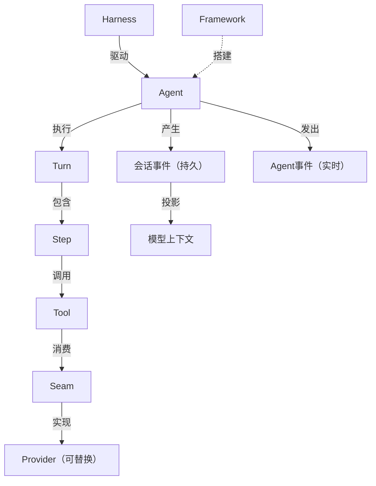

# 02 · 核心概念：把术语彻底厘清

> [01-introduction](01-introduction.md) 引入了 Harness/Agent/Framework 的直觉区分。本章把核心术语**精确化**，
> 重点辨析容易混淆的概念对——术语不清是读源码和讨论时最大的障碍。

## 一、为什么术语值得单独一章

Agent 领域术语混乱：同一个词在不同框架里含义不同，相近的词又常被混用。
比如「Agent」有时指整个系统，有时指一个子任务执行者；「框架」和「Harness」常被当同义词。
本章给出本仓库（及 DSH）的**精确约定**，后续章节都以此为准。

## 二、核心实体：四个层次

从大到小，四个层次别混：

| 层次 | 术语 | 定义 | 类比 |
|---|---|---|---|
| 系统 | **Harness** | 承载并驱动 Agent 的运行时（循环/上下文/工具/状态/安全） | 发动机+底盘 |
| 单元 | **Agent** | 模型+上下文+工具+控制逻辑构成的任务执行单元 | 一辆车 |
| 节奏 | **Turn / Step** | 轮次 / 一次模型请求+其工具 | 一段行程 / 一个动作 |
| 能力 | **Tool / Seam** | 受控能力 / 可替换能力接口 | 车的功能部件 |

**Harness vs Agent**：Harness 是「系统」，Agent 是系统里「做事的单元」。一个 Harness 可以跑多个 Agent（主 Agent + 子 Agent）。
DSH 里 `ctx.agentLoop` 是 Harness 的驱动器，`ctx.agents` 管理活跃 Agent。

**Agent vs Framework**：Agent 是运行时的实体；Framework（LangGraph/CrewAI）是**搭建** Agent 的工具库。
你用 Framework 写代码，跑起来的是 Agent，承载它的是 Harness。三者不在一个层面。

## 三、易混概念对辨析

**Tool vs Seam**：
- Tool 是**面向模型**的能力（模型看到 schema、决定调用）。
- Seam 是**面向系统**的可替换能力接口（Definition+Provider+Consumer）。
- 一个 Tool 通常**消费**某个 Seam（tool-bash 消费 ctx.shell）。Tool 是「模型用的」，Seam 是「系统换的」。

**会话事件 vs Agent 事件**（DSH 关键分野）：
- 会话事件（`session/event`）：**持久事实**，用于回放（turn/step/assistant/tool）。
- Agent 事件（`agent/*`）：**实时协调**，用于拦截/状态（pre-step/request/status）。
- 要可回放 transcript 消费前者；要实时控制用后者。混用会导致「把瞬态当持久」或「把持久当瞬态」。

**瀑布事件 vs 串行事件**：
- 瀑布（waterfall）：监听器调 `next()` 层层传递，可改写（pre-step/request/tools/*）。
- 串行（serial）：无 next()，依次通知（turn-stopping）。
- 区别在于「能否拦截改写」：瀑布能，串行只能观察。

**重试 vs 恢复**：
- 重试：同进程内重发失败请求，不重组装（04 章）。
- 恢复：跨进程从持久日志重建状态（08 章）。
- 瞬时错误用重试，硬中断用恢复。

**压缩 vs 剪枝**：
- 剪枝：单个过大工具结果的表层替换（无损可恢复）。
- 压缩：广义体积缩减，含剪枝+摘要。先剪枝后摘要（05 章）。

## 四、概念关系图

**图解关键**：实线是「组成/执行」关系，虚线是「搭建/可替换」关系。
Agent 执行 Turn，Turn 含 Step，Step 调 Tool，Tool 消费 Seam，Seam 由可替换 Provider 实现。
Agent 产生持久会话事件（投影成上下文）和实时 Agent 事件（用于控制）。

## 五、用代码锚定概念

[minimal_harness.py](../../code/11-harness-experiments/minimal_harness.py) 里每个概念都有对应：
- `Harness` 类 = Harness（驱动器）；`run_turn` = Turn；while 内一次循环 = Step。
- `ToolRegistry` = Tool 注册表；`EventLog` = 会话日志；`derive_messages` = 上下文投影。
- `mock_model` = 模型适配器（Seam 的一个 Provider）。

跑一遍并对照上表，概念就从抽象变具体。

## 六、本章总结

- **核心知识**：四层次（Harness/Agent/Turn-Step/Tool-Seam）；五对易混概念。
- **必须掌握**：Harness≠Agent≠Framework；Tool≠Seam；会话事件≠Agent事件；重试≠恢复。
- **联系**：本章是术语基础 → [03 架构](03-architecture.md) 讲这些概念如何组织成插件系统 → 04-10 逐机制展开。

## 七、参考资料

- DSH `architecture.zh.md`（核心包/事件三域）、`capability-seams.zh.md`（seam 三角色）
- 概念锚点：[minimal_harness.py](../../code/11-harness-experiments/minimal_harness.py)
