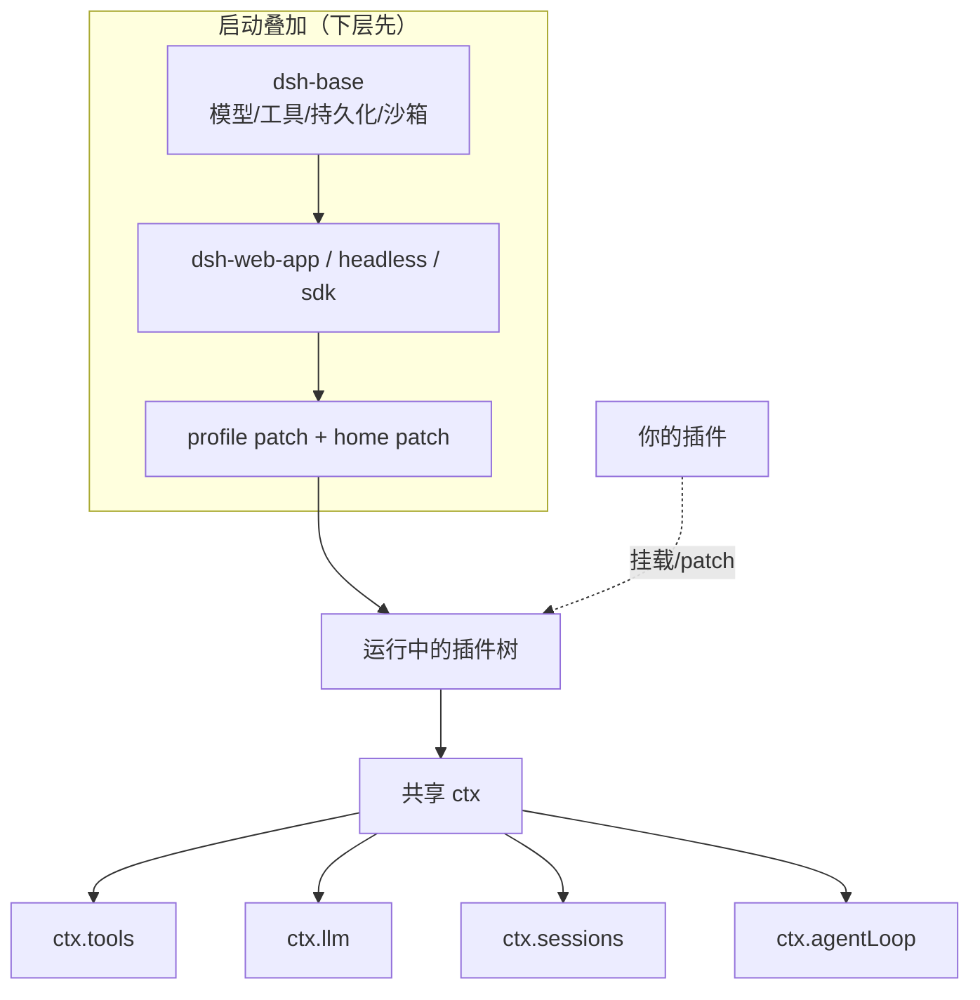

# 03 · 架构：一切皆插件的组合系统

> [01-introduction](01-introduction.md) 说了「一切皆插件」的结论。本章讲**它是怎么组织的**：
> Cordis 插件模型、profile/bundle 组合层、patch 机制。这是读懂 DSH 源码的钥匙。
> 实践对照：[harness-examples](../../code/07-frameworks/harness-examples/README.md)（真实 DSH 插件）。

## 一、问题背景：为什么不用一个大内核

传统软件有个「特权内核」，扩展要打补丁或改源码。Harness 的需求千差万别（本地/远程、Web/命令行、不同模型），
大内核要么臃肿要么不够灵活。DSH 的选择是：**没有特权内核，一切皆插件**。
模型适配器、工具注册表、会话日志、甚至 Agent Loop 本身都是插件，都能从配置替换。

这带来一个强大特性：**扩展 = 把插件挂到其他插件旁边**，而不是改内核。每个注册都是「副作用」，插件卸载时自动撤销。

## 二、核心概念：Cordis 与组合层

**Cordis**：DSH 底层的插件框架。插件向共享上下文（`ctx`）贡献服务、类型化事件、可逆副作用。
`ctx.tools`、`ctx.llm`、`ctx.sessions` 等都是插件注册的服务。

**Profile 与 Bundle**（DSH 的组装单位）：
- **Bundle（组合包）**：Cordis 配置项 + 挂载代码的分发格式。一个 bundle 插入的内容可被上层 patch。
- **Profile**：具名组装，列出叠放的 bundle，存用户自己的 `cordis.patch.yml`。随附 `web`/`headless`/`sdk`/`acp` 等。

**组合层顺序**（启动时依次叠加在空列表上）：
```text
profile 中有序的 bundle → 其 cordis.patch.yml → home patch → --patch overlay
```
`dsh-base` 是共享第一层（模型/工具/持久化/沙箱/审批/设置/凭据/遥测）；
`dsh-web-app` 加浏览器应用，`dsh-headless` 加一次性运行器，等等。

## 三、工作原理：patch 如何替换插件

一条 patch 按 **id** 定位某个条目，**替换其整个 config**，或插入新条目。这是「可替换」的实现机制：

```yaml
# 按 id 覆盖某个插件的完整配置
- id: tool-bash
  name: '@deepseek-ai/dsh-tool-bash'
  config: { ... }
# 或插入新插件
- insert:
    - id: my-plugin
      name: '@local/my-plugin'
      config: {}
```

**preset patch** 在目标声明的 `config.plugins` 内应用这些操作——这就是「Agent Preset」（让某个会话拥有不同能力集合）。
[harness-examples/review-preset](../../code/07-frameworks/harness-examples/review-preset/cordis.patch.yml) 正是用 insert 定义一个只读审查 Agent。

**查看本机配置树**：`dsh --profile web --dump-config` 打印的任何条目，都可被你的 patch 替换。

## 四、架构与流程



**图解关键**：组合层从 dsh-base 向上叠加，最终形成插件树，所有插件向共享 ctx 注册服务。
你的插件（虚线）通过挂载或 patch 加入，无需改内核。替换某层即改变产品形态（web→headless）。

## 五、代码实现：写一个真实插件

[harness-examples](../../code/07-frameworks/harness-examples/README.md) 有三种真实 DSH 插件：

| 类型 | 例子 | 机制 |
|---|---|---|
| Agent Preset | review-preset | preset patch 定义只读 Agent 能力集 |
| Host Plugin | medical-tool-plugin | `ctx.tools.register` 注册工具 |
| MCP Bundle | mcp-bundle-example | 配置型 bundle 接 MCP 服务器 |

以 Host Plugin 为例，核心就是向 ctx 注册：

```javascript
export function apply(ctx, config) {
  return ctx.effect(() => {
    const unregister = ctx.tools.register({ name, description, parameters, execute });
    return () => unregister();   // 副作用可逆：卸载时撤销
  });
}
```

**`ctx.effect` + 返回清理函数**正是「注册是副作用、卸载自动撤销」的体现。这与 minimal_harness 的集中式注册不同——
真实 DSH 每个插件管自己的注册与清理。

## 六、深入分析：设计取舍

**为什么一切皆插件？** 因为可演进性。换模型 = 换 llm 插件；换沙箱 = 换 sandbox 插件；加能力 = 挂新插件。
产品形态（web/headless/sdk）只是不同 bundle 组合。代价：理解成本高，要先懂 Cordis/ctx/事件模型。

**为什么 patch 替换整个 config 而非合并？** 因为可预测。整替意味着「你看到的就是全部」，不会有隐式合并的意外。
要保留原配置需显式重写——这是「明确优于隐式」。

**为什么注册是可逆副作用？** 因为插件要能热卸载（HMR）。如果注册不可逆，卸载后残留会污染系统。
`ctx.effect` 保证「挂载即注册、卸载即撤销」，支撑动态重载。

**与最小实现的差距**：minimal_harness 是单体教学骨架；真实 DSH 是插件组合系统。
先理解骨架（01/04），再理解组合（本章），是循序渐进的路径。

## 七、工程实践

- **本会话**就跑在 DSH 的 `desktop` profile 上（`$DSH_PROFILE=desktop`），你用的每个工具都是插件。
- **练习 1**：读 [review-preset](../../code/07-frameworks/harness-examples/review-preset/cordis.patch.yml)，指出它如何用 preset 限制能力。
- **练习 2**：用 `dsh --profile web --dump-config` 看本机配置树，找一个可替换的条目。
- **练习 3**：给 medical-tool-plugin 加一个新工具，体会 `ctx.tools.register` + `ctx.effect`。

## 八、本章总结

- **核心知识**：Cordis 插件模型；profile/bundle 组合层；patch 按 id 整替；preset；可逆副作用。
- **必须掌握的原理**：无特权内核；扩展=挂插件；注册可逆；组合层决定产品形态。
- **工程实践能力**：能读懂 cordis.patch.yml；能对照 harness-examples 写插件。
- **联系**：[02 核心概念](02-core-concepts.md)（seam/ctx）→ 本章（如何组织）→ 07 执行环境（seam 实例）。

## 九、参考资料

- DSH `architecture.zh.md`（Cordis/profile/组合包/patch，权威）、`cordis-primer.zh.md`
- [Cordis 框架](https://github.com/nicedoc/cordis)
- 实践对照：[harness-examples](../../code/07-frameworks/harness-examples/README.md)
