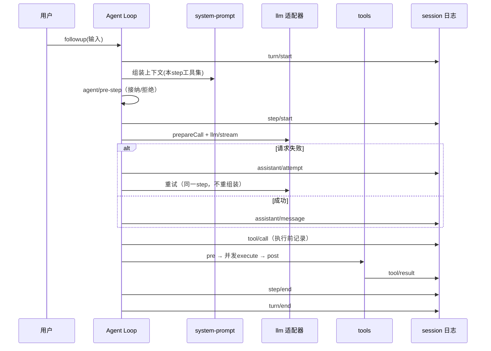

# 04 · 执行循环：一次请求如何变成行动

> 本章深入 Harness 的心脏——Agent Loop。[01-introduction](01-introduction.md) 建立了 step/turn 的直觉，
> 本章讲透真实循环的**完整生命周期、取消与重试语义、事件持久化**。
> 代码锚点：[execution_loop.py](../../code/11-harness-experiments/execution_loop.py)。

## 一、问题背景：一个 while 循环远远不够

看过 01 章的最小循环，你可能觉得 Agent Loop 不就是「while 没结束就继续调模型」吗？
真实系统里，这个朴素想法会在四个地方崩掉：

1. **取消时机**。用户点了「停止」，但模型请求正在异步进行。如果你直接 return，可能已经提交了半截系统提示词或用户消息——下次恢复时上下文就脏了。取消必须发生在**安全点**，且「不提交任何东西」。
2. **重试的边界**。模型超时了要重试，但重试**不能重新走一遍上下文组装和用户消息准入**——否则同一条用户消息会被记录两次，历史就重复了。重试只能在「已打开的 step 内」重发请求。
3. **过程可回放**。出了问题要能精确还原「第几步、调了什么工具、结果是什么」。这要求循环把每个关键节点写成**持久事件**，而不是只留最终答案。
4. **上下文会撑爆**。多轮之后历史超出模型窗口，循环必须能在请求前**压缩**（compaction），而不是直接报错。

DSH 的 `core/agent-loop` 正是把这四件事做对的驱动器。本章逐一拆解。

## 二、核心概念：精确理解循环的词汇

**step 与 turn 的精确边界**（DSH `architecture.zh.md`）：
- **step**：一次模型请求 + 它调用的工具。
- **turn**：零个或多个 step。在领取首条输入前打开，在「不再欠任何工作」时关闭。
- 注意「零个 step」是合法的：如果输入在 `agent/pre-step` 被拒绝，轮次会打开但**不花费任何 step** 就关闭。

**inbox 与 claim（领取）**：用户输入先进 inbox（收件箱），循环「领取」一条下一步输入 + 一条排队消息组成批次。
DSH 的 inbox 是持久投影——即使没有活跃 Agent，待处理输入也可读取。这解释了为什么你关掉页面再回来，输入还在。

**两类事件，两种用途**（这是理解 DSH 的关键分野）：
- **会话事件**（`session/event`：`turn/start`、`step/start`、`assistant/message`、`tool/call`、`tool/result`…）是**持久事实**，用于回放。
- **Agent 事件**（`agent/*`：`agent/pre-step`、`agent/request`、`agent/status`…）是**实时协调**，用于拦截/状态/续跑。
- SDK 要可回放 transcript 就消费 `session/event`；要实时控制就用 `agent/*`。

**waterfall 与 serial**：`agent/pre-step`、`agent/request`、`llm/stream`、`tools/*` 是**瀑布事件**——监听器必须调 `next()` 才传下去，可层层改写；`agent/turn-stopping` 是 **serial 事件**，没有 next()，是终止检查点。

**settlement（落定）**：成功的模型调用记为 `assistant/message`（嵌入精确的紧凑流）；失败/重试/取消记为 `assistant/attempt`（不进模型历史）。回放读这两种持久落定，实时 UI 读瞬态 `agent/assistant-stream`。**进程若在落定前硬中断，不留持久 attempt**——这保证了日志的一致性。

## 三、工作原理：完整生命周期

DSH `agent-lifecycle.zh.md` 的时序，提炼为主干：

```text
followup(content) → inbox 入队 → 唤醒驱动器 → agent/status running
turn/start
  领取下一步输入 + 一条排队消息
  resolve 工具集（每个候选 step 一次）
  system-prompt/assemble 瀑布（带本 step 工具集）
  agent/pre-step 瀑布 → 拒绝 | enter(messages)
    ├─ 拒绝/空/失败 → 批次保持移除，打开的 turn 不花 step
    └─ enter：
       step/start
       agent/request 瀑布 → prepareCall(config, signal)
         （任一异步阶段取消 → 不提交 system 也不提交 users）
       提交 system/message + user/message + request/header/context
       从日志 derive 并 freeze 请求
       llm/stream 瀑布 → StreamChunk* → agent/assistant-stream chunk*
         ├─ 失败 → assistant/attempt → agent/request-error 瀑布
         │         → 重试（在打开的 step 内，不重复 pre-step/users）或保留错误
         └─ 成功 → assistant/message
       按 executionMode 分类工具调用（屏障 + 有界滚动池）
         tool/call → 有序 pre、并发 execute → tool/result（有序 post）
       step/end → 释放本 step 工具集
  自然停止且 inbox 空 → agent/turn-stopping（serial 终止检查点）
  有下一步输入 → 再领取 → 再 pre-step …
turn/end → agent/status idle
```

三个最容易忽略但至关重要的语义：

1. **取消不提交**：`prepareCall` 的两个异步阶段中任一被取消，系统提示词和用户消息**都不提交**。这就是「安全点」的含义——要么完整提交一步，要么什么都不留。
2. **重试不重组装**：上下文溢出或请求失败后的重试，「准备调用并协调已渲染的组装结果，**不重复组装、pre-step 或用户消息准入**」。这避免了历史重复。
3. **压缩在请求前**：`dsh-compaction-basic` 通过 `agent/pre-step` 在 derive 请求**之前**处理上下文压力（先剪枝工具结果，再摘要），而不是等请求失败才补救。

## 四、架构与流程



**图解关键**：注意所有持久事实都流向 `session 日志`（S），而 `agent/pre-step` 是循环内部的实时拦截。
`tool/call` 在 execute **之前**就写入日志——即使工具执行中途崩溃，日志里也有「发起过这次调用」的事实，
恢复时据此补记缺失的工具结果（DSH「失败步骤记录缺失的工具结果」）。这条「先记录后执行」是可靠性的基石。

## 五、代码实现：把语义跑出来

[execution_loop.py](../../code/11-harness-experiments/execution_loop.py) 用约 130 行演示四个机制，离线可跑：

```bash
cd code/11-harness-experiments && ../../.venv/bin/python execution_loop.py
```

**实测事件轨迹**（一个「先失败重试、再调两个工具、最后回答」的任务）：

```text
turn_start
step_start
attempt      模型超时        ← 失败记为 attempt
tool_call    query_rules     ← 重试成功后调工具
tool_result  query_rules
step_end     tool
step_start
tool_call    query_people
tool_result  query_people
step_end     tool
step_start
step_end     answer
turn_end     natural
```

**关键代码讲解**——取消安全点与重试边界：

```python
while steps < self.max_steps:
    if signal.cancelled:                      # 安全点：取消则不提交任何请求
        self.emit("turn_end", reason="cancelled")
        return "[已取消]"
    steps += 1
    self.emit("step_start", step=steps)
    decision = None
    for attempt in range(self.max_retries + 1):   # 重试在打开的 step 内
        try:
            decision = self.model(self.history, list(self.tools))
            break
        except Exception as exc:
            self.emit("attempt", step=steps, error=str(exc))  # 失败记 attempt
            if attempt == self.max_retries:
                self.emit("turn_end", reason="error"); raise
    if "tool_call" in decision:
        self.emit("tool_call", step=steps, name=name)   # 先记录
        result = self.tools[name]({})                    # 后执行
        ...
        continue                                         # 欠回填 → 下一 step
    ...
    self.emit("turn_end", reason="natural"); return answer
```

对照真实语义：
- **`step_start` 只 emit 一次**，重试在内层 for 循环——所以重试**不增加 step 数**（selftest 断言 `step_start` 恰好 3 次：2 工具 + 1 回答，尽管模型失败了 1 次）。这正是「重试不重复组装」的体现。
- **取消检查在 step 开始前**——对应「不提交半截请求」。
- **`tool_call` 先于工具执行 emit**——对应「先记录后执行」。
- **`max_steps` 触发 `turn_end reason=max_steps`**——硬停止边界。

`selftest()` 断言：多 step 计数正确、attempt 被记录、取消停在 cancelled、max_steps 触发上限。全部通过。

## 六、深入分析：为什么这样设计

**为什么重试不能重走 pre-step？** 因为 `agent/pre-step` 会准入用户消息、可能改写上下文。重走一遍会把同一条用户消息再准入一次，历史出现重复，模型看到的上下文就错了。DSH 把「组装/准入」与「发请求」分离，重试只重发后者。

**为什么取消要「什么都不提交」？** 因为日志是真相源。如果取消了却提交了半截 system/user，恢复时 derive 出的历史就包含一个从未完成的请求的输入，污染后续所有步骤。要么完整一步，要么零痕迹。

**为什么 compaction 放在 pre-step 而非请求失败后？** 主动在请求前压缩，避免「请求→溢出→失败→重试」的浪费与不确定性。DSH 区分两条路径：`agent/pre-step` 处理常规压力，`agent/request-error` 只处理规范的上下文溢出。

**最小实现省略了什么？** 并发工具执行的屏障与滚动池、流式 chunk、surface replacement generation、子代理委派。这些是 06（工具并发）和后续章节的内容。先掌握「step/turn + 取消 + 重试 + 事件」主干，再逐项深入。

## 七、工程实践

- **[teaching-agent/m05](../../projects/teaching-agent/m05_workflow.py)** 的 `recursion_limit` 与 `MAX_CLARIFY_ROUNDS` 就是本章「停止条件」的业务版；`SqliteSaver` 是「事件持久化/恢复」的简化版。
- **练习 1**：把 execution_loop 的 `max_retries` 设为 0，跑 flaky 模型，观察 attempt 后直接 turn_end error。
- **练习 2**：在工具执行中途 `signal.cancel()`，思考当前极简版能否做到「不提交半截」——体会真实 DSH 为何要把取消检查放在 prepareCall 的异步阶段。
- **练习 3**：给循环加一个「历史超过 N 条就摘要」的 pre-step 压缩钩子，模拟 compaction。

## 八、本章总结

- **核心知识**：step/turn 精确边界；inbox/claim；会话事件（持久）vs agent 事件（实时）；settlement（message vs attempt）。
- **必须掌握的原理**：取消不提交、重试不重组装、先记录后执行、压缩在请求前。
- **工程实践能力**：能跑通并讲解 execution_loop 的事件轨迹；能指出 teaching-agent 里对应的停止/持久化机制。
- **联系**：01 建立直觉 → 本章深入循环 → [06 工具工程](06-tool-engineering.md) 深入工具流水线 → 08 错误恢复与 Checkpoint。

## 九、参考资料

- DSH `agent-lifecycle.zh.md`（轮次/步骤时序图，权威）、`architecture.zh.md#turn-flow`（轮次流程）
- 本章代码锚点：[execution_loop.py](../../code/11-harness-experiments/execution_loop.py)
- 业务对照：[teaching-agent/m05_workflow.py](../../projects/teaching-agent/m05_workflow.py)
