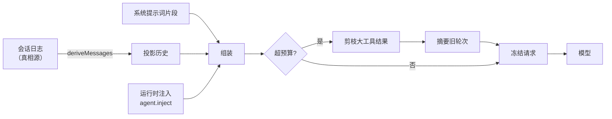

# 05 · 上下文工程：模型看到什么、何时看到

> 本章讲 Harness 如何管理「模型的视野」。[04 执行循环](04-execution-loop.md) 提到「从日志冻结请求」，
> 本章展开：上下文如何组装、如何压缩、运行时事实如何注入。
> 代码锚点：[context_window.py](../../code/11-harness-experiments/context_window.py)。

## 一、问题背景：上下文不是「把历史塞进去」

初学者常以为上下文管理就是「把对话历史拼到 prompt 里」。真实系统里这会出三个问题：

1. **窗口会满**。多轮 + 大工具结果，很快超出模型上下文窗口，请求直接失败。
2. **该看的没看，不该看的看了**。模型需要当前时间、工作目录等**运行时事实**，但这些不该混进对话历史；而某些敏感内容不该进模型视野。
3. **历史会「脏」**。如果直接改历史变量来压缩，就破坏了「日志即真相」——回放时还原不出原始过程。

**上下文工程（Context Engineering）就是系统性地决定：模型在每次请求时看到什么、以什么顺序看、看不到什么。**
DSH 把这件事拆成三个机制：组装（assembly）、压缩（compaction）、注入（inject）。

## 二、核心概念：三个机制

**组装（assembly）**：模型上下文 = 系统提示词片段 + 从日志投影的历史 + 运行时上下文。
DSH 由 `ctx.systemPrompt`（组装注册表）+ `deriveMessages()`（从日志投影历史）协作完成。
关键：**历史不是存出来的变量，而是从日志投影出来的**——这保证了与「日志即真相」一致。

**压缩（compaction）**：历史超预算时缩减体积。DSH `compaction-basic` 的顺序是：
**先剪枝过大的工具结果**（`compaction-tool-result-pruner`，把大结果替换为可恢复的占位），
**再摘要旧轮次**。而且压缩发生在 `agent/pre-step`——**请求之前**主动处理，不是等失败才补救。

**注入（inject）**：把运行时事实（时间、目录、提醒）送进**下一次获准的请求**，但**不改写历史**。
DSH `agent.inject()` 落到 `agent/inbox/spliced`，进入下一步。注入的内容是「附加视野」，不是对话的一部分。

> 术语区分：**压缩 vs 剪枝**。剪枝（pruning）是针对单个过大工具结果的表层替换；
> 压缩（compaction）是更广义的体积缩减，包含剪枝 + 摘要。DSH 先剪枝后摘要，因为剪枝无损可恢复、代价小。

## 三、工作原理：一次请求的上下文如何成形

```text
请求前（agent/pre-step）：
  1. 检测上下文压力（token-meter 测量）
  2. 超预算 → 先剪枝过大工具结果（替换为占位，保留恢复线索）
  3. 仍超 → 摘要旧轮次（保留最近若干条）
组装（system-prompt/assemble）：
  4. 系统提示词片段（角色/规则/工具 schema）
  5. + 从日志投影的历史（deriveMessages）
  6. + 运行时注入（agent.inject 的事实，置末尾）
  7. 冻结为不可变请求 → 发往模型
```

两个关键设计：
- **压缩在请求前**：避免「请求→溢出→失败→重试」的浪费。DSH 区分常规压力（pre-step）与规范上下文溢出（request-error）两条路径。
- **注入不进历史**：运行时事实只影响当前请求，不污染日志。回放时历史仍是干净的对话。

## 四、架构与流程



**图解关键**：日志是唯一历史来源（左），注入是旁路附加（不回流日志）。压缩是组装路径上的一个条件分支，
先剪枝后摘要。最终冻结的请求是不可变的——这呼应 04 章「重试不重组装」。

## 五、代码实现：把三机制跑出来

[context_window.py](../../code/11-harness-experiments/context_window.py) 约 100 行演示，离线可跑：

```bash
cd code/11-harness-experiments && ../../.venv/bin/python context_window.py
```

**实测**（一个大工具结果 + 小预算）：

```text
组装后消息数： 6 | 估算 token： 102
末条（运行时注入）： [运行时上下文] 当前时间 2026-11-17；工作目录 /repo
压缩动作： {'pruned': 1, 'summarized': 0}
压缩后 token： 22 | 预算： 50
```

**关键代码讲解**——组装与压缩：

```python
def assemble(self):
    msgs = [{"role": "system", "content": "\n".join(self.system_sections)}]
    msgs += self._project_history()              # 历史从日志投影，不是存变量
    if self.injected:
        msgs.append({"role": "system", "content": "[运行时上下文] " + "；".join(self.injected)})
    return msgs                                  # 注入置末尾，不进 self.events

def compact(self):
    for e in self.events:                        # 1. 先剪枝大工具结果
        if e["kind"] == "tool" and est_tokens(e["content"]) > 40:
            e["content"] = f"[工具结果已剪枝，原长 {len(e['content'])} 字符，可按事件序号恢复]"
    if self._size(self.assemble()) > self.budget and len(self.events) > 4:
        old, recent = self.events[:-4], self.events[-4:]   # 2. 再摘要旧轮次
        self.events = [{"kind": "user", "content": f"[摘要：earlier {len(old)} 条…]"}] + recent
```

三个细节：
- **`_project_history()` 每次从 `self.events` 重算**——历史是投影，不是独立变量（日志即真相）。
- **注入只进 `assemble()` 的输出，不进 `self.events`**——selftest 断言「注入内容不在历史里」。
- **剪枝保留「可按事件序号恢复」线索**——无损可恢复，这是 DSH 剪枝优于直接删除的地方。

## 六、深入分析：设计取舍

**为什么先剪枝后摘要？** 剪枝针对单个大结果，代价小、可恢复；摘要要调模型、有信息损失。
先做便宜的剪枝，往往就够了，不必动用昂贵的摘要。这是「成本递增」的处理顺序。

**为什么注入不进历史？** 运行时事实（如「当前时间」）每次都变，若进历史会累积一堆过时提醒，污染上下文。
注入是「即时视野」，用完即弃。DSH 把它落到 inbox 而非日志，正是此意。

**为什么压缩在请求前而非失败后？** 主动压缩避免一次必然失败的请求（省 token、省延迟、省不确定性）。
被动重试是兜底，主动压缩是常态。

**最小实现省略了什么？** token-meter 的精确回放测量、摘要的模型调用、surface replacement generation、
多模态图片省略。本章先掌握「组装/压缩/注入」三机制与「日志投影/注入旁路/先剪枝后摘要」三原则。

## 七、工程实践

- **[teaching-agent/m02](../../projects/teaching-agent/m02_intent_slots.py)** 的 prompt 组装是「组装」的业务版；
  其 `_normalize` 清洗可视为一种「内容治理」。
- **练习 1**：把 context_window 的预算调到极小，观察剪枝后仍超预算触发摘要。
- **练习 2**：给 assemble 加一个「敏感内容过滤」钩子，体会「不该看的看了」如何防。
- **练习 3**：思考——如果摘要直接改写日志原始事件会破坏什么？（提示：回放一致性）

## 八、本章总结

- **核心知识**：上下文 = 系统片段 + 日志投影历史 + 运行时注入；压缩先剪枝后摘要；注入不进历史。
- **必须掌握的原理**：历史是投影不是变量；压缩在请求前；注入是旁路即时视野。
- **工程实践能力**：能跑通 context_window 并解释三机制；能对照 teaching-agent 的 prompt 组装。
- **联系**：[04 执行循环](04-execution-loop.md)（冻结请求）→ 本章（上下文成形）→ 08 错误恢复（日志持久）。

## 九、参考资料

- DSH `architecture.zh.md`（会话日志/投影 seam）、`agent-lifecycle.zh.md`（compaction 在 pre-step）、`capability-seams.zh.md`（ctx.systemPrompt/compaction/tokenMeter/toolResultPruner）
- 本章代码锚点：[context_window.py](../../code/11-harness-experiments/context_window.py)
