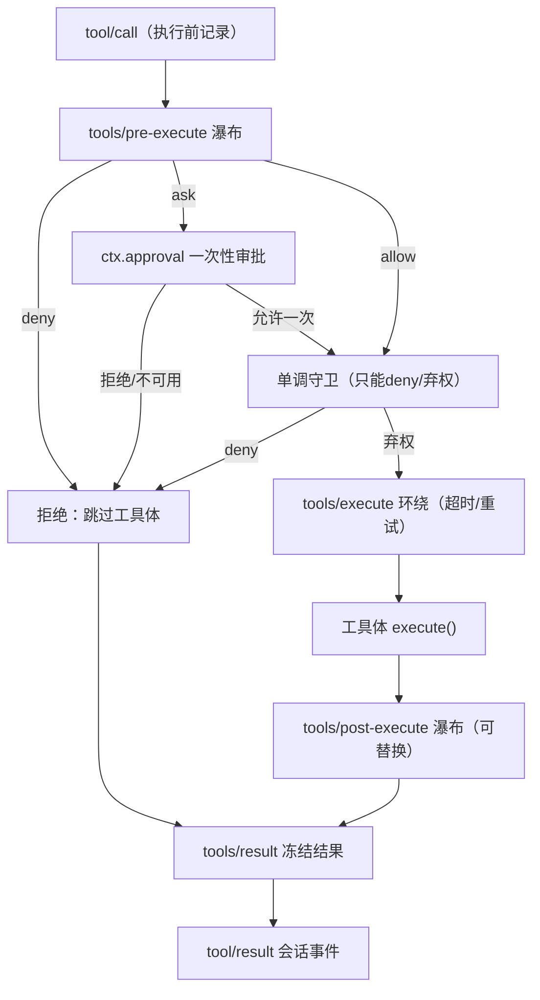

# 06 · 工具工程：把「调用」变成「受控流水线」

> 本章讲透 Harness 如何执行工具。[03-tool-use](../03-tool-use/README.md) 讲「模型怎么决定调工具」，
> 本章讲「Harness 怎么**安全可控地执行**这个调用」。
> 代码锚点：[tool_pipeline.py](../../code/11-harness-experiments/tool_pipeline.py)。

## 一、问题背景：直接调用工具会出什么事

最朴素的工具执行是：模型说调 `delete_file`，你就 `delete_file(args)`。这在生产里是灾难：

- 模型可能调一个**危险工具**（删库、转账），没人拦。
- 模型可能**伪造身份**（args 里塞 `userId=admin`）越权。
- 工具可能**超时卡死**，拖垮整个循环。
- 工具返回一坨原始数据，**撑爆上下文**或泄漏敏感信息。
- 出了问题，**不知道当时调了什么、为什么放行**。

DSH 的答案是：**工具执行不是「调用」，而是一条「流水线」**。每个调用穿过一系列可插拔的关卡，
策略（权限/审批/沙箱/超时/审计）挂在关卡上，而不是写死在每个工具里。这样**加一条安全策略，所有工具自动生效**，
工具本身不需要知道策略的存在。这就是 `tool-execution-pipeline.zh.md` 描述的共享调用流水线。

## 二、核心概念：流水线的关卡

DSH 工具流水线的真实关卡（按顺序）：

| 关卡 | 类型 | 职责 | 关键约束 |
|---|---|---|---|
| `tool/call` | 会话事件 | **执行前**记录调用 | 先记录后执行 |
| `tools/pre-execute` | 瀑布 | 钩子/权限/沙箱 | 可 allow / deny / **ask** |
| 单调守卫（guards） | 注册守卫 | 所有者策略 | **只能 deny 或弃权，不能放行** |
| `ctx.approval` | 一次性审批 | 询问用户 | **缺失/无法回答 → 拒绝**（fail-closed） |
| `tools/execute` | 瀑布（环绕） | 超时/重试/指标 | 包裹工具体 |
| 工具体 `execute()` | 工具自身 | 真正做事 | 经 `fs/*` 守卫（文件改动） |
| `tools/post-execute` | 瀑布 | 接受/拦截/替换/补上下文 | 可变换结果 |
| `tools/result` | 同步通知 | **冻结的权威结果** | 唯一面向模型的结论 |

三个必须理解的术语：

- **瀑布（waterfall）**：监听器层层处理，必须调 `next()` 传下去，可改写调用。pre/execute/post 都是瀑布。
- **单调守卫（monotonic guard）**：「单调」指它**只能收紧、不能放松**——只能拒绝或弃权，绝不能把已被拒的调用放行。这保证了安全策略不会被某个守卫意外撤销。
- **fail-closed（失败即关闭）**：审批器缺失或无法回答时，**默认拒绝**而非默认放行。安全系统的铁律：不确定就拒绝。

## 三、工作原理：一个调用的完整旅程

```text
模型输出 tool-call 块
  → tool/call 会话事件（执行前记录）+ UI 待定卡片
  → tools/pre-execute 瀑布
      ├─ deny → 跳过工具体
      ├─ ask  → ctx.approval 一次性审批
      │          ├─ 允许一次 → 继续
      │          └─ 拒绝/取消/不可用 → 跳过工具体（fail-closed）
      └─ allow → 单调守卫
                  ├─ deny → 跳过工具体
                  └─ 弃权 → tools/execute 环绕（超时/重试）→ 工具体
                              → fs/write-intent 守卫（仅文件改动）
  → projectContent（执行准备的内容）
  → tools/post-execute 瀑布（接受/拦截/替换/补上下文）
  → 规范化（快照失败 → isError）
  → finalizeContent（仅限内容的最终不变式）
  → tools/result（冻结权威结果）→ tool/result 会话事件 + UI 完成卡片
  → 批次落定 → additionalContexts 按 FIFO 注入 user/message
```

两个贯穿全程的不变式：

1. **`tool/call` 先于执行，`tool/result` 是唯一面向模型的结论**。中间无论多少关卡，模型最终只看到一个 tool/result。这让上下文干净、可回放。
2. **拒绝会跳过工具体**。被 pre/guard/approval 拒的调用，工具体**根本不运行**——危险操作没有「执行了再回滚」的机会。

## 四、架构与流程



**图解关键**：所有「拒绝」分支都汇到「跳过工具体」，但最终**仍产生一个 tool/result**（标记 denied）——
模型需要知道「这次调用被拒了」，而不是凭空消失。`post-execute` 在工具体之后，可以替换结果（如脱敏、截断），
冻结后的结果才是模型看到的。这条流水线让「权限/审批/超时/审计/脱敏」各自独立挂载，互不耦合。

## 五、代码实现：把流水线跑出来

[tool_pipeline.py](../../code/11-harness-experiments/tool_pipeline.py) 用约 120 行镜像这条流水线，离线可跑：

```bash
cd code/11-harness-experiments && ../../.venv/bin/python tool_pipeline.py
```

**关键代码讲解**——execute 方法的关卡顺序：

```python
def execute(self, name, args):
    self.events.append({"kind": "tool_call", "name": name})   # ① 执行前记录
    if name not in self.bodies: raise Denied(...)
    verdict = "allow"
    for hook in self.pre_hooks:                               # ② pre-execute 瀑布
        v = hook(name, args)
        if v == "deny": verdict = "deny"; break
        if v == "ask": verdict = "ask"
    if verdict == "deny": ...; raise Denied("pre-execute 拒绝")
    if verdict == "ask":                                      # ③ 审批 fail-closed
        if self.approval is None or not self.approval(name, args):
            ...; raise Denied("审批未通过（fail-closed）")
    for guard in self.guards:                                 # ④ 单调守卫
        if guard(name, args) == "deny": ...; raise Denied("守卫拒绝")
    self.body_ran.append(name)
    result = self.bodies[name](args)                          # ⑤ 工具体
    for hook in self.post_hooks:                              # ⑥ post 替换
        result = hook(name, result)
    self.events.append({"kind": "tool_result", "content": result})  # ⑦ 冻结结果
    return result
```

**实测验证三个不变式**（selftest 逐条断言）：

```text
正常调用： [已审计] 时长 30~240 分钟        ← post 钩子替换了结果
审批 fail-closed：拒绝 | 工具体是否运行: False  ← ask 无审批器 → 拒绝，body 没跑
单调守卫拒绝：守卫拒绝                      ← guard deny
事件顺序：['tool_call', 'tool_result']      ← call 先于 result
```

- **fail-closed 实证**：`p3` 设了 `ask` 但 `approval=None`，调用被拒且 `body_ran==[]`——危险工具体根本没运行。
- **单调性实证**：守卫只能返回 deny/abstain，代码里没有「allow」分支——结构上就不可能放行被拒调用。
- **冻结实证**：`p.events[-1]["content"]` 是 post 处理**后**的结果（`raw!`），不是原始 `raw`。

## 六、深入分析：设计取舍

**为什么用流水线而不是在每个工具里写检查？** 因为策略要**跨工具统一**。如果在每个工具里写权限检查，
新增一条策略要改 N 个工具，还容易漏。流水线让策略挂一次、全局生效，工具与策略解耦。
DSH 原文：「钩子便可跨越不同工具系列，而无需让工具与某个策略服务耦合」。代价：理解流水线顺序的学习成本。

**为什么守卫必须单调？** 假设守卫能放行，那么一个恶意/错误的守卫就能撤销前面所有安全策略。
单调（只能收紧）保证了**安全性只增不减**——这是安全系统的组合性原则。

**为什么审批 fail-closed？** 审批器可能不在（headless 模式）、可能超时、可能用户没回答。
这些「不确定」情况如果默认放行，等于没有审批。fail-closed 把「不确定」一律当「拒绝」，宁可错杀不可放过。

**为什么 post-execute 能替换结果？** 因为原始工具输出可能含敏感数据或过长。post 钩子做脱敏/截断/补上下文，
模型只看到处理后的冻结结果。这把「数据治理」也从工具本体解耦出来。

**最小实现省略了什么？** 并发执行的屏障/滚动池、fs/write-intent 文件守卫、projectContent/finalizeContent 的内容不变式、
PTC 子调用流水线。这些是真实 DSH 的精细处，本章先掌握「关卡顺序 + 三不变式」主干。

## 七、工程实践

- **[teaching-agent/m04](../../projects/teaching-agent/m04_tools.py)** 的 `ToolRegistry.call` 五步校验
  （白名单→拒身份字段→次数限制→参数校验→执行+审计）正是本章流水线的业务简化版。
  对照看：m04 把策略写在 call 里（集中），DSH 把策略挂在瀑布上（可插拔）——后者扩展性更强。
- **练习 1**：给 tool_pipeline 加一个 post 钩子，把结果里的手机号脱敏，验证冻结结果是脱敏后的。
- **练习 2**：加一个「危险工具需审批」的 pre 钩子（`delete_*` 返回 ask），分别测 approval=True/False/None 三种情况。
- **练习 3**：思考——如果一个守卫返回 allow 会破坏什么？试着加一个 allow 守卫，体会单调性为何必要。

## 八、本章总结

- **核心知识**：工具执行是流水线（pre→守卫→审批→execute→post→冻结结果）；瀑布/单调守卫/fail-closed 三概念。
- **必须掌握的原理**：先记录后执行；拒绝跳过工具体；守卫只收紧；审批不确定即拒；模型只见一个冻结结果。
- **工程实践能力**：能跑通 tool_pipeline 并验证三不变式；能对照 teaching-agent/m04 理解集中式 vs 可插拔策略。
- **联系**：[04 执行循环](04-execution-loop.md)（工具在 step 内被调用）→ 本章（工具如何被受控执行）→ 07 执行环境（沙箱）→ 09 安全边界。

## 九、参考资料

- DSH `tool-execution-pipeline.zh.md`（共享调用流水线，权威）、`capability-seams.zh.md`（能力 seam）
- 本章代码锚点：[tool_pipeline.py](../../code/11-harness-experiments/tool_pipeline.py)
- 业务对照：[teaching-agent/m04_tools.py](../../projects/teaching-agent/m04_tools.py)、[其文档 04-工具调用与业务工具设计](../../projects/teaching-agent/docs/04-工具调用与业务工具设计.md)
