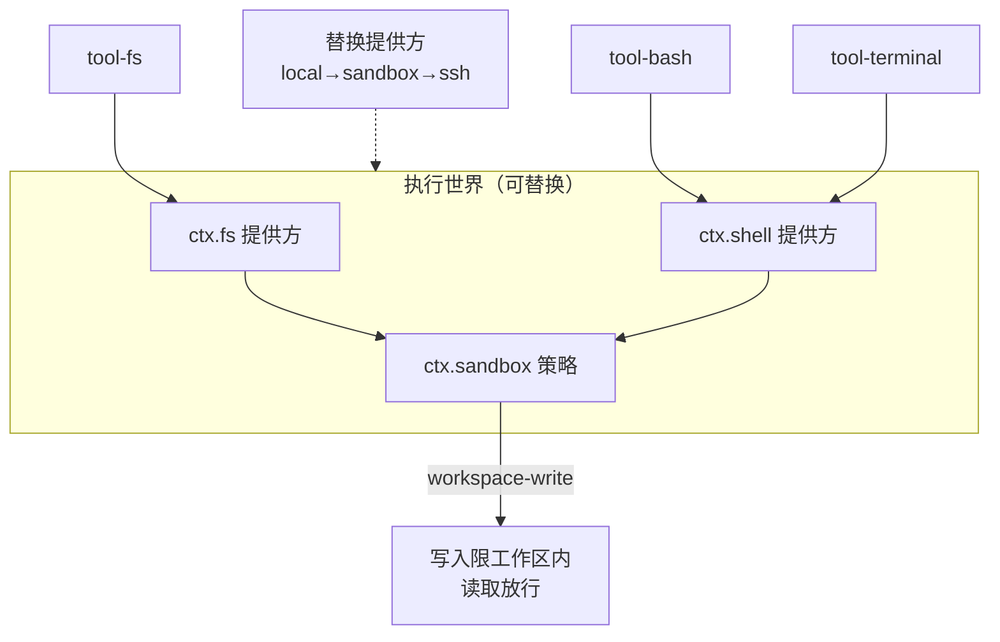

# 07 · 执行环境：Shell、文件系统与沙箱

> 本章讲 Harness 如何**安全地执行行动**。[06 工具工程](06-tool-engineering.md) 讲工具调用的把关流水线，
> 本章讲流水线最后一环——工具体真正动手时，所处的「执行世界」如何被隔离。
> 代码锚点：[sandbox_env.py](../../code/11-harness-experiments/sandbox_env.py)。

## 一、问题背景：Agent 会真的「动手」

Coding Agent 要读文件、改代码、跑命令。这意味着它**真的能删你的文件、跑危险命令、读敏感配置**。
如果执行环境不设防，一个被注入的 Agent 就能 `rm -rf /` 或把密钥发到外网。

传统做法是给每个工具单独写安全检查。但这有个根本问题：**工具五花八门（bash/fs/terminal/LSP），
逐个设防既容易漏，又无法统一升级策略**。DSH 的答案是把「执行环境」本身做成可替换的**能力 seam**，
让所有工具共享同一个受控的「执行世界」。

## 二、核心概念：能力 seam 与执行世界

**能力 seam（capability seam）**：一项可替换能力，由三角色构成——
**Service Definition**（声明接口）、**Service Provider**（实现）、**Consumer**（使用方，通常是工具）。
替换 Provider 就能改变整个产品的行为，而 Consumer 不用改。

DSH 执行环境相关的 seam（`capability-seams.zh.md`）：

| seam | 职责 | 实现 |
|---|---|---|
| `ctx.fs` | 文件系统 | fs-local / fs-sandbox / fs-ssh |
| `ctx.shell` | bash 执行 | bash-local / bash-sandbox |
| `ctx.subprocess` | 子进程 | subprocess-local / subprocess-ssh |
| `ctx.sandbox` | 进程沙箱 | sandbox-local / sandbox-ssh / windows-acl |
| `ctx.workingDirectory` | 会话工作目录 | working-directory |

**最关键的设计**（架构文档原话）：**文件系统与进程提供方共享同一个「执行世界」**。
把它们指向远程沙箱，**Bash、PTY、LSP 就一并搬过去了**，无需为每个工具单独 fork。
这就是 seam 的威力：改一处，全局生效。

**沙箱策略（sandbox-policy）**：定义每次调用的围栏。常见模式 `workspace-write`——
**写入限制在工作区根内，读取放行**。本仓库这个 Harness 会话就用 workspace-write：我只能写 `/Users/jsjchai/agent-lab`，越界写入会被拒。

## 三、工作原理：一次文件写入如何被围栏

```text
工具发起 fs.write(path, content)
  → ctx.fs 提供方（当前是 fs-sandbox）
  → 检查 path 是否在 workspace 根内
      ├─ 在 → 写入放行
      └─ 不在 → 拒绝（Denied），写入不生效
  → fs-observation-policy 事件门（先读后编辑检查）
shell.run(cmd) 同理：cwd 被限定在 workspace，进程经 ctx.sandbox 包装 argv
```

两个要点：
- **读放行、写围栏**：sandbox 通常限制破坏性操作（写/删），读取相对宽松（但仍可配）。
- **fs 与 shell 共享围栏**：换了 sandbox 提供方，文件写入和命令执行**同时**受限，不存在「文件管住了但 shell 没管住」的漏洞。

## 四、架构与流程



**图解关键**：所有执行类工具（tool-fs/tool-bash/tool-terminal）都消费同一组 seam。
虚线表示「替换提供方」——把整个 World 从 local 换成 sandbox 或 ssh，所有工具的执行环境一起改变。
这就是「共享执行世界」：不是每个工具各管各的，而是统一一个可插拔的世界。

## 五、代码实现：提供方替换跑出来

[sandbox_env.py](../../code/11-harness-experiments/sandbox_env.py) 约 100 行演示 seam 替换，离线可跑（不执行真实 shell，教学骨架）：

```bash
cd code/11-harness-experiments && ../../.venv/bin/python sandbox_env.py
```

**实测**：

```text
本地世界写 /etc/passwd： 允许
沙箱世界写 /repo/a.py： 允许
沙箱世界写 /etc/passwd： 拒绝 -> 写入越界：/etc/passwd 不在 /repo 内
同一 shell 在两个世界的 cwd：
  [cwd=/] $ ls          ← 本地世界
  [cwd=/repo] $ ls      ← 沙箱世界（cwd 受限）
```

**关键代码讲解**——围栏与共享世界：

```python
@dataclass
class SandboxFS:                      # fs-sandbox 类比
    workspace: str
    def write(self, path, content):
        if not path.startswith(self.workspace.rstrip("/") + "/"):
            raise Denied(f"写入越界：{path} 不在 {self.workspace} 内")
        self.files[path] = content
    def read(self, path):             # 读取放行
        return self.files.get(path, "")

@dataclass
class ExecutionWorld:                 # fs + shell 共享的执行世界
    fs: object
    workspace: str | None = None
    def cwd(self): return self.workspace or "/"
    def shell(self): return Shell(self)   # shell 复用同一 world 的 cwd
```

- **`SandboxFS.write` 的越界检查**就是 workspace-write 围栏；`read` 不检查（读放行）。
- **`ExecutionWorld` 把 fs 和 shell 绑在一起**：`shell().run()` 的 cwd 来自同一个 world——
  替换 world 即同时替换 fs 和 shell 的行为（selftest 断言 local 写任意路径成功、sandbox 越界被拒）。

## 六、深入分析：设计取舍

**为什么用 seam 而非每工具设防？** 因为执行环境是**横切关注点**。seam 让「隔离」成为可插拔的一层，
所有工具自动继承。新增一个工具不用重新写沙箱逻辑；升级沙箱策略不用改工具。代价：要先理解 seam 抽象。

**为什么 fs 和进程要共享世界？** 因为隔离必须**无死角**。如果 fs 管住了但 shell 能绕过（比如 bash 直接写文件），
围栏就形同虚设。共享世界保证「要么都受限，要么都自由」，不存在旁路。DSH 的 ssh seam 同理：
fs-ssh/subprocess-ssh/sandbox-ssh 共享一条 SSH 连接，把整个执行世界搬到远程。

**为什么读放行写围栏？** 因为破坏性来自写/删/执行，读取的风险相对可控（且 Agent 必须能读才能工作）。
这是「最小权限」的实用折中——不过度限制影响可用性，又守住破坏性操作的边界。

**最小实现省略了什么？** 真实进程沙箱（seatbelt/landlock/ACL）、argv 包装、PTY 隔离、fs 先读后编辑守卫、
远程 ssh 世界。本章先掌握「seam 三角色 + 共享执行世界 + workspace-write 围栏」主干。

## 七、工程实践

- **本 Harness 会话**就是 workspace-write 的实例：我只能写 agent-lab 工作区，越界写入被沙箱拒绝（你可从会话策略看到）。
- **[teaching-agent/m04](../../projects/teaching-agent/m04_tools.py)** 的组织权限校验是「业务层围栏」，与本章「执行层围栏」互补——一个管「能访问哪些数据」，一个管「能写哪些路径」。
- **练习 1**：给 SandboxFS 加「禁止写 .env 文件」规则，体会细粒度策略。
- **练习 2**：实现一个 `RemoteWorld`（模拟 ssh），让 fs 和 shell 都指向「远程」，验证共享世界。
- **练习 3**：思考——如果 shell 不经过 ExecutionWorld 而直接执行，会破坏什么？

## 八、本章总结

- **核心知识**：能力 seam 三角色（Definition/Provider/Consumer）；fs/shell/subprocess/sandbox seam；共享执行世界。
- **必须掌握的原理**：替换提供方全局生效；fs 与进程共享围栏无死角；workspace-write 读放行写围栏。
- **工程实践能力**：能跑通 sandbox_env 并解释提供方替换；能指出本 Harness 的 workspace-write 实例。
- **联系**：[06 工具工程](06-tool-engineering.md)（流水线把关）→ 本章（执行环境隔离）→ 09 安全边界（审批/权限）。

## 九、参考资料

- DSH `capability-seams.zh.md`（ctx.fs/shell/subprocess/sandbox/workingDirectory，权威）、`architecture.zh.md`（共享执行世界）
- 本章代码锚点：[sandbox_env.py](../../code/11-harness-experiments/sandbox_env.py)
- 业务对照：[teaching-agent/m04_tools.py](../../projects/teaching-agent/m04_tools.py)
