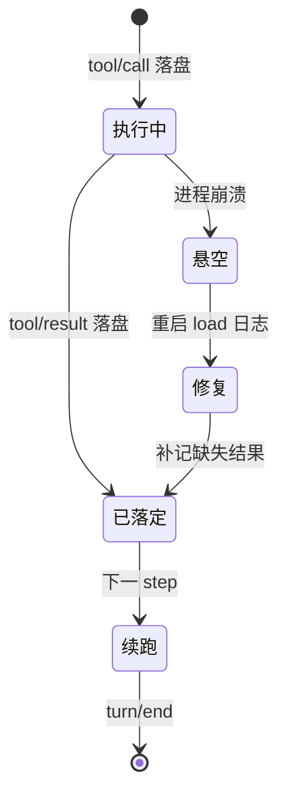

# 08 · 错误恢复与 Checkpoint

> 本章讲 Harness 如何**从失败和中断中活下来**。[04 执行循环](04-execution-loop.md) 讲了重试，
> 本章讲更重的场景：进程崩溃、长任务中断后如何恢复。
> 代码锚点：[checkpoint_recovery.py](../../code/11-harness-experiments/checkpoint_recovery.py)。

## 一、问题背景：长任务一定会被打断

一个 Coding Agent 跑大型重构可能耗时几十分钟。这期间：进程可能被杀、机器可能重启、用户可能关页面、
工具可能执行到一半崩溃。如果状态只在内存里，这一切都意味着**从头再来**——甚至更糟，留下半截修改。

可靠系统必须做到：**任何时刻被打断，都能从持久状态恢复到一个一致的位置继续**。
这需要两件事：把过程持久化（checkpoint），以及恢复时修复不一致（recovery）。

## 二、核心概念：checkpoint 与 recovery 的分工

**Checkpoint（检查点）**：把任务状态持久化到磁盘，使得重启后能恢复。
DSH 用**会话日志**承担此职——每个关键事实（turn/step/tool_call/tool_result）都是持久会话事件，
`session-persistence` 把它落盘（JSONL）。恢复就是重新打开日志、投影出状态。

**Recovery（恢复）**：重启后把状态修复到一致。最典型的不一致是**悬空调用**——
`tool/call` 已记录但 `tool/result` 还没写（工具执行中途崩溃）。DSH 的处理是「**失败步骤记录缺失的工具结果**」：
恢复时检测悬空调用，补记一个「结果缺失」的 tool/result，让日志重新一致，再继续。

> 术语区分：**重试（retry）vs 恢复（recovery）**。
> 重试是**同一进程内**重发失败的请求（04 章，不重组装）；
> 恢复是**跨进程/重启**从持久日志重建状态。重试处理瞬时错误，恢复处理硬中断。

## 三、工作原理：崩溃到恢复的全过程

```text
正常执行：
  tool/call（先记录，落盘）→ 工具体执行 → tool/result（落盘）
崩溃（工具执行中途）：
  tool/call 已落盘，tool/result 未写 → 日志留下「悬空调用」
重启恢复：
  1. 从持久日志重建状态（load）
  2. 检测悬空调用（有 tool/call 无 tool/result）
  3. 补记缺失结果（tool/result content="[中断，结果缺失]"）
  4. 日志重新一致 → 从断点续跑剩余步骤
```

**为什么「先记录后执行」是恢复的基石？** 因为如果先执行后记录，崩溃时「做了什么」无从得知。
先记录 tool/call，即使执行中途崩溃，日志也明确记载「发起过这次调用」，恢复时据此补记结果。
这是 06 章「先记录后执行」不变式在可靠性上的回报。

## 四、架构与流程



**图解关键**：「悬空」是崩溃留下的不一致态。恢复不是跳过它，而是**显式修复**（补记缺失结果），
让状态机回到「已落定」再继续。这保证了日志的完整性——回放时不会看到一个永远没有结果的调用。

## 五、代码实现：崩溃恢复跑出来

[checkpoint_recovery.py](../../code/11-harness-experiments/checkpoint_recovery.py) 约 110 行演示，离线可跑：

```bash
cd code/11-harness-experiments && ../../.venv/bin/python checkpoint_recovery.py
```

**实测**：

```text
崩溃： 在 query_people 执行中途崩溃
悬空调用： ['query_people']
--- 进程重启（从持久日志恢复）---
修复缺失结果： ['query_people']
修复后悬空： []
恢复后 turn_end： recovered
```

**关键代码讲解**——悬空检测与修复：

```python
def run(log, tools, crash_at=None):
    for name in tools:
        log.append("tool_call", name=name)        # 先记录（落盘）
        if name == crash_at:
            raise SimulatedCrash(...)             # 后执行中途崩溃 → tool_result 未写
        log.append("tool_result", name=name, content=tools[name]())

def dangling_calls(self):                         # 有 call 无 result = 悬空
    called = [e["name"] for e in self.events if e["kind"] == "tool_call"]
    settled = {e["name"] for e in self.events if e["kind"] == "tool_result"}
    return [n for n in called if n not in settled]

def repair(log):                                  # 补记缺失结果
    for name in log.dangling_calls():
        log.append("tool_result", name=name, content="[中断，结果缺失]", interrupted=True)
```

- **`DurableLog.save()/load()` 用 JSON 模拟落盘**：selftest 验证「崩溃→save→新实例 load→悬空事实仍在」，证明持久性。
- **`dangling_calls()` 用集合差**找出悬空调用；`repair()` 补记并标 `interrupted=True`。
- 修复后 `dangling_calls()==[]`，日志一致，可续跑。

## 六、深入分析：设计取舍

**为什么用日志做 checkpoint 而非单独存状态快照？** 因为日志既是过程记录又是状态源，一份数据两用，
天然一致（不会出现「快照和日志对不上」）。DSH 的 fork/resume/replay 都从日志派生。代价：日志增长需 compaction 管理。

**为什么修复要「补记」而非「删除悬空调用」？** 删除会丢失「发起过调用」的事实，回放失真。
补记一个「结果缺失」既保留事实又恢复一致，模型也能知道「这次调用没拿到结果」。这是「诚实记录」原则。

**重试和恢复为何分开？** 重试在打开的 step 内重发，不碰持久状态；恢复要重建状态、修复不一致。
混在一起会让简单瞬时错误也走重型恢复路径。分层处理：瞬时错误重试，硬中断恢复。

**最小实现省略了什么？** 真实 JSONL 持久化与 generation 管理、租约/心跳（识别死 Worker）、
幂等续跑（防重复副作用）、并发工具的恢复顺序。这些在 teaching-agent/m10 有业务版。

## 七、工程实践

- **[teaching-agent/m05](../../projects/teaching-agent/m05_workflow.py)** 的 `SqliteSaver` 就是 checkpoint：
  `resume_task` 重新认证 + 重建图 + 从 SQLite 恢复，跨进程续跑（本会话早先实测过 start→resume 跨进程）。
- **[teaching-agent/m10](../../projects/teaching-agent/m10_reliability.py)** 的租约回收（`reap_expired`）+ 幂等键
  是「恢复 + 防重复副作用」的业务版——Worker 宕机后租约过期，任务被回收重跑，幂等键保证不重复写入。
- **练习 1**：让 checkpoint_recovery 在两个工具处都崩溃，验证修复多个悬空调用。
- **练习 2**：给续跑加幂等键，思考为什么恢复重跑不能产生重复副作用。
- **练习 3**：对照 m05，指出它的「悬空检测」对应哪段代码（提示：resume 前检查待处理中断）。

## 八、本章总结

- **核心知识**：checkpoint（日志持久化）vs recovery（修复不一致）；悬空调用；重试 vs 恢复分层。
- **必须掌握的原理**：先记录后执行支撑恢复；补记而非删除；日志一份数据两用。
- **工程实践能力**：能跑通 checkpoint_recovery 的崩溃→修复→续跑；能对照 m05/m10 的持久化与回收。
- **联系**：[04 执行循环](04-execution-loop.md)（重试）→ 本章（恢复）→ 10 生产实践（长任务/可观测）。

## 九、参考资料

- DSH `architecture.zh.md`（会话日志/失败步骤记录缺失工具结果）、`agent-lifecycle.zh.md`（attempt/重试）、`capability-seams.zh.md`（ctx.sessionPersistence）
- 本章代码锚点：[checkpoint_recovery.py](../../code/11-harness-experiments/checkpoint_recovery.py)
- 业务对照：[teaching-agent/m05_workflow.py](../../projects/teaching-agent/m05_workflow.py)、[m10_reliability.py](../../projects/teaching-agent/m10_reliability.py)
