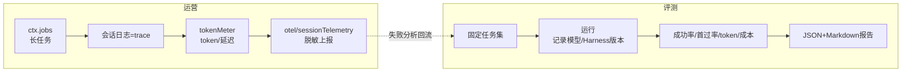

# 10 · 生产实践与 Harness 评测

> 本章讲 Harness 如何**上生产、可观测、可比较**。前面九章讲「怎么建对」，本章讲「怎么运营好、怎么科学评估」。
> 评测锚点：[teaching-agent/m11_model_bench.py](../../projects/teaching-agent/m11_model_bench.py)。

## 一、问题背景：能跑 ≠ 能上生产

一个 Harness demo 跑通了，离生产还差三件事：

1. **长任务管得住**。几十分钟的任务要能后台跑、能查状态、能取消、能恢复，不能占着交互界面。
2. **出了问题查得到**。模型为什么这么答？花了多少 token？哪步慢了？失败率多少？没有可观测性就是黑盒。
3. **好坏说得清**。换了模型/换了 Harness，到底变好还是变坏？不能凭感觉，要有可复现的评测。

这三件事对应 DSH 的 `ctx.jobs`（后台任务）、`ctx.otel`/`tokenMeter`/`sessionTelemetry`（可观测）、以及评测体系。

## 二、核心概念：运营与评估的词汇

**长任务管理（jobs）**：DSH `ctx.jobs` 注册后台任务，`job_*` 工具读取/停止。任务与交互轮次解耦——
发起后可关闭页面，任务继续；用 job_output 查进度，job_kill 取消。这是「长任务不占交互」的基础。

**可观测性（observability）三支柱**：
- **Tracing（追踪）**：一次任务的完整执行轨迹（每步 prompt/工具/耗时）。DSH 会话日志天然就是 trace。
- **Metrics（指标）**：Token Cost、Latency、Success Rate、Failure Rate。DSH `tokenMeter` 测 token，`otel` 上报。
- **Logging（日志）**：结构化事件，敏感字段脱敏（`sessionTelemetry` 脱敏后交后端）。

**Harness 评测**：在**固定任务集 + 固定仓库 + 固定验收标准**下，比较不同模型或不同 Harness 的表现。
关键指标：Task Success Rate、First Pass Rate、Test Pass Rate、Token Consumption、Execution Time、Cost Per Task、Human Intervention Rate。

> 术语区分：**模型对比 vs Harness 对比**。模型对比固定 Harness 换模型（m11 做的）；
> Harness 对比固定模型换编排方式（basic tool calling vs LangGraph vs 自定义 Harness）。两者正交。

## 三、工作原理：评测如何做到可复现

```text
固定变量：
  同一任务集（datasets）+ 同一代码仓库 + 同一验收标准 + 尽量固定环境
记录元数据：
  模型版本 + Harness 版本 + 实验配置
运行：
  对每个任务执行 → 记录结果/token/耗时/失败原因/人工介入
区分：
  mock 测试（验证流程）vs 真实模型评测（验证能力）—— 明确标注，不混淆
输出：
  原始数据（JSON）+ Markdown 报告 → 可重复运行、可对比
```

**为什么必须固定变量？** 因为评测是比较。如果任务集/仓库/标准每次都变，分数差异就无法归因到模型或 Harness。
控制变量是科学评测的前提。

**为什么必须区分 mock 与真实？** mock 验证「流程对不对」，真实模型验证「能力够不够」。
把 mock 的全绿当成真实模型达标，是自欺。本仓库 m08 用 mock 保验收，m11 用真实模型测能力，两者职责分开。

## 四、架构与流程



**图解关键**：左侧运营产生 trace 和指标，右侧评测用固定任务集产出可对比报告。
虚线表示「失败分析回流」——线上 bad case 回流进评测集，形成持续优化闭环。

## 五、代码实现：本仓库的评测锚点

[teaching-agent/m11_model_bench.py](../../projects/teaching-agent/m11_model_bench.py) 已实现模型对比，是本仓库评测的起点：

```bash
cd projects/teaching-agent && ../../.venv/bin/python m11_model_bench.py
```

它的设计体现了本章原则：
- **固定任务集**：`INTENT_CASES`（8 条）+ `RAG_CASES`（5 条），所有模型跑同一组。
- **记录元数据**：模型名写入结果。
- **多维指标**：准确率 / 槽位漂移 / JSON 重试 / 延迟 / RAG 引用 / 拒答。
- **mock 基线对照**：mock 行作为确定性参照。

**实测结论**（本会话早先运行）：

| 模型 | 意图准确率 | 槽位漂移 | 意图延迟 |
|---|---|---|---|
| mock | 100% | 0 | 0s |
| qwen2.5:7b | 87.5% | 3/8 | 1.62s |
| qwen3:8b | 100% | 2/8 | 13.67s |

**解读**：8B 更准但慢 8 倍（思考模式）——这就是「准确率-延迟权衡」，是模型路由（[09 章路由思想](../10-production/README.md)）的依据。
**槽位漂移**指标尤其有价值：即便 8B 也有 2/8 需归一化兜底，证明格式兜底不能省。

## 六、深入分析：设计取舍

**为什么评测要存原始数据而非只存分数？** 因为分数会掩盖细节。存原始执行记录，才能事后分析「为什么这个任务失败」、
才能在新指标出现时重算。DSH 会话日志保留完整 settlement 正是此意。

**为什么记录失败实验？** 失败和成功同样有信息量。只报成功是幸存者偏差。本仓库要求评测「记录失败实验」。

**为什么成熟度要凭证据？** 「Production-ready」不是自封的，要有 CI + tracing + 安全测试 + 运维文档支撑。
本仓库 V2.0 定义四级成熟度（Experimental/Validated/Benchmark/Production-ready），凭证据升级，杜绝虚构完成状态。

**当前差距**：本仓库有 m11 模型对比，但还缺统一 evals 平台、Harness 对比、真实 tracing 接入。这是 V2.0 阶段 E/F 的工作。

## 七、工程实践

- **长任务**：本 Harness 的 `job_*` 工具就是 ctx.jobs 的实例（后台跑、job_output 查、job_kill 停）。
- **评测扩展练习**：给 m11 加一个「Harness 对比」维度——同一模型，比较「直接 tool calling」vs「LangGraph 编排」的成功率/耗时。
- **练习 2**：把 m11 结果存入 `evals/reports/`（带时间戳/模型版本），实现可重复对比。
- **练习 3**：给 teaching-agent 接一个最小 tracing（每步写 JSONL），回放一次失败运行。

## 八、本章总结

- **核心知识**：长任务（jobs）；可观测三支柱（tracing/metrics/logging）；Harness 评测控制变量；模型对比 vs Harness 对比。
- **必须掌握的原理**：评测固定变量 + 记录元数据 + 存原始数据 + 区分 mock/真实；成熟度凭证据。
- **工程实践能力**：能跑 m11 并解读权衡；能设计可复现评测；能指出本仓库评测差距。
- **联系**：前九章「建对」→ 本章「运营好/评得准」→ [11 总结](11-summary.md) 串联全主题。

## 九、参考资料

- DSH `capability-seams.zh.md`（ctx.jobs/otel/tokenMeter/sessionTelemetry/sessionQuery）
- 评测锚点：[teaching-agent/m11_model_bench.py](../../projects/teaching-agent/m11_model_bench.py)、[其文档 11-模型横向对比](../../projects/teaching-agent/docs/11-模型横向对比.md)
- 评测方法论：[Ragas](https://docs.ragas.io/)、[DeepEval](https://docs.confident-ai.com/)
