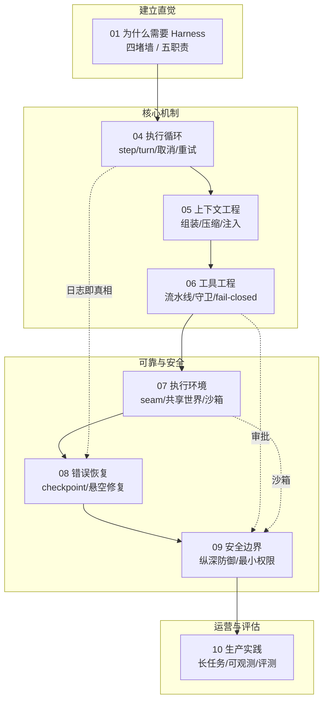

# 11 · 总结：Harness Engineering 知识图谱

> 本章串联全主题，把十章知识织成一张图，给出学习路径与跨主题关联。

## 一、一张图看懂 Harness

## 二、贯穿全主题的三条主线

学完十章，如果只记三件事，记这三条：

1. **日志即真相（model-visible = logged）**。模型看到的上下文必须能从持久日志重建。
   这一条支撑了上下文投影（05）、回放与恢复（08）、可观测（10）。它是 Harness 可靠性的地基。

2. **先记录后执行 + 强制关卡**。tool/call 先落盘再执行（06/08）；危险操作过审批 fail-closed（06/09）；
   执行过沙箱围栏（07）。安全与可靠不靠模型自觉，靠模型**绕不过**的关卡。

3. **一切皆插件，能力可替换（seam）**。模型/工具/文件系统/沙箱都是可替换提供方（03/07）。
   替换一处，全局生效。这是 Harness 灵活性与可演进性的来源。

## 三、核心概念速查

| 概念 | 一句话 | 章节 |
|---|---|---|
| Harness | 把模型变成可靠做事系统的运行时 | 01 |
| step / turn | 一次模型请求+工具 / 若干 step 直到不欠工作 | 04 |
| 瀑布事件 | 监听器调 next() 层层传递 | 04/06 |
| 日志即真相 | 模型可见即已记录，历史从日志投影 | 05/08 |
| 压缩 | 先剪枝大工具结果，再摘要旧轮次 | 05 |
| 单调守卫 | 只能拒绝不能放行 | 06 |
| fail-closed | 不确定即拒绝 | 06/09 |
| 能力 seam | Definition+Provider+Consumer，可替换 | 07 |
| 共享执行世界 | fs 与进程共享围栏，无死角 | 07 |
| 悬空调用 | 有 tool/call 无 tool/result，恢复时补记 | 08 |
| 纵深防御 | 数据/身份/工具/执行层层设防 | 09 |
| 控制变量评测 | 固定任务/仓库/标准，区分 mock/真实 | 10 |

## 四、推荐学习路径

**第一遍（建立直觉，动手）**：
01 → 跑 [minimal_harness](../../code/11-harness-experiments/minimal_harness.py) → 04 → 跑 [execution_loop](../../code/11-harness-experiments/execution_loop.py) → 06 → 跑 [tool_pipeline](../../code/11-harness-experiments/tool_pipeline.py)。

**第二遍（深入机制）**：
05（上下文）→ 07（环境）→ 08（恢复），各跑对应实验。

**第三遍（生产化）**：
09（安全）→ 10（评测）→ 对照 [teaching-agent](../../projects/teaching-agent/README.md) 看业务落地。

**检验学会了**：能不看资料画出 Harness 数据流，能解释「为什么取消不提交、重试不重组装、审批 fail-closed」，
能跑通全部实验并改一个行为。

## 五、与其他主题的联系

Harness 是枢纽，向上承接基础，向下支撑应用：

- **上游基础**：[01-foundations](../01-foundations/README.md)（模型能力）、[03-tool-use](../03-tool-use/README.md)（工具调用）、[05-planning](../05-planning/README.md)（工作流）。
- **下游应用**：
  - **12-coding-agent**：Harness 在代码场景的应用（仓库理解/改码/测试/MR）。
  - **13-ai-software-engineering**：Harness 驱动需求→交付全流程。
  - **14-agent-runtime**：本章机制的运行时实现细节（调度/并发/资源）。
  - **15-agentops**：10 章可观测/评测的运维深化。
- **业务实证**：[teaching-agent](../../projects/teaching-agent/README.md) 的 m04/m05/m07/m10/m11 是 Harness 思想在真实业务的落地。

## 六、本主题的代码资产

| 实验 | 验证 |
|---|---|
| [minimal_harness.py](../../code/11-harness-experiments/minimal_harness.py) | 日志即真相 / 工具白名单 / step-turn |
| [execution_loop.py](../../code/11-harness-experiments/execution_loop.py) | 事件轨迹 / 取消 / 重试 / 停止 |
| [tool_pipeline.py](../../code/11-harness-experiments/tool_pipeline.py) | 流水线 / 单调守卫 / fail-closed / 冻结 |
| [context_window.py](../../code/11-harness-experiments/context_window.py) | 组装 / 压缩 / 注入 |
| [sandbox_env.py](../../code/11-harness-experiments/sandbox_env.py) | seam 替换 / 共享世界 / 围栏 |
| [checkpoint_recovery.py](../../code/11-harness-experiments/checkpoint_recovery.py) | 持久化 / 悬空修复 / 续跑 |
| [injection_defense.py](../../code/11-harness-experiments/injection_defense.py) | 数据指令分离 / 权限门 / 可信身份 |

全部离线可跑、带 selftest。运行：`cd code/11-harness-experiments && ../../.venv/bin/python <文件>`。

## 七、参考资料

- DSH 架构文档（本机安装版）：`architecture.zh.md`、`agent-lifecycle.zh.md`、`tool-execution-pipeline.zh.md`、`capability-seams.zh.md`
- [Cordis 插件框架](https://github.com/nicedoc/cordis)
- 业务实证：[projects/teaching-agent](../../projects/teaching-agent/README.md)
