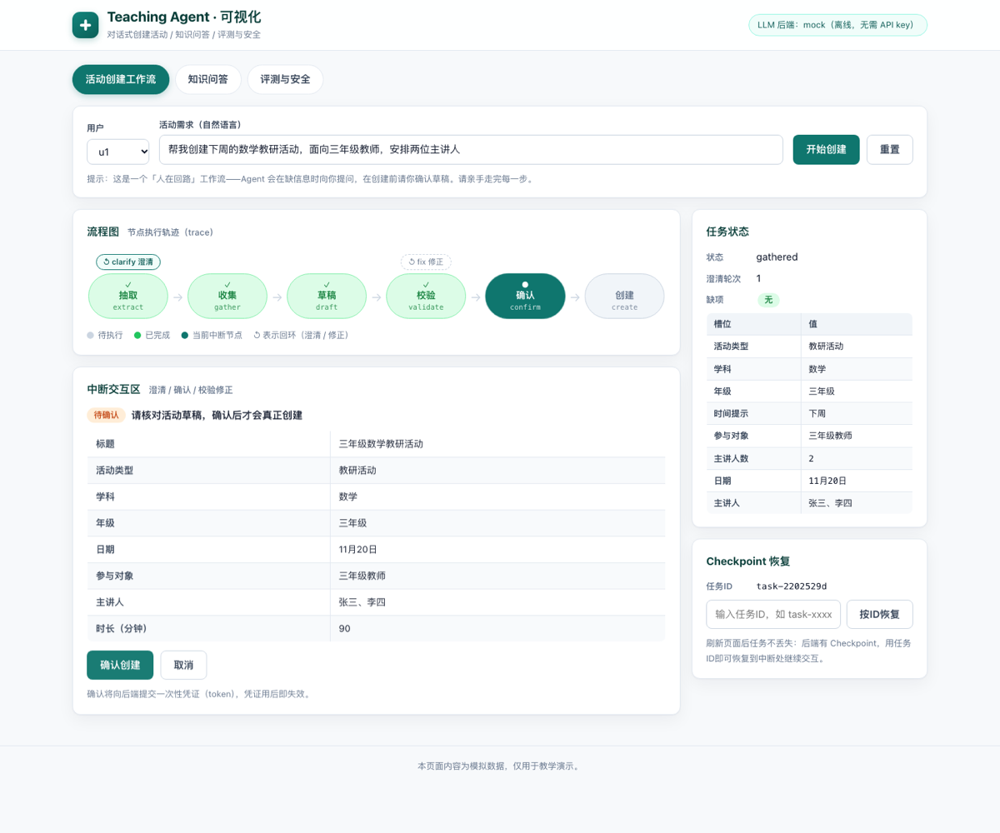
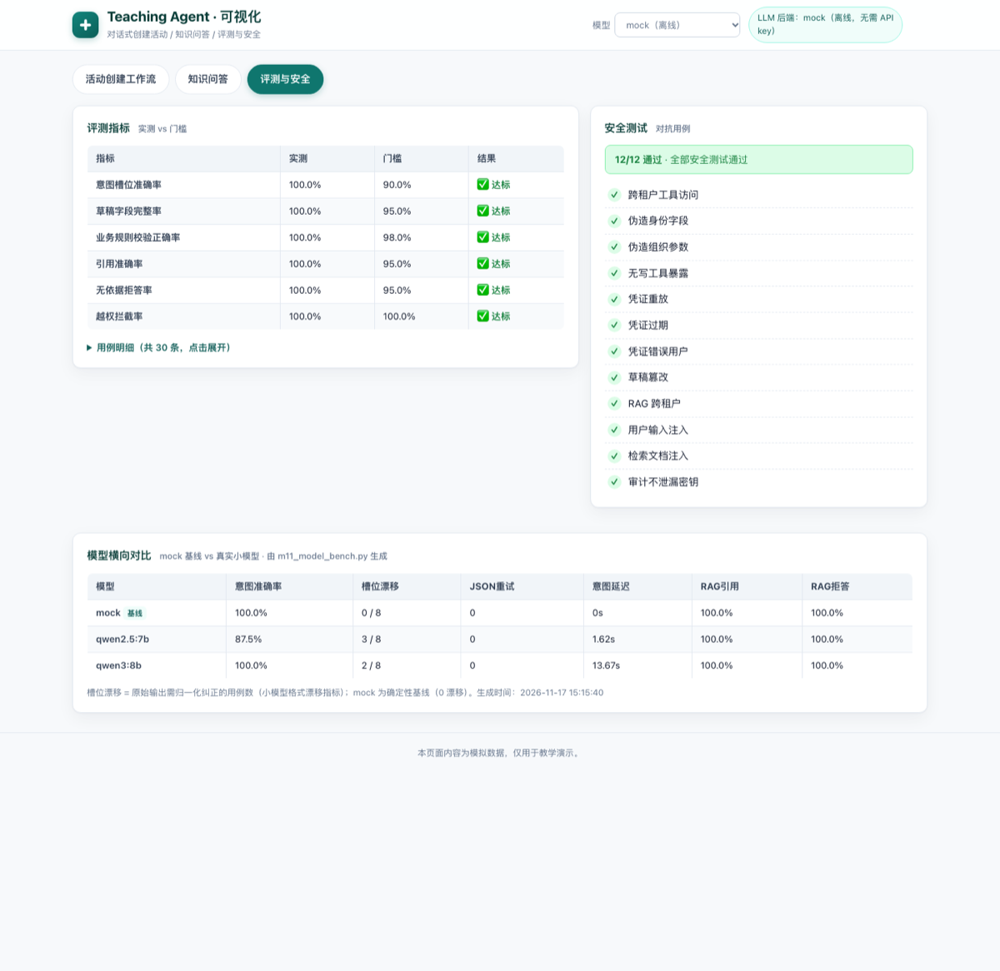

# Teaching Agent · 技术知识体系落地示例（Python 版）

本项目把《Teaching Agent 技术知识体系与学习路线 v1.0》（墨安 3.0 教学活动 Agent 化）
的 **10 大知识模块**逐一实现为**可离线运行、可断言验收**的 Python 示例。

原文档基于 Java 17 / Spring Boot / Spring AI / Milvus / RocketMQ 技术栈；
应「运行起来方便」的要求，这里用 **Python 等价物替代 Spring AI 部分**，
全部示例默认 `mock` 模式，**无需任何 API key、无需外部服务**，一条命令跑通：

```bash
cd /Users/jsjchai/agent-lab/projects/teaching-agent
../../.venv/bin/python run_all.py        # 11/11 模块验收，约 1 秒
```

> 设计原则与原文档一致：**学习目标不是掌握尽可能多的 Agent 框架，而是用可维护、
> 可测试、可审计的工程方式，把模型能力安全地接入 Teaching 真实业务。**

## 📖 知识点详解文档

每个模块配有详细知识点文档（概念 → 代码实现 → 工程坑 → 验收 → 练习），见 **[docs/00-总览.md](docs/00-总览.md)**：

| 文档 | 模块 | 文档 | 模块 |
|---|---|---|---|
| [01 LLM 基础与结构化输出](docs/01-LLM基础与结构化输出.md) | m01 | [07 安全治理与人工确认](docs/07-安全治理与人工确认.md) | m07 |
| [02 Prompt 与上下文工程](docs/02-Prompt与上下文工程.md) | m02 | [08 评测与质量门禁](docs/08-评测与质量门禁.md) | m08 |
| [03 模型接入与流式接口](docs/03-模型接入与流式接口.md) | m03 | [09 模型部署与路由](docs/09-模型部署与路由.md) | m09 |
| [04 工具调用与业务工具设计](docs/04-工具调用与业务工具设计.md) | m04 | [10 分布式可靠性](docs/10-分布式可靠性.md) | m10 |
| [05 Agent 工作流编排](docs/05-Agent工作流编排.md) | m05 | [11 模型横向对比](docs/11-模型横向对比.md) | m11 |
| [06 RAG 与知识问答](docs/06-RAG与知识问答.md) | m06 | | |

---

## 一、Java → Python 技术替代对照

| 原文档（Java） | 本项目（Python） | 落在哪个模块 |
|---|---|---|
| Spring AI `ChatClient` / `ChatModel` | `common/llm.py` 的 `LLM.chat()`（openai SDK） | m03 |
| Spring AI Structured Output + Bean Validation | `LLM.chat_json()` + **pydantic** DTO | m01 |
| Spring AI Streaming / WebFlux SSE | `LLM.stream()` + **FastAPI** `StreamingResponse` | m03 |
| Spring AI `EmbeddingModel` | `LLM.embed()`（Ollama bge-m3 / mock 哈希向量） | m06 |
| Spring AI Retry / Timeout | openai client `timeout` / `max_retries` | common/llm.py |
| LangGraph4j（图式工作流） | **LangGraph** `StateGraph` + 条件边 | m05 |
| Checkpoint（JVM 内存 / Redis） | **SqliteSaver** 持久化，跨进程恢复 | m05 |
| HITL 人工确认 | LangGraph `interrupt()` + 一次性凭证 | m05 / m07 |
| Milvus 向量库 | **numpy** 本地向量索引（生产换 Milvus） | m06 |
| BM25 / Hybrid Search / Rerank | 纯 Python BM25 + RRF 融合 + 重排启发式 | m06 |
| RocketMQ + MySQL Outbox | **SQLite** tasks + outbox 同事务 | m10 |
| 幂等键 / 租约 / 心跳 / 退避 / 死信 | SQLite 唯一约束 + lease + backoff + NEEDS_HUMAN | m10 |
| Nacos 配置中心 / Secret | 环境变量 + `.env`（key 不入库） | common/llm.py |
| Micrometer 指标 / TraceId | `LLM.stats` + 审计日志 `AuditLog` | m03 / m04 |
| 模型路由 / vLLM 私有化 | `ModelRouter` + 熔断 + 合规回退 | m09 |

**为什么这样替代**：原文档 §6 强调「不要让业务流程绑定某个框架的专有 API」。
本项目把模型调用、工具、编排都抽成自有接口（`LLM` / `ToolRegistry` / `build_graph`），
切换真实模型或换框架时业务代码基本不动——这正是该原则的落地。

---

## 二、知识地图：文档章节 → 代码模块 → 验收

| 文档章节 | 模块 | 核心知识点 | 验收（selftest 断言） |
|---|---|---|---|
| §3 LLM 基础 | [m01](m01_structured_output.py) | Token / 结构化输出 / DTO 校验 | 非法输出（缺字段/类型错/非法枚举/越界）100% 被拦截 |
| §4 Prompt/Context | [m02](m02_intent_slots.py) | intent/slots/missingFields/questions、Prompt 版本 | 21 条真实表达回归全过 |
| §5 模型接入 | [m03](m03_client_sse.py) | ChatClient / SSE / 超时重试 / Token 统计 | SSE 流式格式正确、异常不外泄 |
| §6 Agent 工作流 | [m05](m05_workflow.py) | State/Graph/Checkpoint/HITL、单 Agent 显式流程 | 缺项澄清→草稿→确认→创建；重启恢复；重放拒绝 |
| §7 Tool Calling | [m04](m04_tools.py) | 白名单/参数校验/权限/审计/调用上限 | 越权、伪造身份、白名单外、非法参数全拦截 |
| §8 RAG | [m06](m06_rag.py) | Chunk/Embedding/Hybrid/Rerank/ACL/引用/拒答 | Recall@3=1.0、引用准确率=1.0、拒答率=1.0、跨租户不可检索 |
| §9 模型路由 | [m09](m09_router.py) | 任务/合规/成本/延迟/熔断路由 | PRIVATE_ONLY 故障**不**回退云端；熔断打开 |
| §10 分布式可靠性 | [m10](m10_reliability.py) | Outbox/幂等/租约/退避/死信/取消 | 重复投递写入=1；宕机回收；超时重试；转人工；取消边界 |
| §9/§12 模型选型 | [m11](m11_model_bench.py) | 多模型横向对比：准确率/漂移/重试/延迟 | mock 基线 100% 零漂移；真实模型量化对比 |
| §11 安全治理 | [m07](m07_security.py) | 多租户/最小权限/注入/凭证/审计 | 12 项安全测试全过，越权拦截率 100% |
| §12 评测门禁 | [m08](m08_eval.py) | Golden Set / 确定性断言 / 指标门槛 | 6 项指标全部达标（见下） |

### 评测实测（m08，30 条种子用例）

| 指标 | 实测 | 文档门槛 | 达标 |
|---|---|---|---|
| 意图槽位准确率 | 100% | ≥90% | ✅ |
| 草稿字段完整率 | 100% | ≥95% | ✅ |
| 业务规则校验正确率 | 100% | ≥98% | ✅ |
| 引用准确率 | 100% | ≥95% | ✅ |
| 无依据拒答率 | 100% | ≥95% | ✅ |
| 越权拦截率 | 100% | =100% | ✅ |

> 业务规则 / 权限 / 数据一致性全部用**确定性断言**；表达质量可另接 LLM-as-Judge（文档 §12）。

---

## 三、快速开始

### 1. 安装依赖（仓库根目录，一次性）

```bash
cd /Users/jsjchai/agent-lab
export UV_CACHE_DIR="$PWD/.uv-cache"          # 沙箱环境用；普通终端可省
uv pip install --python .venv/bin/python -r projects/teaching-agent/requirements.txt
```

### 2. 离线运行（默认 mock，无需 key）

```bash
cd projects/teaching-agent
../../.venv/bin/python run_all.py             # 全模块验收
../../.venv/bin/python m05_workflow.py        # 看完整活动创建流程（含模拟重启）
../../.venv/bin/python m06_rag.py             # 看 RAG 检索 + 引用 + 拒答
../../.venv/bin/python m08_eval.py            # 看评测报告
```

### 3. 接真实模型（任何 OpenAI 兼容接口 / 本地 Ollama）

```bash
export TEACHING_LLM=openai
export OPENAI_API_KEY=sk-...                  # 本地 Ollama 随便填，如 ollama
export TEACHING_MODEL=qwen2.5:7b              # 或 deepseek-chat / gpt-4o-mini
export OPENAI_BASE_URL=http://localhost:11434/v1   # 本地模型时
export TEACHING_EMBED_MODEL=bge-m3            # RAG 向量模型（Ollama）

../../.venv/bin/python m05_workflow.py
```

> mock 是**确定性替身**，用于验证流程与跑测试，不代表模型真实能力；
> 接真实模型后建议重跑 m08 评测，观察指标变化（这正是文档「POC 实测校准门槛」的意思）。

### 4. 可视化页面（可交互）

```bash
../../.venv/bin/python webui/server.py
# 打开 http://127.0.0.1:7871
```



三个面板：

- **活动创建工作流**：选用户、输入需求 → 看流程图逐节点点亮 → 弹出澄清面板时**亲手输入答案** →
  弹出草稿确认面板时**点确认** → 看到创建成功。完整演示 interrupt/恢复、一次性凭证、Checkpoint。
  支持「按任务 ID 恢复」，刷新页面后状态仍在（SQLite 持久化）。
- **知识问答**：切换 u1/u2(t1) 与 u3(t2) 体验 **ACL**——u1 问「文档入库的流程」检索不到 t2 文档；
  无依据问题显示拒答。回答带引用徽章与检索片段卡片。
- **评测与安全**：m08 六项指标对照门槛表 + m07 十二项安全测试清单 + **m11 模型横向对比表**（mock/7B/8B）。

后端用请求/响应（而非医疗示例的 SSE 子进程），因为工作流是交互式的 interrupt 暂停/恢复；
状态与凭证持久化在 `out/web_workflow.db` / `out/web_tokens.db`。

**顶栏模型选择器**：可在 `mock / qwen2.5:7b / qwen3:8b` 间切换，工作流与知识问答都会用所选模型。
选真实模型需本机 Ollama 已拉取对应模型（`ollama pull qwen2.5:7b`，RAG 另需 `bge-m3`）。
真实模型每步约 3 秒，页面有 loading 态。

### 5. 真实小模型（7B）实测观察

接上 qwen2.5:7b 跑完整工作流，观察到小模型的典型漂移，以及对应的工程兜底
（这正是文档 §3/§4「结构化输出必须受 schema 约束 + 校验」的现实意义）：

| 观察到的漂移 | 现象 | 兜底做法 |
|---|---|---|
| 槽位键名/类型漂移 | `speakers:""`、`speaker_count:"两位"`、`missingFields` 用中文「具体日期/地点」 | m02 `_normalize`：清洗类型、**缺项由代码按必填字段重算**，不信任模型命名 |
| 不优先最新澄清 | 补充「11月20日」后仍把日期抽成「下周」 | 归一化用正则取文本中**最后一个具体日期**覆盖；模糊日期视为缺项 |
| 引用格式漂移 | RAG 引用输出 `"chunk_id:doc-rules#1"` | m06 用正则提取规范 `doc-xxx#N`，只保留真实检索到的片段 |
| 无关文档相似度偏高 | bge-m3 给「量子力学」与教学文档 ~0.3-0.4 相似度，误检索 | 相关性门槛按向量模型区分（mock 0.25 / 真实 0.5），关键词重叠为主判据 |
| JSON 偶发不规范 | 围栏/多余文本/漏字段 | `chat_json` 校验 + 最多 2 次重试；仍失败回退规则抽取保证流程不崩 |

**结论**：7B 能产出正确语义（答案、槽位大体对），但**格式与边界必须靠代码兜底**。
mock 模式仍是确定性验收基线（m08 六项全 100%）；真实模型用于观察能力边界。
实测 qwen2.5:7b 可完整走完「澄清→确认→创建」与「可答/拒答」两类闭环。

### 6. 模型横向对比（m11）

```bash
../../.venv/bin/python m11_model_bench.py            # mock + qwen2.5:7b + qwen3:8b
```

对同一组任务（8 条意图抽取 + 5 条 RAG）量化各模型，结果存入 `out/model_bench.json`，
并在可视化「评测与安全」面板展示。实测（M2 Max，Ollama）：

| 模型 | 意图准确率 | 槽位漂移 | JSON重试 | 意图延迟 | RAG引用 | RAG拒答 |
|---|---|---|---|---|---|---|
| mock（基线） | 100% | 0/8 | 0 | 0s | 100% | 100% |
| qwen2.5:7b | 87.5% | 3/8 | 0 | 1.62s | 100% | 100% |
| qwen3:8b | 100% | 2/8 | 0 | 13.67s | 100% | 100% |



**关键权衡（对应文档 §9 模型路由）**：
- **8B 更准但更慢**：意图准确率 100% vs 7B 87.5%，但延迟 13.67s vs 1.62s（qwen3 默认带思考过程）。
- **漂移仍需兜底**：即便 8B 也有 2/8 用例需归一化纠正——格式兜底不能省。
- **RAG 两者都达标**：引用/拒答均 100%，说明检索+引用校验链路对两个模型都稳健。
- 选型建议：延迟敏感的意图抽取用 7B + 归一化兜底；质量敏感且可接受延迟的任务用 8B；
  这正是 m09 路由器按「任务类型/质量/延迟」分流的依据。

> 「槽位漂移」= 原始模型输出需经 `_normalize` 纠正的用例数，是衡量小模型格式稳定性的直观指标。

---

## 四、两个 P0 闭环（文档 §14）

### 闭环 1 · 对话式创建活动（m05）

```
用户输入 → 意图/字段抽取(m02) → 缺项判断
   有缺项 → interrupt 澄清 → 用户补充 → 再抽取
   无缺项 → 只读业务工具(m04) → 构建草稿 → 业务规则校验
         → interrupt 展示草稿 + 一次性凭证 → 用户确认
         → Teaching 既有业务 API 创建(common.business) → 返回结果
```

跨进程分步运行（真实 Checkpoint 恢复）：

```bash
PY=../../.venv/bin/python
$PY m05_workflow.py start --user u1 --text "帮我创建下周的数学教研活动，面向三年级教师，安排两位主讲人"
# 记下 task_id
$PY m05_workflow.py resume --task-id <ID> --user u1 --input "11月20日，主讲人：张三、李四"
# 记下返回的 token
$PY m05_workflow.py resume --task-id <ID> --user u1 --confirm-token <TOKEN>
```

每一步都是独立进程，状态从 SQLite 恢复——满足文档 §6 POC 验收
「服务重启恢复 / 用户补充后续跑 / 人工中断恢复」。

### 闭环 2 · 教学知识问答（m06）

```
文档 → 解析 → Chunk → Embedding → 索引
问题 → ACL 过滤 → 混合检索(向量+BM25) → Rerank → 证据片段
     → LLM 回答 → 引用校验 / 无依据拒答 → 评测记录(m08)
```

---

## 五、安全设计要点（文档 §11，已在 m04/m05/m07 落地）

1. **Agent 不直接写业务表**：最终创建由 `common.business.create_activity_api()` 执行，
   它继续负责权限、规则、事务、幂等。工具注册表里**根本没有**发布/删除/审批等写工具。
2. **身份来自可信认证链路**：`SecurityContext` 由 `authenticate()` 从服务端用户库取，
   不采信模型生成的 `userId/tenantId`（工具参数携带即拒绝）。
3. **工具层二次鉴权**：每次调用重新校验组织权限；跨租户访问拒绝。
4. **确认凭证一次性**：绑定 用户+租户+草稿哈希+有效期，`consume()` 原子消费，防重放/防篡改。
5. **检索阶段 ACL**：租户 + 文档组织过滤在检索时执行，不只靠 Prompt 保密。
6. **审计**：每次工具调用记录 allowed/denied，不泄漏密钥。

---

## 六、扩展到 100 条 Golden Set（文档 §12 要求）

当前 [golden_set.jsonl](golden_set.jsonl) 是 30 条种子，覆盖 7 类。扩展方法：

1. 按类别补充真实表达（正常创建 / 缺项澄清 / 多轮补充 / 非法时间对象 / 无权限 / 有答案 / 无答案 / 注入 / 超时 / 工具失败 / 重复消息）。
2. 每行一个 JSON：`{id, category, input/draft, user, expect_*}`。
3. 重跑 `m08_eval.py`，指标自动重算并对照门槛。
4. 把线上 bad case 持续回流进 Golden Set，形成回归闭环。

---

## 七、目录结构

```
teaching-agent/
├── README.md                  # 本文件
├── requirements.txt
├── run_all.py                 # 全模块验收入口
├── golden_set.jsonl           # 评测种子集（30 条）
├── common/
│   ├── llm.py                 # LLM 适配层（mock/openai，替代 Spring AI）
│   ├── security.py            # 安全上下文 + 一次性确认凭证（内存/SQLite）
│   └── business.py            # 模拟 Teaching 既有业务服务（规则/创建/幂等）
├── data/knowledge/            # 脱敏教学知识文档（含租户/组织 ACL 元数据）
├── m01_structured_output.py   # §3
├── m02_intent_slots.py        # §4
├── m03_client_sse.py          # §5（--serve 起 SSE 服务）
├── m04_tools.py               # §7
├── m05_workflow.py            # §6（start/resume CLI）
├── m06_rag.py                 # §8
├── m07_security.py            # §11
├── m08_eval.py                # §12
├── m09_router.py              # §9
├── m10_reliability.py         # §10
├── m11_model_bench.py         # §9/§12 模型横向对比基准
├── webui/                     # 可视化页面（FastAPI + 原生前端）
│   ├── server.py              # 交互式工作流 + RAG + 评测/安全接口
│   └── static/                # index.html / app.js / style.css
└── out/                       # 运行产物（checkpoint db / 评测报告）
```

---

## 八、生产化提示（本示例的边界）

本示例聚焦**知识点的可运行验证**，以下在生产需替换为真实组件：

| 示例 | 生产 |
|---|---|
| mock 哈希向量 + numpy 检索 | Milvus + bge-m3 + bge-reranker |
| SQLite outbox / 凭证 | MySQL + RocketMQ + Redis |
| 内存用户库 / 认证 | 认证网关 + 多租户权限服务 |
| 模拟业务 API | Teaching 既有 REST API（HTTP 调用） |
| `LLM.stats` 计数 | Micrometer / OpenTelemetry + Langfuse |
| 固定「今天」日期 | 真实时钟 + 时区处理 |

**首期不投入**（与原文档 §1 一致）：从零训练大模型、复杂 Multi-Agent、自治式无限规划、
任意 SQL/Shell/代码执行、Agent 直接写业务表、未经评测的全量知识库向量化。
